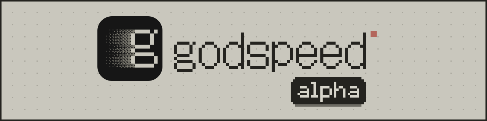
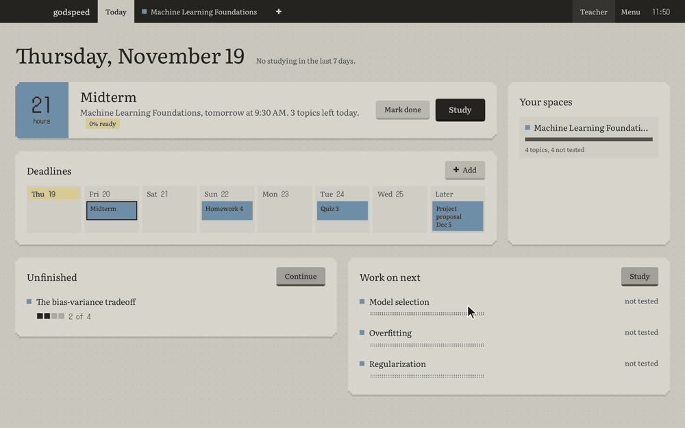
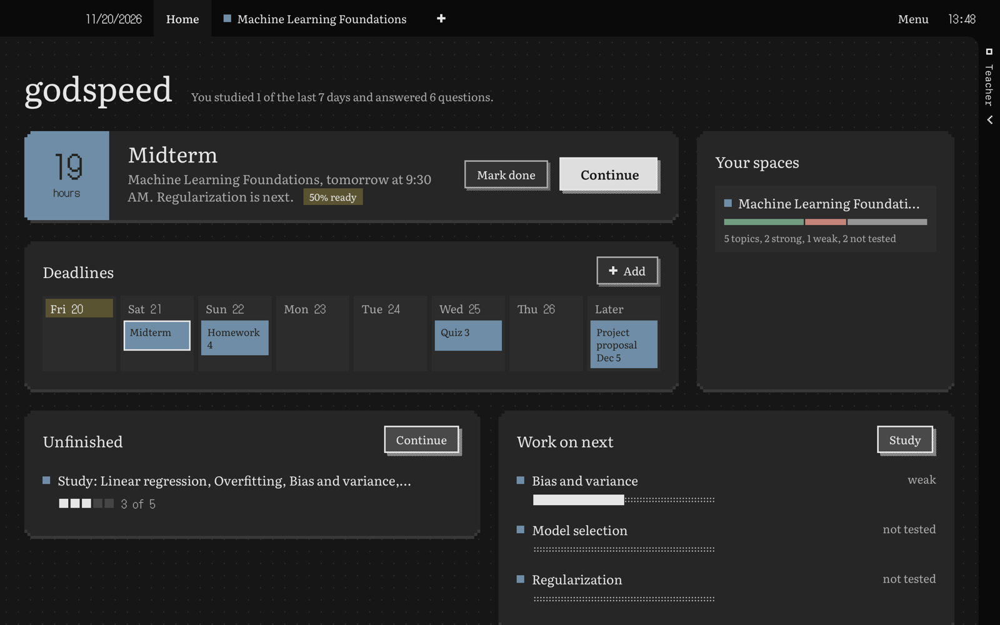
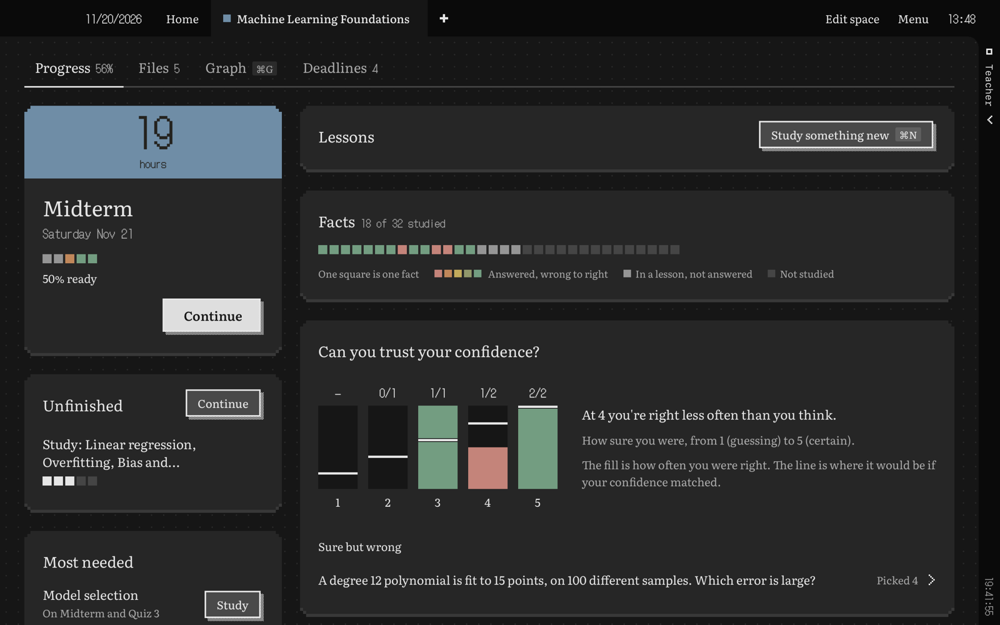
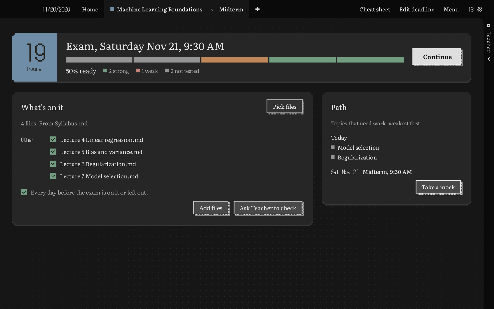
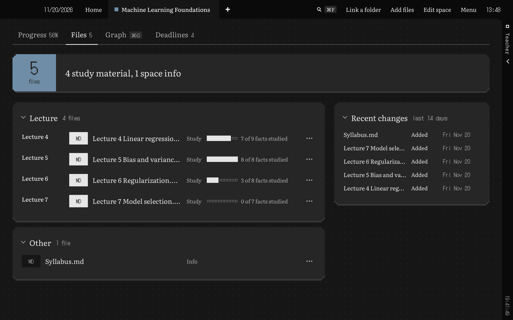
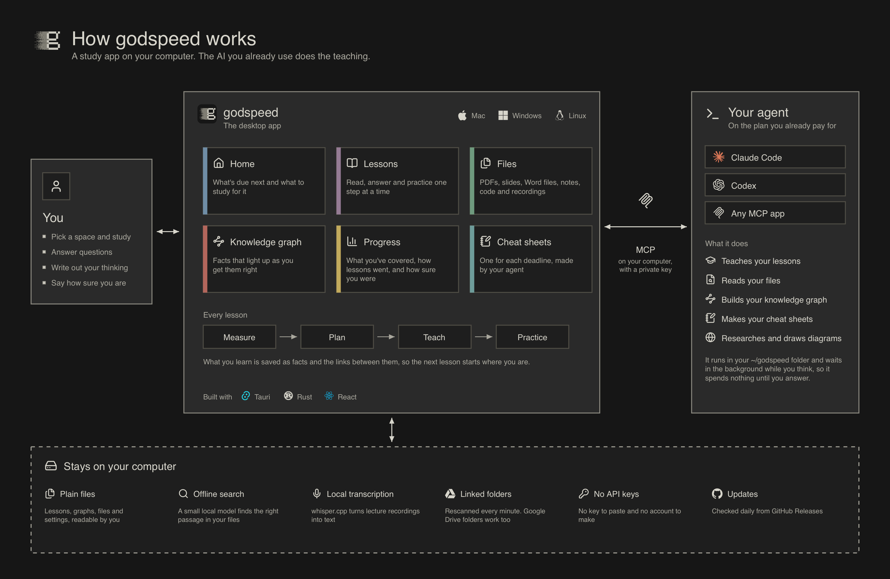

<p align="center">
  
</p>

<h3 align="center">The AI agent you already use teaches you, and godspeed remembers where you got stuck.</h3>

<p align="center">A free, open-source study app. It runs on the Claude or ChatGPT plan you already pay for, with no API keys.</p>

<p align="center"><b>godspeed is in alpha. Things change fast between updates.</b></p>

<p align="center">
  <a href="https://github.com/bayshores/godspeed/releases/latest/download/godspeed-mac-apple-silicon.dmg"></a>
  <a href="https://github.com/bayshores/godspeed/releases/latest/download/godspeed-mac-intel.dmg"></a>
  <a href="https://github.com/bayshores/godspeed/releases/latest/download/godspeed-windows-x64-setup.exe"></a>
  <a href="https://github.com/bayshores/godspeed/releases/latest/download/godspeed-linux-x64.AppImage"></a>
</p>

<p align="center">
  <a href="https://learnatgodspeed.com/">Website</a>&emsp;
  <a href="#how-it-works">How it works</a>&emsp;
  <a href="#where-it-came-from">Where it came from</a>&emsp;
  <a href="#get-started">Get started</a>&emsp;
  <a href="docs/development.md">Docs</a>&emsp;
  <a href="https://github.com/bayshores/godspeed/issues">Issues</a>
</p>

<p align="center">
  <a href="https://github.com/bayshores/godspeed/releases/latest"></a>
  
  <a href="LICENSE"></a>
  <a href="https://m8ven.ai/mcp/bayshores-godspeed-1epilf?s=readme"></a>
</p>

<p align="center">
  
</p>

<p align="center"><sub>Recorded in the app on a made-up machine learning space. The teacher's replies are scripted, so a live agent takes longer to answer.</sub></p>

## What a lesson looks like

The GIF up top is one topic of a lesson, and it goes like this.

1. Home shows what's due, and you pick a deadline and hit Continue.
2. While the teacher gets ready you can watch its plan and the page of your lecture it's reading.
3. It explains a step at a time, quotes your own lecture and draws a plot when one helps.
4. You guess before you're told and say how sure you are, and the plot shows you what really happens.
5. Then it checks that you got it with a question you have to answer on your own.
6. Every topic ends at a stopping point, so you can quit there and pick it back up from Home.

After a right answer the teacher can give you one sentence to keep, and it shows up again later. Questions from older lessons come back when they're due too, and godspeed asks and grades those itself without calling your agent.

## Why I made it

I was using Claude to study for discrete math and it kept going in circles. I'd get stuck on a counting problem, work through it with Claude, and then ten days later I'd get stuck on basically the same problem in a new chat that had no idea we'd already done this. I even wrote a tutoring skill so it would give me hints instead of answers, but that didn't really help because every new chat still knew nothing about me.

So godspeed keeps all of that outside the chat. It saves your lessons, your answers, how sure you were on each one and a graph of what you know, and whatever agent you use (Claude Code, Codex or anything else with MCP) teaches from that.

## Where it came from

godspeed is a fork of [LearnHarness](https://github.com/amosblomqvist/learnharness) by Amos Blomqvist, and the way it teaches comes from there. Working out where your understanding stops, building up from that one step at a time and saving what you learn as a graph were all in LearnHarness before I touched anything.

I forked it in late October because I couldn't hook it up to the Claude plan I was already paying for, and I didn't want to buy API credits on top of that. So the first thing I changed was who does the teaching. godspeed has no model built in, and the agent you already use connects to it over MCP and teaches from there.

After that I kept changing it to fit how I actually study, and about 1,500 commits later it's pretty much its own app. Spaces, files, deadlines, homework, mocks, cheat sheets, paths, plugins, the calculator and the look all got added here.

### The Rust rewrite

LearnHarness is an Electron app with a Next.js server, and godspeed was too until version 0.6.1. That's when I moved everything under the screens to Rust and swapped Electron for Tauri, and the React screens stayed the same.

| | Before | After |
| --- | --- | --- |
| Mac download | 202 MB | 49 MB |
| Windows download | 210 MB | 40 MB |
| Linux AppImage | 429 MB | 127 MB |
| Server memory when idle | 71 MB | about 10 MB |

It isn't noticeably faster to use, it's just a lot smaller and lighter on your computer.

## What's in it

| Part | What it does |
| --- | --- |
| Spaces | One for each thing you study, like a course, a certification or a language. Each has its own lessons, files, graph, deadlines and cheat sheets. |
| Files | PDFs, Word and PowerPoint files, EPUB books, notes, code, transcripts and lecture recordings. Or link a folder, Google Drive works too. |
| Deadlines | Exams, homework, quizzes, projects and interviews. Home shows the next one big, with a button to start studying for it, and the week ahead as seven day columns with a Later column after them. |
| Paths | No syllabus? Tell your agent your goal, like "I want to become a backend developer", and it writes a path of topics in order. Study takes the next one you haven't got down yet. |
| Knowledge graph | What your files and lessons cover, as one picture of the space that zooms like a map. Each topic is a figure of its facts, and a fact lights up as you get it right. |
| Progress | How ready you are for each deadline, and whether your confidence matches your results. |
| Homework | Attach the assignment and the teacher goes through it one problem at a time. It gives you hints but never the answer. |
| Mocks | Take a mock on any exam, quiz or interview deadline, timed or not. |
| Cheat sheets | Your agent makes a PDF cheat sheet for a deadline, and you tell it what to change. |
| Plugins | Small add-ons for a lesson or a space, like one that turns the question you're on into a meme. A plugin can't open your files. Add one in Settings or [make your own](docs/plugins/README.md). They're new, so how they work can still change. |
| Noise | Click Noise in the top bar for soft brown noise while you study. Your computer makes it, so there's no audio to download. |
| Calculator | End a calculation with `=` in any box and the answer shows up in grey. It does algebra, derivatives and integrals too. |
| Your agent's screen | Click your teacher's strip on the window's right edge to open it. You can ask your agent to set up spaces or add deadlines there. |

<table>
  <tr>
    <td width="50%"></td>
    <td width="50%"></td>
  </tr>
  <tr>
    <td align="center"><sub>Home</sub></td>
    <td align="center"><sub>Progress</sub></td>
  </tr>
  <tr>
    <td width="50%"></td>
    <td width="50%"></td>
  </tr>
  <tr>
    <td align="center"><sub>A deadline</sub></td>
    <td align="center"><sub>Files</sub></td>
  </tr>
</table>

## How it works



The teacher figures out where your understanding stops, from your answers and how sure you were. It plans the steps from there to your next deadline, and each step builds on something you already get. You predict, read the explanation, then check yourself. After that you get problems where you have to pick the right idea on your own.

What you learn is saved as facts linked back to the lesson they came from, so the next lesson can build on them.

## Get started

Download it with the buttons at the top, and it updates itself after that.

- Mac needs macOS 14 or newer.
- Claude Code needs version 2.1.330 or newer. If godspeed says it needs an update, run `claude update`.
- Windows will say "Windows protected your PC" because the app isn't signed there. Click **More info**, then **Run anyway**.
- Linux also has a [.deb](https://github.com/bayshores/godspeed/releases/latest/download/godspeed-linux-x64.deb) for Ubuntu 22.04 or newer and Debian 12 or newer.

Open it and click **Start Claude Code**, or pick Codex under **Use another agent**. godspeed runs your agent inside the app in its own `~/godspeed` folder, so it stays out of your other chats, and then you can start a lesson.

Any other MCP app works too, and **Other app** shows the address and token (Streamable HTTP, `Authorization: Bearer <token>`).

<details>
<summary>More on how the agent connects</summary>

<br>

- While godspeed is open it runs an MCP server on your computer. Only programs on your computer that hold the token can connect.
- While you think, Claude Code waits in a background hook, so it spends no tokens until you answer. godspeed starts it without your own plugins, MCP servers and skills, which every request would otherwise carry.
- A second session of your agent reads your files and builds the graph in the background, so the teacher stays free for you.
- **Change command** under **Settings → Connection** sets what godspeed runs instead of `claude` or `codex`.
- Ask your agent to set up your spaces, and it builds them from your course files.
- Agents can save short notes about you (like "the midterm is over") so the next one knows. You can see and delete them under **Settings → Teaching → Remembered**.

</details>

## Your data

- It's your own agent on your own plan, so godspeed has no subscription or markup of its own.
- Your lessons, graphs, files and settings stay on your computer as plain files you can read.
- It isn't offline though, since your agent gets the context it needs for each task and web research fetches pages.
- If you paste a Tavily key in Settings, your search words go to Tavily. Otherwise your agent uses its own web search.
- The system prompts are visible and you can edit them.

## Development

```bash
npm install
node scripts/fetch-model.mjs   # once
npm run dev                    # http://localhost:3000
npm run check                  # everything CI runs
```

`src/` is the React screens and `crates/` is the Rust server and the Tauri shell. The [development guide](docs/development.md) and [architecture](docs/architecture/README.md) have the rest. Bugs and requests go to [Issues](https://github.com/bayshores/godspeed/issues).

## License

[AGPL-3.0](LICENSE). godspeed started as a fork of [LearnHarness](https://github.com/amosblomqvist/learnharness) by Amos Blomqvist, keeps its teaching method, and is under the same license.
