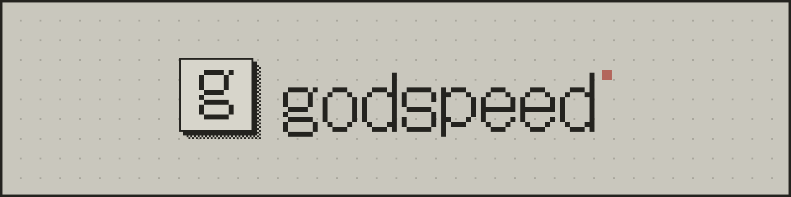
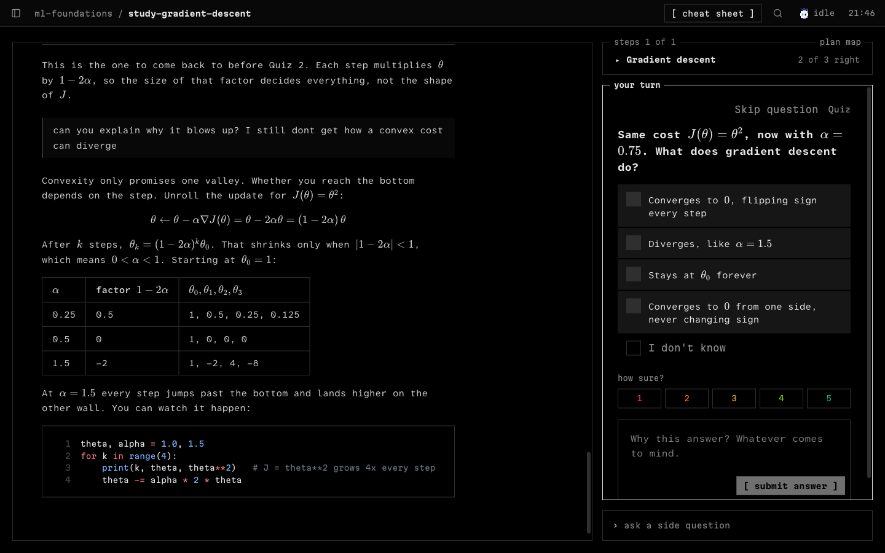
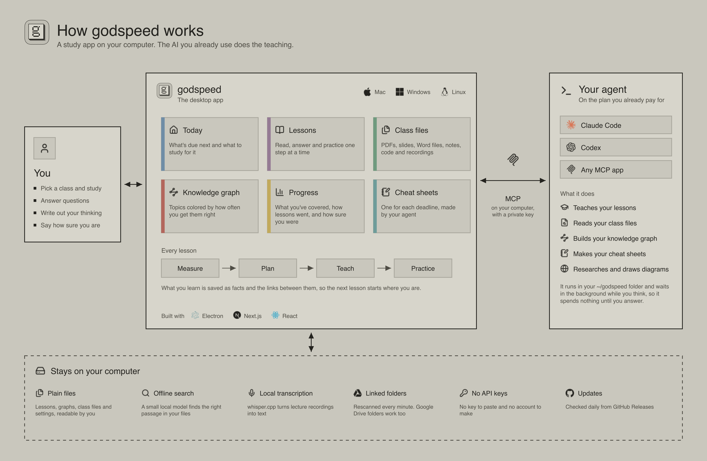
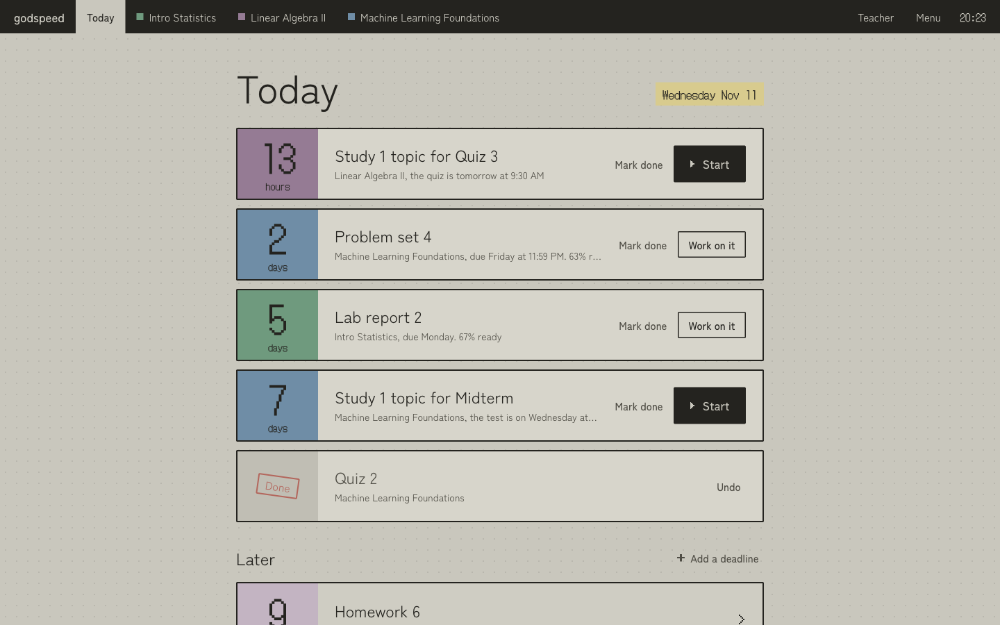
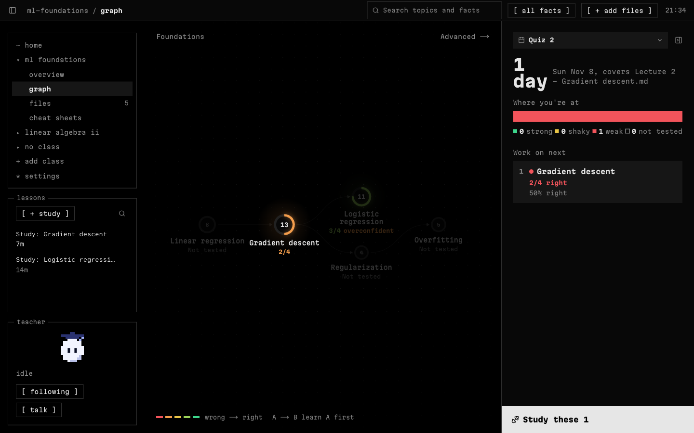
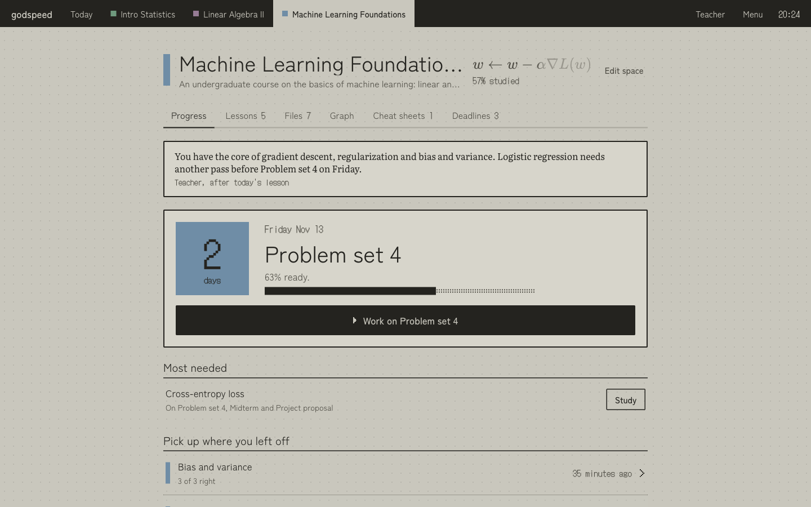
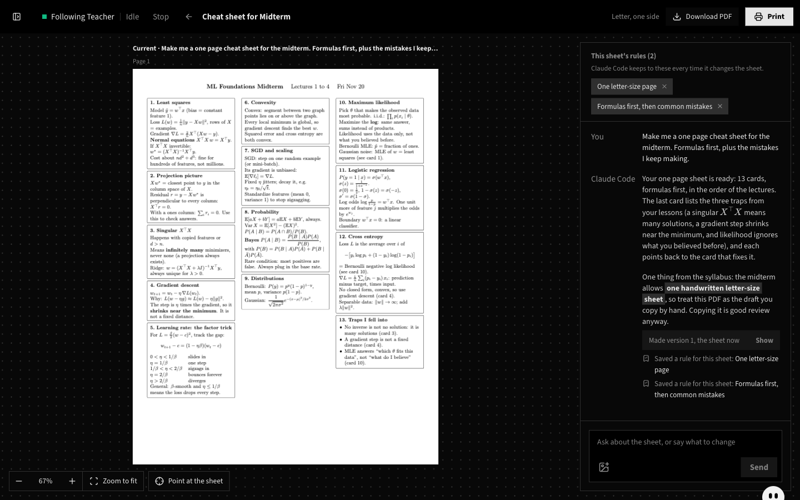

<p align="center">
  
</p>

<p align="center"><strong>A free, open-source AI tutor for anything you study, taught by the AI you already pay for.</strong></p>

<p align="center">
  <a href="https://github.com/bayshores/godspeed/releases/latest"><strong>Download</strong></a> ·
  <a href="https://learnatgodspeed.com/">Website</a> ·
  <a href="#how-it-works">How it works</a> ·
  <a href="#outside-agents-mcp">Outside agents</a> ·
  <a href="docs/development.md">Docs</a> ·
  <a href="https://github.com/bayshores/godspeed/issues">Issues</a>
</p>

<p align="center">
  <a href="https://m8ven.ai/mcp/bayshores-godspeed-1epilf?s=readme"></a>
</p>

godspeed is a study app for students and self-learners. Claude Code, Codex or any MCP app becomes your tutor: it checks what you already know, plans a path to your goal or your next deadline, teaches one step at a time, then quizzes you. You sort what you study into spaces (a course, a certification, a language), and every space gets its own lessons, files (PDFs, notes, recordings), knowledge graph, deadlines and cheat sheets. It runs on Mac, Windows and Linux, and needs no API keys.



## How it works



<sub>The diagram is an Excalidraw file, [`docs/assets/how-godspeed-works.excalidraw`](docs/assets/how-godspeed-works.excalidraw). Open it at [excalidraw.com](https://excalidraw.com) to edit it.</sub>

1. **Measure.** The teacher finds where your understanding ends on each part the lesson depends on, from your answers, your confidence and the reasoning you write with them.
2. **Plan.** It maps the steps from there to your goal. A line above the lesson shows which step you're on, and the plan changes when your answers say it should.
3. **Teach.** Each step builds on something you already understand. You predict, read the explanation, then check yourself. Confusions get fixed before anything is built on them.
4. **Practice.** Problems make you recall the right idea without being told which one it is.

Everything you learn is saved as facts and the reasoning chains between them, linked back to the lesson they came from. Later lessons read that graph instead of starting from zero.

## What's in it

- **Study.** One Study button starts a lesson for a topic, a homework method or a question you're stuck on. godspeed picks what to teach first and what to drill from how you've done so far. You can add pictures and PDFs to a message, and the teacher can ask you to write code in an editor. When the teacher uses your space's files or a web page, a small number marks it, and clicking it shows that page.
- **Spaces.** A space is one thing you study, like a course, a certification or a language. Each space has its own lessons, files, knowledge graph, deadlines and cheat sheets. Add PDFs, Word and PowerPoint files, notes, code, transcripts and lecture recordings (transcribed on your computer with whisper.cpp), or link a folder that's rescanned every minute. Google Drive folders work too.
- **Today and deadlines.** Add exams, homework, quizzes and projects with a date, an optional time and the files they cover. Today lists what to do next across every space, each with the days left, how ready you are (or how many problems you've done) and one button to start. Everything further out sits under Later.



- **Knowledge graph.** Your agent groups facts into topics, and each space's Graph tab lays them out in columns by level, from what you learn first to what builds on it. Each topic shows one square per fact, colored by how often you get it right. Pick a topic to see what it needs and what it leads to, or open a fact to see where it came from and practice it. The next deadline sits on top with the days left.



- **Homework.** Attach the assignment file to a homework or project and hit Work on it. The teacher lists its problems and opens them one at a time. The whole problem stays in view beside the lesson while you do the work in the one writing box, typed or as a photo, and the teacher checks it with hints but never gives you the answer. A problem counts as done once your own work is right.
- **Preps.** For one interview or test, **Prepare for something** in the menu makes a prep. You say what it is and add files like the job posting, and the teacher looks it up and writes a prep sheet with the topics to study in order. Take timed mocks like the real thing (code questions run their examples on your computer), then study what you got wrong.
- **Progress.** How ready you are for each deadline, how each lesson went, and whether your confidence matches your results (five levels, from guessing to certain).



- **Cheat sheets.** Your agent makes a PDF cheat sheet for a deadline. Tell it what to change in the chat beside the sheet, point at the part you mean, and the rules you give it stick for that sheet. The sheet can also sit beside a lesson.



- **Calculator.** In any box you write in, end a calculation with `=` and the answer shows in grey after it. Click it (or press Tab) to keep it. It does numbers, letters you set on a line above (`x = 3`), expanding and simplifying, `solve 2x + 3 = 11`, derivatives (`d/dx x^3 =`) and integrals (`int x^2 dx =`), all on your computer.
- **Talk.** Ask your agent to set up spaces, add deadlines or answer questions about your spaces, by clicking the teacher in the top bar.

## Get started

Download godspeed for your computer:

- **[Mac with an Apple chip (M1 or newer)](https://github.com/bayshores/godspeed/releases/latest/download/godspeed-mac-apple-silicon.dmg):** open the file, then drag godspeed into Applications. It needs macOS 14 or newer.
- **[Mac with an Intel chip](https://github.com/bayshores/godspeed/releases/latest/download/godspeed-mac-intel.dmg):** the same steps. It also needs macOS 14 or newer, which Intel Macs from 2018 on can run.
- **[Windows](https://github.com/bayshores/godspeed/releases/latest/download/godspeed-windows-x64-setup.exe):** open the file. If Windows says "Windows protected your PC", click **More info**, then **Run anyway**. (The app isn't signed on Windows.)
- **Linux:** [AppImage](https://github.com/bayshores/godspeed/releases/latest/download/godspeed-linux-x64.AppImage) (most computers) or [.deb](https://github.com/bayshores/godspeed/releases/latest/download/godspeed-linux-x64.deb) (Ubuntu 22.04 or newer, Debian 12 or newer). Make the AppImage executable, then open it.

Each link downloads the newest version directly.

The app checks for updates once a day and installs them when you quit. **Settings → General → Check for updates** checks right away.

The first launch walks you through connecting your agent (below). You can find the same steps later under **Settings → Connection**.

To build it yourself instead: `npm install`, then `npm run desktop:local` (an unsigned Mac app in `target/release/bundle/macos/`), or `node scripts/fetch-model.mjs` once and then `npm run dev` (http://localhost:3000).

## Outside agents (MCP)

While godspeed is open it runs an MCP server, and an agent you already use is its teacher. The agent also does the background jobs: research, diagrams, PDF reading and building your knowledge graph. If no agent is teaching, that work waits and starts when one does. An agent can be connected without teaching. The teacher panel and **Settings → Connection** say so and tell you how to start it.

1. Click **Open Claude Code** (the arrow next to it switches to **Codex**). godspeed makes a folder for your agent, `~/godspeed`, and opens a terminal there running it. The folder holds the agent's instructions (`CLAUDE.md`, `AGENTS.md`) and its connection to the app, so godspeed only loads when you study, not in your other chats. You can also run the command yourself: **Copy the command** copies it. If you start your agent through a launcher, **Change command** under the button sets the command godspeed runs instead of `claude` or `codex`. In Claude Code, `/setup-spaces` builds your spaces from your course files.
   - **Other MCP apps:** pick **Other app** for the address and token (Streamable HTTP, `Authorization: Bearer <token>`). For a helper, start a second session and tell it "Start as the helper".
2. Start a lesson. You answer in the godspeed window and the agent teaches.

While you think, Claude Code waits in a background script, so the agent spends no tokens until you answer. Open Claude Code and Open Codex each open a second window of the same agent, the helper. It reads your files and builds the graph so the teacher stays free for you, and when the teacher stops to tidy its memory, the helper answers your lesson and Talk messages so you don't wait. With nothing to do it just waits for free. **Settings → Connection** shows what each window is doing. Agents can also list and read lessons, search your graph and your space files, import notes, and manage spaces and deadlines. They can save short notes about you (like "the midterm is over"), and every agent sees those notes and where you left off when it connects. You can see and delete the notes under **Settings → Connection**. Only programs on your computer that hold the token can connect.

## Your plans, your data

- The AI is your own agent, on the plan you already pay for. godspeed has no subscription or markup of its own.
- Lessons, graphs, space files and settings stay on your machine as plain files you can read.
- Each task sends the context it needs to your agent, and web research fetches pages. Local storage doesn't mean offline.
- Your agent looks things up with its own web search. If you'd rather use Tavily, paste your own Tavily key under **Settings → Connection**. It stays in a private file on your computer, and your search words go to Tavily.
- System prompts are visible and editable.

## Development

```bash
npm run check        # typecheck + tests + lint + dead-code check (knip) + Rust tests, clippy and cargo machete: what CI runs
npm test             # frontend and shared tests only. deterministic: no LLM, no network
npm run rust:check   # the Rust half alone
```

A change is done when `npm run check` passes.

The code is split in two. `src/` is the Vite and React screens (`frontend/`) and the pure logic they share (`shared/core/`). `crates/` is the Rust server, the agent loops, the files on disk, and the Tauri desktop shell. Tests sit beside what they test: `tests/` for TypeScript, and each crate's `tests/` and `src/` for Rust.

See the [development guide](docs/development.md) and [architecture](docs/architecture.md). Bugs and requests go to [GitHub Issues](https://github.com/bayshores/godspeed/issues).

## License

[AGPL-3.0](LICENSE). godspeed started as a fork of [LearnHarness](https://github.com/amosblomqvist/learnharness) by Amos Blomqvist, keeps its teaching method, and is distributed under the same license.
