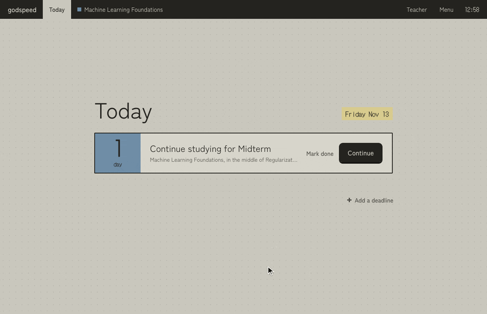

<p align="center">
  
</p>

<h3 align="center">The AI agent you already use teaches you, and godspeed remembers where you got stuck.</h3>

<p align="center">A free, open-source study app. It runs on the Claude or ChatGPT plan you already pay for, with no API keys.</p>

<p align="center">
  <a href="https://github.com/bayshores/godspeed/releases/latest/download/godspeed-mac-apple-silicon.dmg"></a>
  <a href="https://github.com/bayshores/godspeed/releases/latest/download/godspeed-mac-intel.dmg"></a>
  <a href="https://github.com/bayshores/godspeed/releases/latest/download/godspeed-windows-x64-setup.exe"></a>
  <a href="https://github.com/bayshores/godspeed/releases/latest/download/godspeed-linux-x64.AppImage"></a>
</p>

<p align="center">
  <a href="https://learnatgodspeed.com/">Website</a>&emsp;
  <a href="#how-it-works">How it works</a>&emsp;
  <a href="#get-started">Get started</a>&emsp;
  <a href="docs/development.md">Docs</a>&emsp;
  <a href="https://github.com/bayshores/godspeed/issues">Issues</a>
</p>

<p align="center">
  <a href="https://github.com/bayshores/godspeed/releases/latest"></a>
  <a href="LICENSE"></a>
  <a href="https://m8ven.ai/mcp/bayshores-godspeed-1epilf?s=readme"></a>
</p>

<p align="center">
  
</p>

<p align="center"><sub>Recorded in the app on a made-up machine learning space. The teacher's replies are replayed from a real lesson, so a live agent takes longer to answer.</sub></p>

## Why I made it

I made godspeed because I was using Claude to study for CSE 21 and it kept going in circles. I'd get stuck on a counting problem, work through it with Claude, and ten days later get stuck on basically the same problem in a new chat that had no idea we'd done this before. I'd even written a tutoring skill so it would give hints instead of answers. Didn't matter much. Every chat started from zero.

So godspeed saves all of that outside the chat. It's a desktop app that keeps your lessons, your answers, how sure you were on each one, and a graph of what you know. Claude Code, Codex or any other agent that supports MCP teaches from all of it.

## One topic, start to finish

That GIF up top is one topic of a Study lesson. Here's what happens in it.

1. Today says what to study next, and one button starts it.
2. The teacher explains one step at a time and quotes your own lecture. The page it quoted shows under the reply with those words marked.
3. You answer, and you say how sure you are, from guessing to certain.
4. After a right answer the teacher can hand you one sentence to keep. It comes back later next to the question it answered.
5. The lesson stops at the end of every topic. **Keep going** starts the next one. **Stop here** saves your place, and Today picks it up.

Two things the GIF doesn't get to. Questions from earlier lessons come back when they're due, and godspeed asks and grades those itself without calling your agent. And when a plot would help, you guess what it will show first, then it opens.

## Everything around the lesson

<p align="center">
  
</p>

| Part | What it does |
| --- | --- |
| **Spaces** | A space is one thing you study, like a course, a certification or a language. Each one has its own lessons, files, knowledge graph, deadlines and cheat sheets. Add PDFs, Word and PowerPoint files, EPUB books, notes, code, transcripts and lecture recordings (transcribed on your computer with whisper.cpp), or link a folder that's rescanned every minute. Google Drive folders work too. When a PDF page has formulas, your agent writes that page out once with the math in LaTeX and godspeed keeps it for search and later lessons. |
| **Today and deadlines** | Add exams, homework, quizzes and projects with a date and the files they cover. Today lists what to do next across every space, each with the days left, how ready you are and one button to start. While godspeed is running it sends one notification a day when a deadline is 3 days away or less. |
| **Knowledge graph** | Your agent groups what you learn into topics, laid out in columns from what you learn first to what builds on it. Each topic shows one square per fact, colored by how often you get it right. |
| **Homework** | Attach the assignment file and hit Work on it. The teacher opens its problems one at a time and checks your work with hints, but never gives you the answer. A problem counts as done once your own work is right. |
| **Preps** | For one interview or test. You say what it is and add files like the job posting, and the teacher writes a prep sheet with the topics in order. Take timed mocks (code questions run their examples on your computer), then study what you got wrong. |
| **Progress** | How ready you are for each deadline, how each lesson went, and whether your confidence matches your results. |
| **Cheat sheets** | Your agent makes a PDF cheat sheet for a deadline. Point at the part you mean, say what to change, and the rules you give it stick for that sheet. |
| **Calculator** | In any box you write in, end a calculation with `=` and the answer shows in grey after it. It does numbers, algebra, `solve 2x + 3 = 11`, derivatives and integrals, all on your computer. |
| **Talk** | Click the teacher in the top bar to have your agent set up spaces, add deadlines or answer questions about them. |

## How it works


1. **Measure.** The teacher finds where your understanding ends on each part the lesson depends on, from your answers, your confidence and the reasoning you write with them.
2. **Plan.** It maps the steps from there to your goal or your next deadline, and the plan changes when your answers say it should.
3. **Teach.** Each step builds on something you already understand. You predict, read the explanation, then check yourself. Confusions get fixed before anything is built on them.
4. **Practice.** Problems make you recall the right idea without being told which one it is.

Everything you learn is saved as facts and the reasoning chains between them, linked back to the lesson they came from. Later lessons read that graph instead of starting from zero.

## Get started

| Your computer | Download | Good to know |
| --- | --- | --- |
| Mac with an Apple chip (M1 or newer) | [godspeed-mac-apple-silicon.dmg](https://github.com/bayshores/godspeed/releases/latest/download/godspeed-mac-apple-silicon.dmg) | Open the file, then drag godspeed into Applications. It needs macOS 14 or newer. |
| Mac with an Intel chip | [godspeed-mac-intel.dmg](https://github.com/bayshores/godspeed/releases/latest/download/godspeed-mac-intel.dmg) | The same steps. It also needs macOS 14 or newer, which Intel Macs from 2018 on can run. |
| Windows | [godspeed-windows-x64-setup.exe](https://github.com/bayshores/godspeed/releases/latest/download/godspeed-windows-x64-setup.exe) | If Windows says "Windows protected your PC", click **More info**, then **Run anyway**. The app isn't signed on Windows. |
| Linux | [AppImage](https://github.com/bayshores/godspeed/releases/latest/download/godspeed-linux-x64.AppImage) or [.deb](https://github.com/bayshores/godspeed/releases/latest/download/godspeed-linux-x64.deb) | The AppImage runs on most computers once you make it executable. The .deb is for Ubuntu 22.04 or newer and Debian 12 or newer. |

Each link downloads the newest version. The app checks for updates once a day and installs them when you quit.

Then connect your agent. The first launch walks you through it, and the same steps are under **Settings → Connection** later.

1. Click **Open Claude Code** (the arrow next to it switches to **Codex**). godspeed makes a folder for your agent, `~/godspeed`, and opens a terminal there running it.
2. Start a lesson. You answer in the godspeed window and the agent teaches.

Any other MCP app works too. Pick **Other app** for the address and token (Streamable HTTP, `Authorization: Bearer <token>`).

<details>
<summary>More about how the agent connects</summary>

<br>

While godspeed is open it runs an MCP server, and an agent you already use is its teacher. The agent also does the background jobs, which are research, diagrams, PDF reading and building your knowledge graph. If no agent is teaching, that work waits and starts when one does.

The `~/godspeed` folder holds the agent's instructions (`CLAUDE.md`, `AGENTS.md`) and its connection to the app, so godspeed only loads when you study and stays out of your other chats. **Copy the command** copies the start command if you'd rather run it yourself. If you start your agent through a launcher, **Change command** sets the command godspeed runs instead of `claude` or `codex`. In Claude Code, `/setup-spaces` builds your spaces from your course files.

While you think, Claude Code waits in a background script, so the agent spends no tokens until you answer.

Open Claude Code and Open Codex each open a second window of the same agent, the helper. It reads your files and builds the graph so the teacher stays free for you. When the teacher stops to tidy its memory, the helper answers your lesson and Talk messages so you don't wait. For another MCP app, start a second session and tell it "Start as the helper". **Settings → Connection** shows what each window is doing.

Agents can also list and read lessons, search your graph and your space files, import notes, and manage spaces and deadlines. They can save short notes about you (like "the midterm is over"), and every agent sees those notes and where you left off when it connects. You can see and delete the notes under **Settings → Connection**. Only programs on your computer that hold the token can connect.

</details>

## Your plans, your data

- The AI is your own agent, on the plan you already pay for. godspeed has no subscription or markup of its own.
- Lessons, graphs, space files and settings stay on your machine as plain files you can read.
- Each task sends the context it needs to your agent, and web research fetches pages. Local storage doesn't mean offline.
- Your agent looks things up with its own web search. If you'd rather use Tavily, paste your own Tavily key under **Settings → Connection**. It stays in a private file on your computer, and your search words go to Tavily.
- System prompts are visible and editable.

## Development

```bash
npm install
node scripts/fetch-model.mjs   # once
npm run dev                    # http://localhost:3000
npm run desktop:local          # an unsigned Mac app in target/release/bundle/macos/
npm run check                  # typecheck, tests, lint, dead-code check, Rust tests, clippy and cargo machete. CI runs the same
npm test                       # frontend and shared tests only, with no LLM and no network
npm run rust:check             # the Rust half alone
```

A change is done when `npm run check` passes.

The code is split in two. `src/` is the Vite and React screens (`frontend/`) and the pure logic they share (`shared/core/`). `crates/` is the Rust server, the agent loops, the files on disk, and the Tauri desktop shell. Tests sit beside what they test, in `tests/` for TypeScript and in each crate for Rust.

See the [development guide](docs/development.md) and [architecture](docs/architecture.md). The diagram above is an Excalidraw file, [`docs/assets/how-godspeed-works.excalidraw`](docs/assets/how-godspeed-works.excalidraw). Bugs and requests go to [GitHub Issues](https://github.com/bayshores/godspeed/issues).

## License

[AGPL-3.0](LICENSE). godspeed started as a fork of [LearnHarness](https://github.com/amosblomqvist/learnharness) by Amos Blomqvist, keeps its teaching method, and is distributed under the same license.
