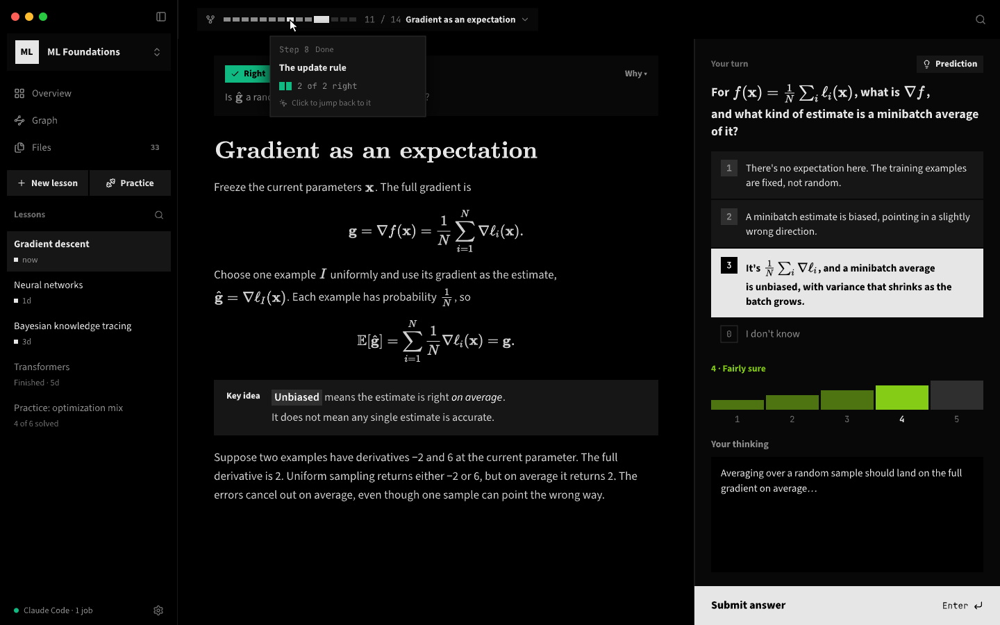

<p align="center">
  <picture>
    <source media="(prefers-color-scheme: dark)" srcset="docs/assets/lh_banner_dark.png">
    <source media="(prefers-color-scheme: light)" srcset="docs/assets/lh_banner_light.png">
    
  </picture>
</p>

<p align="center"><strong>An agent harness for learning, taught by the AI you already pay for.</strong></p>

<p align="center">
  <a href="#get-started">Get started</a> ·
  <a href="#whats-different-from-learnharness">What's different</a> ·
  <a href="#outside-agents-mcp">Outside agents</a> ·
  <a href="docs/development.md">Docs</a> ·
  <a href="https://github.com/bayshores/godspeed/issues">Issues</a>
</p>

godspeed is a fork of [LearnHarness](https://github.com/amosblomqvist/learnharness) by Amos Blomqvist. The teaching method is the same: measure what you know, plan a path to your goal, teach one reasoning step at a time, then practice. The fork changes who does the teaching and what you study with it. Claude Code, Codex or any MCP app can be your teacher on your own plan, and your courses get their own files, graphs, exams and progress.



## What's different from LearnHarness

| | LearnHarness | godspeed |
|---|---|---|
| **Who teaches** | Models from 30+ providers, through your API keys | Your subscription sign-ins (ChatGPT, GitHub Copilot, Grok) or an outside agent: Claude Code, Codex, any MCP app |
| **API keys** | Required | None. There is nowhere to paste one |
| **Organization** | One graph for everything | Classes, each with its own lessons, knowledge graph, files and exams |
| **Course files** | Import notes | Add PDFs, notes, transcripts and recordings (transcribed locally with whisper.cpp), or link a folder that's rescanned every minute |
| **Graph** | A canvas of individual facts | A topic map. The AI groups facts into topics, colors each by how often you get it right, and draws arrows for "learn this first" |
| **Progress** | None | A class Overview: coverage per file, how each lesson went, and whether your confidence matches your results |
| **Exams** | None | Add exams with dates and the files they cover. The Graph shows days left and what to work on next |
| **Lessons** | Chat with a floating answer dock | A reading column, a plan step bar, and an always-open "Your turn" panel with number keys for answers |
| **Confidence** | Percent slider | Five levels |
| **Look** | Rounded corners | OLED black, square corners, CMU Serif titles, Source Sans 3 text |
| **Dictation and web search keys** | Deepgram, Tavily, Brave | Removed |
| **Install** | Signed downloads for Mac, Windows and Linux | Build from source |

The lesson screen was also rebuilt for speed. While the teacher writes, the screen redraws at most once per frame and only the message being written updates. Diagrams, code highlighting and the topic map load the first time you need them.

## How it works

1. **Measure.** The teacher finds where your understanding ends on each part the lesson depends on, from your answers, your confidence and what you type in the thinking box.
2. **Plan.** It maps the steps from there to your goal. The step bar shows where you are, and the plan changes when your answers say it should.
3. **Teach.** Each step builds on something you already understand. You predict, read the explanation, then check yourself. Confusions get fixed before anything is built on them.
4. **Practice.** Practice lessons pose varied problems that make you recall the right idea without being told which one it is.

Everything you learn is saved as facts and the reasoning chains between them, linked back to the lesson they came from. Later lessons read that graph instead of starting from zero.


## Get started

```bash
npm install
npm run desktop:local   # builds an unsigned Mac app into dist/
```

Or run it in a browser with `npm run dev` at http://localhost:3000.

Then pick a teacher. Sign in to a subscription under **Settings → Providers**, or connect an outside agent (below).

## Outside agents (MCP)

While godspeed is open it runs an MCP server, so an agent you already use can be its teacher. It can also do the background jobs: research, diagrams, PDF reading and building your knowledge graph.

1. Open **Settings → Outside agents** and turn on access.
2. Connect your agent:
   - **Claude Code:** `/plugin marketplace add bayshores/godspeed`, then `/plugin install godspeed@godspeed`, then `/godspeed:teach` (add a topic to start a new lesson). `/godspeed:setup-classes` builds your classes from your course files.
   - **Codex:** paste the config snippet from that settings screen into `~/.codex/config.toml`.
   - **Other MCP apps:** use the address and token shown there (Streamable HTTP, `Authorization: Bearer <token>`).
3. Choose **Outside agent (MCP)** as a lesson's model. You answer in the godspeed window and the agent teaches.

While you think, the Claude Code plugin waits in a background script, so the agent spends no tokens until you answer. Agents can also list and read lessons, search your graph, import notes, and manage classes and exams. Only programs on your computer that hold the token can connect.

## Your plans, your data

- Models run on subscriptions you already have, or on your own agent. godspeed has no subscription or markup of its own.
- Lessons, graphs, class files and settings stay on your machine as plain files you can read.
- Model requests send the context a task needs to the model you picked, and web research fetches pages. Local storage doesn't mean offline.
- System prompts are visible and editable.

## Development

```bash
npm test             # deterministic: no LLM, no network
npm run typecheck
npm run lint
```

See the [development guide](docs/development.md) and [architecture](docs/architecture.md). Bugs and requests go to [GitHub Issues](https://github.com/bayshores/godspeed/issues).

## License

[AGPL-3.0](LICENSE). godspeed is based on LearnHarness, copyright its authors, and is distributed under the same license.
