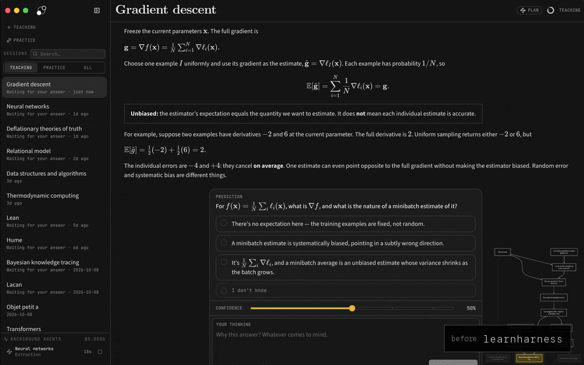
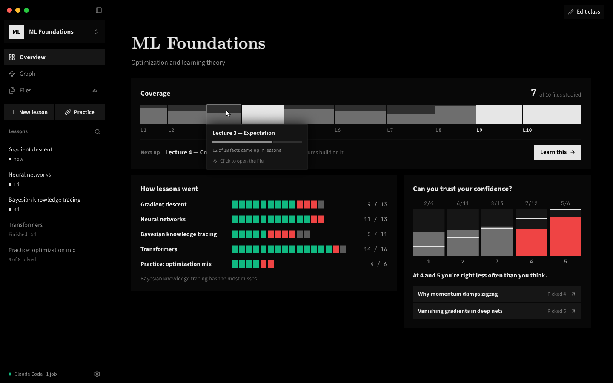

<p align="center">
  <picture>
    <source media="(prefers-color-scheme: dark)" srcset="docs/assets/lh_banner_dark.png">
    <source media="(prefers-color-scheme: light)" srcset="docs/assets/lh_banner_light.png">
    
  </picture>
</p>

<p align="center"><strong>A free, open-source AI tutor for your classes, taught by the AI you already pay for.</strong></p>

<p align="center">
  <a href="https://github.com/bayshores/godspeed/releases/latest"><strong>Download</strong></a> ·
  <a href="https://learnatgodspeed.com/">Website</a> ·
  <a href="#whats-different-from-learnharness">What's different</a> ·
  <a href="#outside-agents-mcp">Outside agents</a> ·
  <a href="docs/development.md">Docs</a> ·
  <a href="https://github.com/bayshores/godspeed/issues">Issues</a>
</p>

godspeed is a study app for students and self-learners. Claude Code, Codex or any MCP app becomes your tutor: it checks what you already know, plans a path to your goal or your next deadline, teaches one step at a time, then quizzes you. Every class gets its own lessons, files (PDFs, notes, lecture recordings), knowledge graph and deadlines. It runs on Mac, Windows and Linux, and needs no API keys.

godspeed is a fork of [LearnHarness](https://github.com/amosblomqvist/learnharness) by Amos Blomqvist, and keeps its teaching method. The fork changes who teaches (an agent you already use) and adds classes, files, graphs and deadlines.



## What's different from LearnHarness

| | LearnHarness | godspeed |
|---|---|---|
| **Who teaches** | Models from 30+ providers, through your API keys or a ChatGPT sign-in | An agent you already use: Claude Code, Codex, or any MCP app |
| **API keys and sign-ins** | An API key, or sign in with ChatGPT. Agents that can't be signed into, like Claude Code, are left out | Neither. godspeed is an MCP server, so there is no key to paste and no account to sign in to |
| **Organization** | One graph for everything | Classes, each with its own lessons, knowledge graph, files and deadlines |
| **Course files** | Import notes | Add PDFs, notes, transcripts and recordings (transcribed locally with whisper.cpp), or link a folder that's rescanned every minute |
| **Graph** | A canvas of individual facts | A topic map. The AI groups facts into topics, colors each by how often you get it right, and draws arrows for "learn this first" |
| **Progress** | None | A class Overview: coverage per file, how each lesson went, and whether your confidence matches your results |
| **Deadlines** | None | Add exams, homework, quizzes and projects with a date, an optional time and the files they cover. Home shows what's coming up, and the Graph shows days left and what to work on next |
| **Lessons** | Chat with a floating answer dock | A reading column, a plan step bar, and an always-open "Your turn" panel with number keys for answers. You can add pictures and PDFs to a message, and the teacher can ask you to write code in an editor |
| **Confidence** | Percent slider | Five levels |
| **Look** | Rounded corners | OLED black, square corners, CMU Serif titles, Source Sans 3 text |
| **Dictation and web search keys** | Deepgram, Tavily, Brave | Removed |

The lesson screen was also rebuilt for speed. While the teacher writes, the screen redraws at most once per frame and only the message being written updates. Diagrams, code highlighting and the topic map load the first time you need them.

## How it works

1. **Measure.** The teacher finds where your understanding ends on each part the lesson depends on, from your answers, your confidence and what you type in the thinking box.
2. **Plan.** It maps the steps from there to your goal. The step bar shows where you are, and the plan changes when your answers say it should.
3. **Teach.** Each step builds on something you already understand. You predict, read the explanation, then check yourself. Confusions get fixed before anything is built on them.
4. **Practice.** Practice lessons pose varied problems that make you recall the right idea without being told which one it is.

Everything you learn is saved as facts and the reasoning chains between them, linked back to the lesson they came from. Later lessons read that graph instead of starting from zero.



## Get started

Download godspeed for your computer:

- **[Mac with an Apple chip (M1 or newer)](https://github.com/bayshores/godspeed/releases/latest/download/godspeed-mac-apple-silicon.dmg):** open the file, then drag godspeed into Applications.
- **[Windows](https://github.com/bayshores/godspeed/releases/latest/download/godspeed-windows-x64-setup.exe):** open the file. If Windows says "Windows protected your PC", click **More info**, then **Run anyway**. (The app isn't signed on Windows.)
- **Linux:** [AppImage](https://github.com/bayshores/godspeed/releases/latest/download/godspeed-linux-x64.AppImage) (most computers) or [.deb](https://github.com/bayshores/godspeed/releases/latest/download/godspeed-linux-x64.deb) (Ubuntu, Debian). Make the AppImage executable, then open it.

Each link downloads the newest version directly.

The app checks for updates once a day and installs them when you quit. **Settings → General → Check for updates** checks right away.

The first launch walks you through connecting your agent (below). You can find the same steps later under **Settings → Connection**.

To build it yourself instead: `npm install`, then `npm run desktop:local` (an unsigned Mac app in `dist/`) or `npm run dev` (http://localhost:3000).

## Outside agents (MCP)

While godspeed is open it runs an MCP server, and an agent you already use is its teacher. The agent also does the background jobs: research, diagrams, PDF reading and building your knowledge graph. If no agent is teaching, that work waits and starts when one does. An agent can be connected without teaching; the sidebar and **Settings → Connection** say so and tell you how to start it.

1. Click **Open Claude Code** (the arrow next to it switches to **Codex**). godspeed makes a folder for your agent, `~/godspeed`, and opens a terminal there running it. The folder holds the agent's instructions (`CLAUDE.md`, `AGENTS.md`) and its connection to the app, so godspeed only loads when you study, not in your other chats. You can also run the command yourself: **Copy the command** copies it. In Claude Code, `/setup-classes` builds your classes from your course files.
   - **Other MCP apps:** pick **Other app** for the address and token (Streamable HTTP, `Authorization: Bearer <token>`).
2. Start a lesson. You answer in the godspeed window and the agent teaches.

While you think, Claude Code waits in a background script, so the agent spends no tokens until you answer. Agents can also list and read lessons, search your graph and your class files, import notes, and manage classes and deadlines. They can save short notes about you (like "the midterm is over"), and every agent sees those notes and where you left off when it connects. You can see and delete the notes under **Settings → Connection**. Only programs on your computer that hold the token can connect.

## Your plans, your data

- The AI is your own agent, on the plan you already pay for. godspeed has no subscription or markup of its own.
- Lessons, graphs, class files and settings stay on your machine as plain files you can read.
- Each task sends the context it needs to your agent, and web research fetches pages. Local storage doesn't mean offline.
- System prompts are visible and editable.

## Development

```bash
npm run check        # typecheck + tests + lint + dead-code check (knip): what CI runs
npm test             # tests only. deterministic: no LLM, no network
```

A change is done when `npm run check` passes.

See the [development guide](docs/development.md) and [architecture](docs/architecture.md). Bugs and requests go to [GitHub Issues](https://github.com/bayshores/godspeed/issues).

## License

[AGPL-3.0](LICENSE). godspeed is based on LearnHarness, copyright its authors, and is distributed under the same license.
