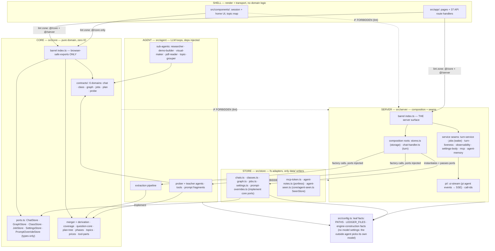
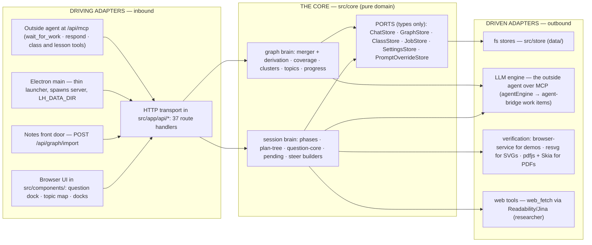
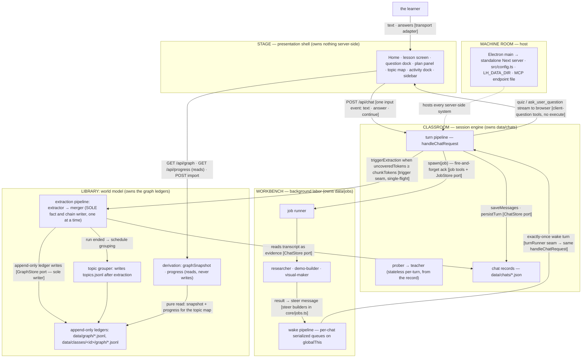
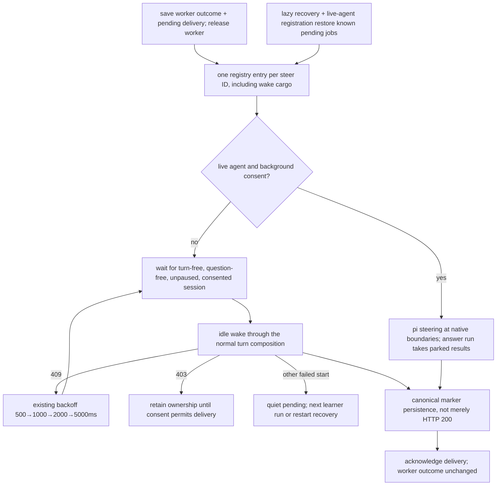
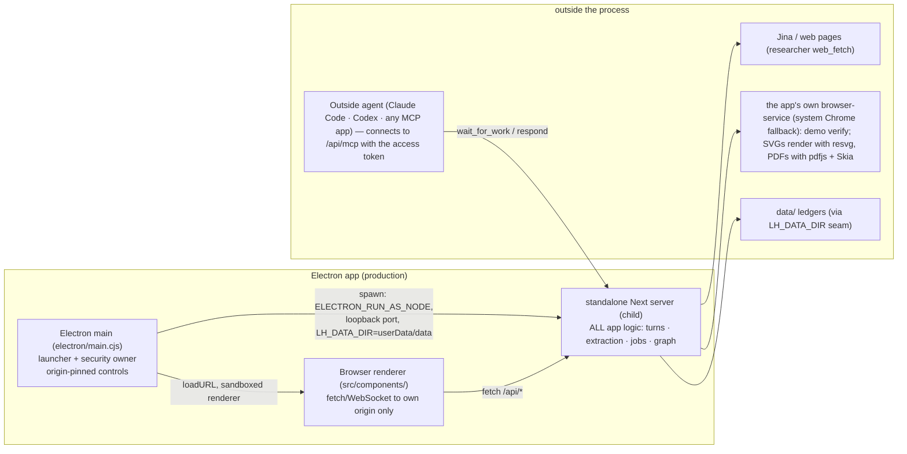

# godspeed — Architecture

Status: **the canonical architecture spec** for the app as built. When this file and the code disagree, the code is right and this file gets fixed. The file-by-file layout lives in [development.md](development.md). Product reasoning and old decisions live in [vision.md](vision.md) (much of it is history). Finished plans and the old spec are in [archive/](archive/).

**What this is.** A standalone learning app (web + Electron desktop): the learner's knowledge accumulates into a persistent, cross-session knowledge graph per class, built from tutoring sessions in which a teacher agent authors a formal, visible dependency tree (the plan tree) and verifies understanding with structured questions. Home (`src/app/page.tsx`) shows what is coming up across classes; each class's graph is drawn as a topic map at `/graph`; the session is the classroom.

**Design principles, in priority order:**

1. **Maximum control.** Every dependency edge is explicit and machine-checked. Nothing reaches sideways for convenience.
2. **Easy editability.** A worker can trace any behavior to one file. Layers are named by responsibility, not by framework accident.
3. **Zero technical debt.** The shape you see is the shape that runs. Deprecated paths are deleted, not parked.
4. **Crystal-clear architecture.** Two barrels as the entire public API, two composition roots, one writer per store, named seams. When a rule can be a lint rule, it is.

**The one-sentence model:** a pure domain core at the center; every external effect (fs, LLMs, browser, OS) behind an adapter at the edge; two composition roots as the only places the edges are plugged together; and every persistent store written by exactly one system.

---

## 1. Two axes, one law

Hold the architecture along two orthogonal axes:

**Static structure — the hexagon.** One pure core (`src/core`); everything else is an *adapter* (implements a core port or drives the core) or a *composition root* (the only code that wires adapters to core). Dependency arrows point **inward only** — toward purity, toward stability. Two barrels are the entire public API: `@/core` (browser-safe) and `@/server` (the server-side surface).

**Runtime ownership — six systems.** Each persistent store has exactly one owning writer-system; systems talk only through named, idempotent protocols:

| System | Owns (sole writer) | Role |
|---|---|---|
| **Classroom** — session engine | `data/chats/*.json` | the turn pipeline, prober→teacher, plan tree, questions, phases |
| **Workbench** — background labor | `data/jobs/*.json` | job runner, researcher/demo-builder/visual-maker, steer delivery |
| **Library**: world model | `data/graph/*` and `data/classes/<id>/graph/*` ledgers | extraction pipeline (sole fact and chain writer), topic grouping, derivation |
| **Classes**: courses | `data/classes/<id>/class.json` + `files/` | class records, class files, linked folders, deadlines (`src/server/classes.ts` through the `ClassStore` port) (§6.1) |
| **Stage**: presentation shell | nothing server-side | src/components/, Home, the topic map, the lesson screen, docks; a pure consumer via `/api/*` |
| **Machine room**: host | process + config, `data/mcp-token`, `data/agent-notes.json`, `data/agent-seen.json` | Electron main, standalone Next server, `src/config.ts`, data-dir seam, the outside-agent boundary (§8.1) |

**The unifying law** (generates everything else): **imports point inward, writes point to append-only evidence, and everything else is derived.** Dependency flows toward purity; data flows toward evidence; no state is stored where it can be recomputed.

---

## 2. The layers and the import law

Dependency arrows point **down only**. Each layer may import the core barrel; nothing skips a boundary for convenience.

```
┌──────────────────────────────────────────────────────────────┐
│ SHELL      src/app/        Next.js route handlers (transport) │
│            src/components/ session + home UI (render only)    │
├──────────────────────────────────────────────────────────────┤
│ SERVER     src/server      composition roots (stores.ts,      │
│            chat-handler.ts) + named service seams + the      │
│            pi engine bridge. Zero business logic              │
├──────────────────────────────────────────────────────────────┤
│ AGENT      src/agent       prober + teacher loops, tool       │
│            surfaces, prompt fragments, sub-agents, the       │
│            extraction pipeline. Deps arrive via factories —  │
│            never imported from below                          │
├──────────────────────────────────────────────────────────────┤
│ CORE       src/core        pure domain: contracts (6 domains),│
│            ports, merger + derivation, coverage, question-   │
│            core, plan-tree, phases, topics, prices. No IO     │
│            (a few files use node:crypto: pure                 │
│            but node-bound, hence kept out of the barrel)      │
├──────────────────────────────────────────────────────────────┤
│ STORE      src/store       fs adapters: chats · classes ·    │
│            graph ledgers · jobs · settings · prompt          │
│            overrides (implement core ports) + portless       │
│            mcp-token, agent-notes; agent-seen. The ONLY      │
│            modules that touch data/                          │
└──────────────────────────────────────────────────────────────┘
```

**The import law** (`eslint.config.mjs` — the config's sole job; four `import/no-restricted-paths` zones, all `"error"`; each verified to fire; `lint` is a gate on every change):

| Zone | May import | Rationale |
|---|---|---|
| `src/components/**` | `@/core` only (the barrel) | The UI renders domain data; it never runs domain logic or touches IO |
| `src/app/**` | `@/core` + `@/server` (the barrels) | Route handlers are transport; they delegate to server entry points |
| `src/core/**` | nothing below itself (never `agent`/`server`/`store`) | The core is pure; adapters implement its ports, never the reverse |
| `src/agent/**` | never `server`/`store` | The agent layer receives its dependencies (ports, engines, seams) via factories/closures |



**Two rules are documentation-only by design.** The ESLint plugin's `except` can't express "all but one", so (a) `src/server/stores.ts` is *intended* to be the only server module importing adapters — but the server barrel also re-exports the settings reader and `promptOverrides`, and `observability.ts`, `onboarding.ts`, `whats-new.ts`, `settings-read.ts`, `mcp.ts`, `agent-memory.ts` and `classes.ts` (for `writeFileAtomic`) import store modules directly; and (b) the browser-safety of the core barrel is a doc-comment convention (see §2.1). `tests/`, `scripts/`, and `electron/` are deliberately outside the law (lint-excluded); tests import freely across layers, scripts act as extra composition roots.

### 2.1 The core barrel and browser-safety

`src/core/index.ts` exports browser-safe modules: pure logic + types, no fs, no network. Deliberately **not** barrel-exported (server code imports them directly): `graph.ts` and `agent-seen.ts` (need `node:crypto`), `clusters.ts`, `session-clusters.ts` and `agent-briefing.ts` (server-only roles). One exception: `coverage.ts` is exported although it imports `node:crypto`. Port *types* are types-only, hence safe to re-export. This split is what lets the same core serve browser (grading, plan statuses, usage folding) and server (merger, derivation, coverage).

### 2.2 Contracts — one file per domain

`src/core/contracts.ts` is a barrel over six domain files:

- `contracts/plan.ts` — plan tree types + derived statuses (`derivePlanStatuses`)
- `contracts/graph.ts`: graph domain (ledgers, findings shapes, snapshot, topics)
- `contracts/chat.ts`: session records, the usage channel, handoff text
- `contracts/jobs.ts` — the ack-and-steer protocol: job records, steer message builders, deterministic steer ids, usage accumulation
- `contracts/probe.ts`: probe assessment + the shared schema
- `contracts/class.ts`: class records, class files, deadlines, signatures and icons

---

## 3. Ports, adapters, and the composition roots

Storage is **per-entity semantic ports**, never one generic interface: `ChatStore`, `GraphStore`, `ClassStore`, `JobStore`, `SettingsStore`, `PromptOverrideStore` (`src/core/ports.ts`, types only). The fs adapters (`src/store/{chats,graph,classes,jobs,settings,prompt-overrides}.ts`) implement them and contain persistence and nothing else. `src/store/agent-seen.ts` implements `SeenStore` from `src/core/agent-seen.ts`. Two small adapters have no port: `mcp-token.ts` (the access token) and `agent-notes.ts` (the agents' notes about the learner).

**Idioms.** Graph evidence lives in **append-only JSONL ledgers** (corrupt-line-tolerant reads; strict shape guards drop invalid lines, never guess). Chats, classes, jobs, sources, agent notes, agent-seen marks and the settings blob are whole-file read-modify-write JSON. All writes are synchronous, single-process (atomicity rides the Node event loop). Merge/dedup/derivation semantics are **reader-side, in core** — the store never decides.

- **`src/server/stores.ts` is THE composition root for storage**: it instantiates the adapters and hands the port objects to everything else (chat-handler, job runner, extraction pipeline, graph/classes/chats routes, turn services). It also hands out one `GraphStore` per graph folder (`graphStoreFor(scope)`, §6.1). It is the single place a storage decision (JSON vs SQLite, local vs remote) gets re-made.
- **`src/server/chat-handler.ts` is THE composition root for a turn**: it wires the stores, the job runner, the extraction pipeline, and the pi engine into the stream response (`setTurnRunner`/`setJobRespawn` register its seams for the wake pipeline). All logic lives behind the seams it calls.
- The agent layer is dependency-inverted throughout: `createJobRunner({ chatStore, jobStore, deliver })`, `createExtractionPipeline({ chatStore, graphStore, extractor?, relatedFacts? })`, `createTeacherTools({ chatId, chatStore, jobStore, spawn })`, `createProberAgent`/`createTeacherAgent(engine?, tools?, …)`. Tests inject the same ports production wires — or swap an in-memory port.

The engine side is adapted too: `src/agent/models.ts` (`agentEngine()`) is the ONE production engine — the outside agent (MCP). Its stream parks each model request as a work item in `src/agent/agent-bridge.ts`, and the connected agent takes it with `wait_for_work` and answers with `respond` (`src/server/mcp.ts`). There are no model settings and no API keys: the agent picks its own model in its own harness. Chat records store pi's own message shapes (`src/core/native-messages.ts`), so a turn replays the record directly; `toLlmMessages` there turns app markers into model text and gives dangling tool calls an interrupted result. `src/server/pi/ui-stream.ts` streams the pi agent events to the browser as SSE, and `call-ids.ts` makes tool-call ids unique at that boundary.



---

## 4. The six systems (runtime ownership and protocols)

The systems view: each box owns its store; edges are the protocols, each with the adapter/seam that implements it. (Classes are left out of the diagram; see §6.1.)



The server-side systems are each the sole writer of their own store, connected by named protocols: the **turn request** (Stage→Classroom), the **ack-and-steer** loop (Classroom→Workbench→Classroom), and the **extraction trigger + transcript read** (Classroom→Library). Practice is not a separate system: it is a lesson kind that runs in the Classroom (§7). The Stage touches systems only through the thin HTTP transport; the teacher reaches the Library directly through the gated prober tools (`list_sessions` / `list_propositions`) rather than any injected context.

---

## 5. The session (one chat turn)

`handleChatRequest` is framework-free (plain `Request`/`Response`) with a `buildAgent` test seam so tests drive it with scripted engines. The turn, in exact order:

```mermaid
sequenceDiagram
    participant B as Browser (lesson screen)
    participant R as POST /api/chat
    participant H as handleChatRequest
    participant L as turn-liveness (globalThis)
    participant CS as chatStore adapter
    participant A as prober/teacher/practice agent (pi engine)
    participant F as end-of-turn seams

    B->>R: {chatId, input}: ONE input event (text · answer · continue; practice adds thinking · next)
    R->>H: handleChatRequest(req)
    H->>H: turn the input (or queued steers) into native record appends
    H->>L: beginTurn(chatId)
    Note over H,L: already running → 409; the client waits for that turn to end,<br/>then POSTs the same input again (gives up after 30 s)
    H->>CS: saveMessages (write-ahead: persist even before the stream)
    H->>A: build agent from record (successful probe_done in the record ⇒ teacher)
    Note over H,A: the record IS the pi message list; toLlmMessages flattens<br/>markers and gives dangling tool calls an interrupted result
    A-->>B: SSE stream of pi agent events (ui-stream)
    Note over B: question tools only check input on the server and end the turn:<br/>rendered in the dock; graded client-side via question-core
    B->>B: QuestionDock: parse → shuffle (seeded) → buildAnswer (grade)
    B->>R: next POST with input {answer}
    A-->>F: turn ends
    F->>CS: persistTurn (canonical, idempotent) + appendTurnUsage
    F->>F: triggerExtraction — if uncovered tokens ≥ chunkTokens, fire async
    F->>L: endTurn (ALWAYS last — the registry never locks)
```

- **Client-side question tools** (`probe`, `quiz`, `ask_user_question`, `explain`, `recall`, `write_code`) only check their input on the server and then end the turn (the "question posed" placeholder lives in memory and is never saved). The call streams to the browser, the learner answers in the dock, the client grades via `question-core` (or `code-question.ts` for code, which the teacher grades by reading) and POSTs the answer as an input event. The server saves it as the call's native tool result and the next turn runs. A pending question saved in the record is exactly what makes **resume mid-question free**. Deterministic seeded shuffling (keyed by toolCallId) keeps server and client renders identical.
- **The prober→teacher handoff**: the first turn(s) run the prober (floor/ceiling via quiz, goal via ask); `probe_done` (server-executed) files the assessment and queues a handoff steer; from the first `tool-probe_done` part in the transcript, the handler builds the teacher agent for every later turn. Phases (`core/phases.ts`) fold strictly: probe → plan → teach.
- **The formal plan tree is author-once**: the teacher authors the session's dependency map with a single schema-validated `plan_init` tool (a mermaid-subset graph, parsed deterministically with line-numbered errors, validated as a DAG). Progress is never mutated — statuses (`current`/`visited`/upcoming) are **derived** from tagged quiz calls in the transcript; the tree panel and the plan blocks render that derivation.
- **Job tools are server-executed, ack-and-steer**: `research`/`demo`/`visual`/`pdf` resolve immediately mid-turn with a fire-and-forget ack (the teacher keeps teaching); `spawn(job, input)` fires the background runner.
- **Attachments**: a learner message can carry up to 5 pictures and PDFs (`src/core/attachments.ts`, `src/server/attachments.ts`). A picture is resized (long side at most 1568 px) and stored inline in the message. A PDF is saved in `data/chats/<id>/`, and the message gets a short note with the file's path. Limits: 20 MB per picture, 30 MB per PDF.
- **Class and date context**: a class lesson starts with a `class-context` marker (the class card, `src/server/class-card.ts`). A hidden `today-context` marker tells the model today's date, time and time zone and the class's open deadlines. A new one is added before the learner's message when the day or the deadlines changed, or a compaction cut the last one out of view (`src/core/today-note.ts`).
- Turn services are named seams taking explicit dependencies. Extraction contains its errors, but **canonical persistence must not fail silently**: a failed input write refuses acceptance without starting an agent; `persistTurn` throws on a failed reply write. The runner reports settlement failure before `[DONE]` and releases liveness even when normal settlement fails. Steer reconciliation uses the durable record, so a later bookkeeping failure cannot replay already-saved learner input.
- **Late attachment must still see settlement failure.** A small, memory-only notice per session precedes the settled stream terminal when the failing turn has already left the live registry. The next accepted turn, successful session deletion, or server exit clears it. Reopening seeds the existing banner from that notice and waits for ordinary learner input; dismissing the banner is not permission to automatically retry the model. No synthetic failure entry is added to the saved transcript.
- **Recovery never blindly resends an answer.** Submitted question drafts survive optimistic unmount in memory; the existing Submit action reconciles uncertain acceptance against the canonical record and running-turn state before sending again. EOF or a rejected stream read without a terminal triggers one read-only reattachment; another transport failure shows the existing error banner rather than claiming completion. Explicit completion, cancellation, and the literal-final-entry saved-error rule remain unchanged.

### 5.1 The wake pipeline (Workbench → Classroom)

**Worker completion and session delivery are separate lifecycles.** Dispatch persists the tool input on the job before spawning. On completion, the runner saves its result, terminal worker status (`done`/`error`), and `delivery: {kind: "result", status: "pending"}` in one job-record update. It then queues the native custom **steer message** without awaiting delivery. Its content is model-facing text; details carry the UI artifact. Worker resources are released and the Background agents row disappears even if an unanswered question holds the result indefinitely. Dispatch cards say “finished,” not “delivered.” Only computing workers can be aborted; abort saves an independent pending abort notice.



The per-chat registry retains ownership across live handoff, idle-wake flight, and 409/403 return; repeated submissions share one entry/promise. A deterministic marker ID in the **saved conversation** completes delivery. Streaming visibility alone does not. A failed bookkeeping acknowledgement cannot replay a saved marker, and later teaching/model failure does not reopen delivery or retry the accepted turn. Failed starts leave results durably pending without a new error UI or retry timer; the in-memory entry stays parked until a learner run or process restart. Normal question/dismissal waits and consent deferrals are not failures.

Recovery reads saved job input before legacy transcript lookup. Missing research questions fail honestly without invoking the researcher. Legacy running jobs with saved results become finished workers with pending delivery; legacy terminal jobs without delivery metadata remain untouched, rather than guessing that old outcomes should be replayed. Pending result and abort notices are restored before a newly registered agent's first steering poll, even without a preceding jobs-feed read. Deleting a session discards its pending delivery obligations; only live turns and computing workers block deletion. These guarantees use the existing JSON storage and single-process delivery registry, not a transactional queue or a promise of exactly-once model execution.

Sub-agents **verify, never one-shot**: the demo-builder runs its HTML in the app's own browser-service (system Chrome as a fallback) before delivery; the visual-maker renders each SVG and looks at it (the connected agent must accept images).

---

## 6. The knowledge graph — two channels, one writer

**The extraction pipeline is the sole writer of facts and chains.** Nothing else appends to a graph's `nodes.jsonl` or `chains.jsonl`: not the teacher, not the server, not a migration script. Two other writes exist, both named: deletion (`src/core/graph-deletion.ts`) rewrites the ledgers when the learner deletes a fact, deletes or moves a lesson, or removes or rebuilds a class file; and the topic grouper appends to `topics.jsonl`.

```mermaid
flowchart TB
    TRIG["trigger seam (turn-service): coverageOf(record, coverageLedger)<br/>— uncovered tokens ≥ graph.extractionChunkTokens (settings)?"] -->|"yes, single-flight per source"| RUN["extraction.runExtraction(chatId)"]
    IMPORT["POST /api/graph/import (notes front door)<br/>deterministic src id = sha256(path)"] -->|"importNotes: shared pipeline, per-door preambles"| RUN
    RUN --> BATCH["batchRuns — greedy token-budgeted batches of oldest uncovered TEACHER-PROSE messages"]
    EXT["EXTRACTOR (LLM) — sees the teacher-prose view or a notes stretch,<br/>plus THE GRAPH SO FAR (this source) and RELATED IDEAS (~25 picked by the app's local search)<br/>one submit: new propositions + REASONING CHAINS + reteaches (ids of existing ideas it teaches again)"]
    EXT --> MERGE
    MERGE["MERGER (deterministic, core/graph.ts) — the ONLY ledger writer:<br/>a node per new proposition · reteach credit on existing nodes · chain dedupe (premises+conclusion → one arg_ id) · coverage checkpoint"]
    MERGE --> GROUP["run ended → scheduleTopicGrouping (per graph, debounced 20 s)"]
    MERGE -->|"failure at ANY stage"| NOTHING["checkpoints nothing — the next trigger re-runs"]
```



**Raw reasoning chains only** (2026-09-27 cleanup; teacher-prose view 2026-09-28): the extractor reads ONLY the session — and since the 2026-09-28 ruling, ONLY the teacher agent's prose: plain paragraphs under the session title, no learner messages, no thinking, no tool calls or results, no quiz blocks. Coverage fingerprints, slot tokens, and batch budgets all derive from that same selection (`messageViewLines` in `core/coverage.ts`), so "covered" is exactly "what the extractor saw" — a quiz answer or learner edit can never open a run, and only a teacher-prose edit re-opens its message. The old call+result inseparability bond is deleted (nothing left to keep together); batching is pure greedy fill. The shared markdown engine (`core/session-markdown.ts`) keeps the full session format for the future user-facing export and is no longer used by extraction. The extractor's deliverable is propositions + REASONING CHAINS (owner redesign, 2026-09-30): a chain is premises that JOINTLY entail a conclusion — independent arguments for the same conclusion are separate chains, conclusions are reusable by id as premises, and a bare proposition rides the propositions list alone. The wire schema carries propositions (id/name/statement/optional aliases) + chains (premises minItems 1/conclusion) — and since the chains-primary ruling (2026-09-30) the STORE carries exactly that wire shape: chains append as-is to `chains.jsonl` (`SessionFindings` IS the store shape now; `chainsToEdges` and `chainsToGraph` are deleted — no translation seam exists). **Supports edges are retired entirely** (owner, same evening): `EdgeType`, the supports draw toggle and thickness slider, and every supports code path are gone — a stored typed edge no longer exists anywhere, and every arrow is derived from a chain. No migration, no backcompat: the pre-chains graph data was wiped by ruling. The chain laws are enforced by the practice-proven error-back hook at the submit seam: every premise/conclusion id must resolve to a submitted proposition, premises are non-empty, no self-reference — a violation returns an error string and the model re-submits within its turns. The prompt is GOAL-FIRST, no rule armor (owner philosophy ruling, 2026-09-30): one shared `EXTRACTION_CORE` (the goal, the truth law, the submission mechanics) plus two one-sentence contextualizations — session and notes preambles — assembled at the call sites, so both front doors share the core by construction; the old defensive lists (DROP lists, merge-your-own-output, name walls, when-in-doubt-omit, the faithfulness paragraph) are all cut, and the old opening describing Quiz/Recall-check/Question blocks (stale since the teacher-prose ruling) is simply omitted. A `prepareArguments` heal at the pre-validation seam rescues stringified-payload submits (propositions or chains). Every node is an objective, world-facing fact. No quiz outcomes, no understanding assessments — the events ledger and `UnderstandingLevel` are deleted. How well the learner knows a fact is derived at read time from lesson answers (`GET /api/progress`); nothing ever writes learner states back to the graph.

**Digest-aware serialized extraction — the extractor is the assembler** (owner redesign, 2026-09-30 evening): the spine stage came and went in one day — the owner's live test showed the post-hoc assembly pass added complexity without perceptible gain, because the real problems (restatement nodes, shallow re-derivations) are mint-time issues. The replacement moves assembly INTO the extractor: when a source already yielded material, each stretch's extractor prompt carries **THE GRAPH SO FAR** (that source's merged propositions and chains, ids verbatim), and the extractor builds on it — referencing existing ids instead of restating them, leaning on established conclusions as premises. Chains may therefore span stretches: endpoints are a mixed namespace of fresh local ids OR existing `n_` ids (validated at the submit seam, error-back; the merger's job-local map passes existing ids through verbatim). The system prompt reframes the goal as uncovering the source's **core ideas** and showing how everything **derives from the foundations** — direction upward, prefer lean derivations, never re-derive what the graph already holds. Because each stretch must read every earlier merge, a source's batches/chunks run **STRICTLY IN ORDER** (serialized per source); cross-source runs stay parallel. The first stretch of a source runs bare (no digest, no extra spend).

**Chain simplification — the merger's maintenance pass** (owner, 2026-09-30 evening): the same conclusion often arrives from many angles — `[A,B]⟹X`, `[X,C]⟹Y`, and then `[A,B,C]⟹Y`, which adds nothing. At every merge, `simplifyChains` (core/graph.ts) walks the WHOLE chain ledger and drops provably redundant chains: a chain is redundant when its premises already derive its conclusion through the other kept chains (forward closure: start from its premises, add the conclusion of every kept chain whose premises are all known, and see whether its conclusion turns up). Chains with the most premises, then the newest, are checked first, so the leanest, earliest derivation stands, and a chain already dropped never helps derive another, so two chains that derive each other never both go. `[A,B]⟹X` + `[X,C]⟹Y` make `[A,B,C]⟹Y` redundant, while `[A]⟹Y` next to `[A,B]⟹X` + `[X]⟹Y` stays (A alone never reaches X). Same-(premises, conclusion) lines are one logical chain — a key drops with every provenance line. The rewrite rides the merge's audit-locked critical section (atomic `rewriteLedgers`); run stats count the drop separately (`droppedChains`) so appends and maintenance never blur. Simplification runs at merge time because a NEW chain can make an OLD one redundant — nothing is retroactively re-derived, only provable redundancy is removed.

**Per-part jobs, one at a time** — every part (a notes stretch) and every batch (chat coverage) is its own JOB: registry row, usage record, failure domain. Extract + merge for every job runs inside one process-wide graph lock on `globalThis` (`withGraphLock` in `extraction.ts`): the extractor reads the live graph (its own source's findings and the related ideas), so two at once would each miss what the other is adding and mint duplicates. A job waiting for the lock shows the `waiting` phase. A source's parts run in order. Failure isolation: one job failing (bad part, degraded model output) is absorbed; its messages stay uncovered and re-runnable while its siblings still merge, and the run returns what actually merged. Abort is source-wide: the serial loop stops at the first AbortError (also while waiting for the lock), and merged jobs keep their checkpoints. The status feed shows one row per job (`file.md · 2/5` suffixes for parts), and each job persists its own usage record (failed jobs bill their partial spend too).

**Identity without a second model call.** The extractor is the only LLM stage and the only one that sees the source. Before each part, the app's local search (`relatedFacts`, the hybrid embedding + BM25 search in `src/server/search-index.ts`) picks the ~25 existing ideas that best match the part's text, and the prompt lists them as RELATED IDEAS (`id | name | statement`) next to THE GRAPH SO FAR. An idea either list already holds is never submitted again: the extractor references it by its `n_` id in chains and lists it in `reteaches` when the part teaches it. The merger (`mergeFindings`, deterministic) then appends: every new proposition becomes a node; each valid `reteaches` id gets a credit line (this source's provenance, the node's own name and statement) so the source counts toward that idea; chains resolve through the job-local id map (existing `n_` ids pass through verbatim) and dedupe by (sorted premises, conclusion), so a known argument re-asserted elsewhere appends under the SAME `arg_` id with provenance unioned; then the chain-simplification pass runs and coverage checkpoints. The submit seam rejects `reteaches` ids that are not existing ideas, and chains whose ids resolve to nothing; the model re-submits within its turns. Duplicates the search misses stay as separate nodes.

**Coverage, not quiz-counting** (supersedes the v1 every-N-quiz-answers trigger): each message's *view* (the compact line format `core/coverage.ts` has always hashed) is hashed into a per-chat fingerprint ledger (`coverage.jsonl`); "covered" means exactly "a run committed on this content." The prompt view is the richer markdown document — a deliberate 2026-09-27 split: re-formatting presentation never re-opens covered history. Uncovered = fingerprint diff, never dual-tracked; runs are greedy token-budgeted batches (`graph.extractionChunkTokens` — a settings knob, default 4096, floor 500, read fresh each turn) of the oldest uncovered messages — quiz-less sessions extract too. A coarse `sessions.jsonl` checkpoint still marks each merged run. The trigger seam (`turn-service.ts`) is trigger-agnostic from the pipeline's side: when a better mechanism lands (session end, idle, explicit flush), only the seam changes. Single-flight per source; the run registry powers the coverage UI and true abort.

**Two front doors, one pipeline**: chat transcripts (coverage-triggered) and notes and class files (`POST /api/graph/import`, the `import_notes` MCP tool, or a class's file pipeline; each file becomes a `NotesSource` playing the `chatId` role, deterministic id from the path hash). Every explicit "No class" re-import processes the whole file again and adds to that source (the old content-fingerprint no-op is gone; `contentFp` is legacy, ignored). Class files (classes wave, 2026-10-26) are different: each has a class-unique source id (`src_` + hash of class + file id), and a changed or removed file has its old facts removed first (`deleteSourceTraces`, the delete-nodes law applied to a source) before re-extraction. Notes chunk like chats (owner, 2026-09-28): large files split at line boundaries under the same token budget, and each chunk runs as its own job exactly like a chat batch — in order per source, one job at a time under the graph lock. No single model call carries a whole file. Both submit tools require their top-level fields (`propositions`, `chains` and `reteaches` present even when empty): a payload missing them fails validation rather than silently merging structure-less nodes.

**The read channel is pure derivation.** `GET /api/graph` and `GET /api/progress` read the ledgers and never write. The stored truth is propositions (`nodes.jsonl`) + reasoning chains (`chains.jsonl`). `graphSnapshot` merges the ledgers, then `deriveView` (core/graph.ts) rebuilds a view on every read: each stored chain becomes an implication node (id = the chain's `arg_` id, name `⟹`) with arrows premise→implication→conclusion; a chain whose member was deleted drops. Two independent arguments for one conclusion (`A∧B⇒E`, `C∧D⇒E`) stay two implication nodes, never one merged `A∧B∧C∧D⇒E`. Clusters are the birth-session partition over propositions (`birthSessionPartition`, core/session-clusters.ts); the chain table groups chains by them.

**Deletion is full death, cascade-aware.** Deleting a proposition kills EVERY stored chain that references it, premise or conclusion. Deleting an implication node (any `arg_`-prefixed id) deletes exactly that ONE stored argument and nothing else. The same confirm dialog (`src/components/delete-node-dialog.tsx`) opens from a fact's right-click menu in the topic panel and from the chain table's Delete.

**The teacher probes, nothing is injected** (supersedes the semantic-injection experiment, killed 2026-09-23): the teacher reaches the graph on its own terms through two read-only prober tools — `list_sessions` (birth sessions, the learner's files) and `list_propositions` (the names of what a session covered) — gated by the `agent.graphTools` setting (composing with `graph.enabled`). No topic embedding, no top-K selection, no session-start steer; the agent decides what to look at, and the graph never writes into a lesson unbidden.

**Rendering**: `/graph` is a topic map (`src/components/graph/topic-map.tsx`). The topic grouper (`src/agent/subagents/topic-grouper.ts`, scheduled by `src/server/topics.ts`) groups a graph's facts into topics and appends a full snapshot to `topics.jsonl`. `src/components/graph/layout.ts` places the topics in columns by prerequisite depth and draws only direct arrows. Nothing about the layout is stored.

---

### 6.1 Classes — one graph per class (owner ruling 2026-10-26)

`GraphStore` is built per graph folder (`createGraphStore(graphFilesIn(dir))`); the composition root hands out `graphStoreFor(scope)` (null = "No class" = `data/graph/`, a class id = `data/classes/<id>/graph/`) and `graphStoreForChat(chatId)`. The extraction pipeline resolves its target per source (`storeFor`), so the one writer still writes, now into the lesson's or file's own class graph. Reads may cross classes (the prober's map tools take `graphs`), writes never do (`mergeFindings` writes only the own graph). Class orchestration lives in `src/server/classes.ts` (file pipeline, linked-folder scan every 60 s, lesson moves, cascade delete); the class card is `src/server/class-card.ts`; lesson birth is `src/server/lessons.ts`.

**Class files.** A file is `study` (turned into facts) or `info` (the teacher can read it with `read_class` / `search_class_files` / `read_passage`, but it never becomes facts). A linked folder adds every supported file in it as study material, up to `MAX_LINKED_FILES` (500). Recordings are transcribed locally with whisper.cpp (`src/server/transcribe.ts`). The work of reading a study file is a background work item for the outside agent: nothing is extracted until an agent is taking work.

**Deadlines.** A class can have deadlines (`ClassDeadline` in `src/core/contracts/class.ts`): kind `exam`, `homework`, `quiz` or `project`, a name, a due day, an optional time on the learner's own clock, the study files it covers, and a done flag. The learner edits them in Edit class; an outside agent edits them with `add_class_deadline` (a list at once) / `update_class_deadline` / `remove_class_deadline`. `GET /api/deadlines` lists every open deadline for Home's "Coming up" and the sidebar's "Due soon". `GET /api/progress` turns a deadline's files into days left, a ready percentage and a "Work on next" list for the topic map. The teacher sees them through the `today-context` marker (§5).

## 7. Practice sessions

Practice is a lesson kind (`kind: "practice"` on the chat record). The learner starts one from New lesson → Practice (`/new?mode=practice`), from "Practice these N" / "Practice this topic" on the topic map, or with "Start from facts" on the New lesson screen (the chain table in select mode, `src/components/home/facts-picker.tsx`). `createLesson` (`src/server/lessons.ts`) turns the picked facts into a `graph-context` marker using `chainsForSelection` (`src/core/chains.ts`): a stored chain is included when its conclusion and every premise are picked, and a picked fact in no included chain stands alone. The practice agent's tools are `problem` and `conclude` (`src/agent/tools/practice.ts`), plus the read-only file tools (`read`, `ls`, `find`, `grep`), the `research` and `pdf` jobs, the map readers when `agent.graphTools` is on, and the class tools in a class lesson; its instructions live in `src/agent/prompts/practice/`. The learner's work is saved as `practice-thinking` markers, and `practice-next` / `problem-dismissed` mark moving on or skipping. Practice is never extracted and never writes to the graph.

**The chain table** (`src/components/chain-table.tsx`) lists every reasoning chain of the graph, grouped by birth cluster, with a search. Its checkboxes pick clusters, chains or single facts. On the topic map, the floating bar deletes the selection through the same confirm dialog (deletes run one at a time and stop at the first failure, then announce `lh:graph-revision` so the page refetches). Opened from "Start from facts" on the New lesson screen, the bar has Done instead of Delete, and the picks become the new lesson's opening context (a teach or practice lesson).

---

## 8. Process boundaries (the machine room)



The Electron main is a launcher + security guard, never a host for teaching or inference logic: single-instance lock, deny-by-default permissions, origin-pinned navigation, sandboxed renderer. All Next.js code runs unchanged in a child process (`output: "standalone"`), relocated by the `LH_DATA_DIR` seam (also the test seam — `data-dir-seam.test.ts` covers it, including a fresh-child-process case). The build hard-fails if repo `data/` would leak into the bundle or if prompt assets fall out of the trace (`scripts/build-server.mjs`). The packaged app flips Electron fuses (`electronFuses` in `electron/electron-builder.yml`): no extra `file://` privileges and no `--inspect` flags or SIGUSR1 to attach a debugger. When the server crashes, the main process starts it again (at most 3 times a minute) with `LH_SERVER_RESTARTED=1` and reloads the window; that server's first page shows a "godspeed restarted after a problem" notice instead of the welcome screen (`firstLoadScreen` in `src/server/welcome.ts`). After too many crashes a "godspeed stopped working" dialog offers Relaunch, Report a bug and Quit.

---

### 8.1 Outside-agent boundary

The outside agent is the only model (owner, 2026-10-27). The server makes the access token `data/mcp-token` (mode 0600) on the first page load (`src/app/layout.tsx`) and again whenever it is missing, so access is always on. `/api/mcp` accepts only local, non-browser requests that carry the token (`src/server/mcp.ts` `refuse`). The Electron app writes `data/mcp-endpoint.json` so the godspeed folder's connector can find the address; the connector reads the token file itself. Settings → Connection shows the connection status, shows and rotates the token, and has the button that opens the agent (or the setup for another MCP app). No credentials for model providers exist anywhere in the app. The server speaks both MCP versions on one endpoint: the 2026-07-28 one, where every request carries the client's version and name and `server/discover` replaces the handshake (Claude Code and the folder's scripts), and the older one that starts with `initialize` (Codex). Each request names the agent from its client info. The older version keeps a JSON-mode transport, because the SDK's own fallback for it answers in SSE, which the folder's scripts can't read. The move is recorded in [archive/mcp-2026-migration.md](archive/mcp-2026-migration.md).

**The godspeed folder.** Agents are opened in one folder, `~/godspeed` by default (`data/agent-folder.json` remembers another one and whether the one-time notice was seen). `src/server/agent-folder.ts` writes it from `src/server/agent-folder-files/` and `src/core/agent-folder.ts`: `CLAUDE.md` (Claude Code's work loop with the waiter) and `AGENTS.md` (Codex's), the `setup-classes` skill, `.mcp.json` (Claude Code runs `.godspeed/connect.mjs`, a stdio bridge to `/api/mcp`), and in `.godspeed/` the scripts, `claude-settings.json` (loaded with `--settings`, so it applies before the folder is trusted: it turns on the folder's server, allows godspeed's tools and the waiter, and adds the forget hook) and a start script per agent. Codex gets the same connector through `-c` flags, its tools pre-approved, with no project config (that would need the folder trusted). The app rewrites the files once per start, so an update reaches them. "Open Claude Code" (`src/components/agent-folder/`) writes the folder, then `lh:open-agent` (`electron/open-terminal.cjs`) opens Terminal, a Windows console or a Linux terminal running the start script; only those scripts can be run. The setup log follows the agent status from there. People who set up the old way (the retired Claude Code plugin, or the Codex config they pasted) see a one-time notice. Both load godspeed in every folder, so `src/server/old-setup.ts` finds and removes what is left of them: the plugin's install and marketplace entries in Claude Code's plugin lists, its files in `plugins/cache/godspeed` and `plugins/marketplaces/godspeed` (a project that switched the plugin on still loads those after `claude plugin uninstall`), and the Codex block in `~/.codex/config.toml`. Setting up the folder removes them; once the folder exists, anything left shows as a corner notice on app start and a line in Settings → Connection, both with Remove.

**The work loop.** Every model request (a lesson turn, a helper job, an extraction run, topic grouping) waits in `src/agent/agent-bridge.ts` as a work item. The agent takes one with `wait_for_work` and answers with `respond`. If no agent is teaching, the work waits. Claude Code waits in a background script (`.godspeed/wait-for-work.mjs` in the godspeed folder), so the agent spends no tokens while the learner thinks; `CLAUDE.md` and the idle, `turn_complete` and `start_lesson` notes point a Claude Code client at it. Codex has no waiter: its wait is capped by its MCP tool timeout (60 s by default), so its start command sets `tool_timeout_sec = 620`, and `wait_for_work` accepts `timeout_seconds` up to 600 (default 45). Any request counts as "connected"; only `wait_for_work`, `respond` and `read_work` count as "teaching" (`agentTeaching`), and `GET /api/mcp-access` reports both plus `claimedLessons`, the lessons whose request an agent took and hasn't answered.

**The item's shape.** A work item is a compact JSON block (conversation, tools, messages), then its instructions and every message text of 1,000 characters or more as plain-text blocks (a message's `text` reads `[text N]`), so line breaks, quotes and LaTeX need no escaping.

**Paging.** A long work item is split into pages of at most 24,000 UTF-8 bytes of text blocks (`src/core/work-pages.ts` `pageBlocks`), because agents cut long tool results. The agent reads pages 2 and up with `read_work`, and `respond` is refused until every page is read.

**What each agent has seen.** A later item in the same lesson carries only the new messages. What each agent (by its session id) has already seen of each lesson is saved in `data/agent-seen.json` (`src/core/agent-seen.ts`, `src/store/agent-seen.ts`), so an app restart or a second agent gets the right part. In a new conversation, instructions and tool schemas the agent already got (kept in memory per agent) come by reference: `instructionsAsIn` names the earlier work item, `toolsAsBefore` lists the tools. `full_context: true` on `wait_for_work`, or `read_work` with `full: true` for the item in hand, sends everything again.

**The forget hook.** When Claude Code compacts or the learner runs `/clear`, the godspeed folder's hook (`.godspeed/claude-settings.json` → `.godspeed/forget.mjs`) calls `POST /api/mcp/forget` with the session id (`handleAgentForget` in `src/server/mcp.ts`), so that agent's next item comes in full. If the app is closed, the hook removes the session from `agent-seen.json` itself.

**The other tools.** Besides the loop, agents get lesson, graph and class tools. `list_lessons` takes `class_id` (a class or `"none"`) and `limit` (default 20, max 200) and returns `{lessons, total}`. `read_lesson` pages a long lesson like a work item (`page`, a "Page N of M" note). `read_class` gives file counts by status and only the failed files; `files: true` lists them all. `add_class_deadline` takes a `deadlines` list and `set_class_file_kind` a `file_ids` list: valid items are applied and failed ones come back under `refused`. `update_class` and `unlink_class_folder` return only what changed. Every tool carries MCP annotations (read-only, destructive, no open web). The server instructions tell the agent to use only a work item's own tools inside it, through `respond`, even when the server has a tool with the same name, so the lesson keeps what it looked up.

**Agent notes and the briefing.** The MCP tools `remember` and `forget` keep short notes about the learner in `data/agent-notes.json` (`src/store/agent-notes.ts`, at most 200 characters each). The learner sees and deletes them in Settings → Connection. Every `initialize` or `server/discover` hands over instructions in this order: the intro and work loop, the waiter paragraph (Claude Code only), a "Where you left off" briefing (`src/server/agent-memory.ts`, `src/core/agent-briefing.ts`: the setup each class still lacks, the classes, the last lessons, the next deadlines and the saved notes), then the Memory and Classes paragraphs. The setup check (`src/core/class-setup.ts`) lists a missing icon, signature or description, so classes made before an update catch up the next time an agent connects; a new class feature the agent sets adds its check there. Claude Code cuts server instructions at 4096 characters, so the briefing gets a length budget that ends it before the cut, dropping lessons, then deadlines (list_lessons and read_class bring both back), then the oldest notes (they live only here), then classes, then setup, and saying what it left out.

**Rules the agent saves.** When the learner states a lasting preference, the teacher calls `save_rule` (a lesson tool, `src/agent/tools/rules.ts`) or an outside agent calls the MCP tool of the same name. The rule joins the learner's own list (Settings → Teaching for every lesson, Edit class for one class), up to the usual 20 rules of 200 characters, and `data/agent-rules.json` (`src/server/agent-rules.ts`) marks it as the agent's, so the lists say "Saved by Halley". A lesson shows the save as one line with Undo and Edit (`rule-saved-line.tsx`); a save from the terminal sends `rules-changed` with the rule, and the window shows a corner notice with the same buttons (`rule-notice.tsx`). Both go through `/api/rules`. Editing a rule makes it the learner's, and marks of rules the learner removed are dropped when the list is read.

## 9. The foundational invariants — what ALWAYS holds

### Tier A — machine-enforced (`eslint.config.mjs`; lint fails the build)

| Law | Zone |
|---|---|
| **Imports point inward.** `src/core` never imports `agent`/`server`/`store` | zone 3 |
| **The shell sees barrels only.** `src/components/**` → `@/core`; `src/app/**` → `@/core` + `@/server` | zones 1–2 |
| **The agent layer never imports server or store** — every dependency arrives as a factory/closure argument | zone 4 |

### Tier B — gate-enforced elsewhere

| Law | Gate |
|---|---|
| Strict types, no silent indexing (`strict`, `noUncheckedIndexedAccess`, `verbatimModuleSyntax`) | `tsc --noEmit` |
| No session data in the bundle; prompt assets traced | `build-server.mjs` hard-fails |
| The core barrel stays browser-safe (node-bound/heavy modules deliberately excluded) | barrel doc-comment; chunk-verified when the exclusions were set |

### Tier C — conventional, verified to hold in the code today

| Law |
|---|
| **One composition root per concern** — `stores.ts` (storage), `chat-handler.ts` (a turn) |
| **One writer per ledger** — the merger is the sole writer of facts and chains (deletion and the topic grouper are the two named exceptions, §6); job records only by the runner; class records only through `ClassStore` |
| **The store never decides** — adapters persist and shape-guard; merge/dedup/derivation semantics are reader-side, in core |
| **Derived, never dual-tracked** — append-only evidence; every state recomputed at read (snapshot, plan statuses, phases, costs, coverage) |
| **Idempotency via deterministic keys** — steer ids, ledger refs, coverage fingerprints, source content fingerprints, cluster content hashes; re-running anything converges |
| **LLMs judge; code mechanizes** — grading, merging, fingerprints, layout are deterministic; a failed LLM stage checkpoints nothing |
| **The persisted record is the only source of truth** — agents are stateless per-turn rebuilds; no unanswered tool call reaches a provider |
| **Failure containment** — side channels (context, extraction, usage, naming) are fire-and-forget behind try/catch seams; a side-channel failure never touches the response or the persist; the turn registry clears on every path |
| **Absence is not zero** — unreported tokens, absent prices, absent levels render as absent, never fabricated |
| **Schema-valid ⇔ parseable** — boundary zod schemas are shared verbatim by producer and consumer |

### Known deviations from the ideal (documented, deliberate or accepted)

- The server barrel re-exports the settings reader and `promptOverrides`, and several server modules (`observability.ts`, `onboarding.ts`, `whats-new.ts`, `settings-read.ts`, `mcp.ts`, `agent-memory.ts`, `classes.ts`) import store modules directly. The "only `stores.ts` imports adapters" rule is documentation-only.
- `scripts/` and `electron/` are lint-exempt; `tests/` imports freely across layers.
- Small conventional-only sync points: `SIDEBAR_AUTOCLOSE` mirrored in `electron/main.cjs` ↔ `src/components/sidebar.tsx`; IPC channel names mirrored by comment; the jobs dir path hardcoded in the adapter rather than `src/config.ts`.

---

## 10. Observability and change delivery (the push model, owner ruling 2026-10-02)

Structured-logging frameworks are still deferred; the baseline is one correlation-tagged log line per event at the seams (`[chat <id>]` on turn services, `[extraction <id>]` on the pipeline, `[job <id>]` on runners, `[graph]` on reads). What has grown past log lines is the **activity feed** (`server/observability.ts` → `GET /api/activity` → the activity dock): running jobs, extraction runs, jobs that failed lately, per-run usage (tokens; nothing has a dollar price), and true abort (`POST /api/activity/abort` — kind `job`/`extraction`/`turn`). When structured logging lands, it goes behind these seams — no call sites change.

### 10.1 The events channel — how the client learns truth moved

Before 2026-10-02 the client discovered server-side change by polling: a lattice of interval polls (sidebar 2.5s, dock adaptive 2.5/10s, jobs 1/4s, graph status 2s, practice 2s, post-turn watches) whose blind spots were measured in the probe→teach handoff freeze (a server-initiated turn in a jobless session was invisible to an open view). The ruling: **push** — exactly one app-scoped SSE channel, `GET /api/events` (`core/events.ts` bus → `server/events-stream.ts` seam), held open by **one EventSource per open window** (`src/components/server-events.tsx`, mounted outermost in the root layout — the only file where `EventSource` exists). The client owns the connection's lifetime; the server frames `: ping` heartbeats every 25s and never closes first. **Notify→fetch**: payloads never carry data — an event says only *that* truth moved (plus a key like `chatId`); every consumer then fetches fresh from the normal endpoints. Reconnects (EventSource auto-retry) fire a **resync** hook per consumer for one immediate refetch, healing any events the gap ate.

### 10.2 Event vocabulary

| Event | Payload | Emitted at |
|---|---|---|
| `turn-started` | `{chatId}` | `beginTurn` success (after the registry write; the double-begin 409 path is silent) — every turn, client-initiated included |
| `turn-settled` | `{chatId}` | `endTurn` on a live entry — fires after `persistTurn`, so fetches read durable truth |
| `jobs-changed` | `{chatId}` | every job-store write (create/update/delete-that-removed) |
| `activity-changed` | `{}` | an extraction run changed phase, or a background work item (not a lesson turn) was queued, taken or dropped (`src/agent/agent-bridge.ts`) |
| `chats-changed` | `{}` | list-shape writes only: chat create/rename/delete-that-removed |
| `classes-changed` | `{}` | a class was created, edited, archived or deleted, or its files changed |
| `agent-changed` | `{}` | the outside agent checked in or went quiet, or a request started or stopped waiting for it |
| `record-changed` | `{chatId}` | a chat record changed without a turn: a dismissal, an answer that leaves a sibling question open, or a finished compaction |
| `compaction-changed` | `{chatId, running}` | a compaction started or finished; `running: true` blocks sending |
| `agent-action` | the action | an outside agent changed something (`src/server/agent-actions.ts`) |

### 10.3 Emitter laws

- **Notify-after-write** — the emit always follows the successful write, so a fetch triggered by the event reads committed truth.
- **Present-entry gating** — mutations that changed nothing (missing-id update, delete of an absent row) emit nothing.
- **THE SILENCE LAW** — content writers (`saveMessages`, `appendTurnUsage`, `appendExtractionUsage`, `saveTree`) are deliberately silent: `saveMessages` would spam per turn-persist, and list-visible effects already arrive via `turn-started`/`turn-settled` (pinned in tests).
- **Reads never emit** — pure reads are side-effect-free (pinned).

The bus itself is a `globalThis`-backed listener set (the Next per-entry-module discipline, same as the turn registry), snapshot-iterated so unsubscribing mid-emit is safe, with per-listener error isolation.

### 10.4 Consumer laws

- **Refs, not closures** — handlers read `localStreamRef`/`turnInFlightRef`/`statusRef`, never stale render state.
- **The 409-race guard** — on `turn-started`, ignore when `localStreamRef.current` is held (the client's own turn just began; it owns that stream) or already attached; otherwise attach to the running turn (`GET /stream` live response).
- **No mid-attached-stream sync** — while attached, the terminal frame owns settle; a `turn-settled`-triggered `syncFromServer` would swap a stale snapshot and break in-place continuation (the one exception: error status heals by detaching).
- **~250ms trailing debounce** — bursty emitters coalesce into one fetch per window (sidebar/dock/jobs/graph all share the shape).
- **Resync on reconnect** — every consumer refetches once when the channel (re)opens.

### 10.5 What remains bounded or local, and why

- **Extraction-coverage ×2** (session menu block + ring) — bounded, run-scoped 2s reads: the ring drains **per fold**, and the events channel is per **phase**; that granularity gap is accepted by design (owner, 2026-10-02).
- **The 409-retry poll** (`session-core.ts`, 500ms→5s ramp) — a racing client's bounded backoff while a turn it tried to start is already running; not standing.
- **Dock clock ticker** (1s `setNow`) — local rendering, no network.
- **Mount fast-paths kept** — `initiallyInFlight` (attach on render-time snapshot), the mount-time `needsContinuation` check, and the `lh:chat-renamed`/`lh:turn-state` **local window broadcasts** (instant same-tab patching; the channel is for cross-window and server-initiated truth).

---

## 11. Testing

All deterministic, no network: engines are injected (pi-ai's **faux provider** — `createFauxCore`/`setResponses` — wrapped as the `PiEngine` production uses), `globalThis.fetch` is stubbed where transport matters, and pure logic gets in-memory port implementations. Suites either mirror production wiring with the real fs adapters (backup-and-clear of the ledgers they touch) or swap in-memory ports deliberately ("this suite never touches data/graph"). Four strata:

1. **Pure core units** — merger via real adapters, derivation, coverage, question grading, plan tree, phases, clusters, topics, progress, tool-parts, prices, fuzzy search, work pages, the agent briefing.
2. **Server flows** — `handleChatRequest` driven end-to-end with scripted faux engines: persistence, liveness, steer claiming, the wake pipeline (409 retry, quiz deferral, idempotency), crash recovery, the data-dir seam (including a fresh child process).
3. **Sub-agent loops** — researcher/demo-builder/visual-maker with fake headless APIs; the extraction pipeline end-to-end (reteach credit, failure-checkpoints-nothing, single-flight, abort).
4. **Render tests** — transcript, cards, docks, composer, sidebar, coverage, stats, the chain table and practice cards via React server-side rendering (`renderToStaticMarkup`), no DOM library.

Gate on every change: `npm run check` passes (`tsc --noEmit`, all tests, `eslint`, and `knip` for unused files, exports and packages). CI runs the same four steps.

---

## 12. The seam directory

Every place the architecture is designed to be cut — the "one file" a future change should touch:

| Seam | File | What it swaps |
|---|---|---|
| Storage decision (JSON→SQLite, remote) | `src/server/stores.ts` | the adapters, once |
| LLM engine | `src/agent/models.ts` (`agentEngine`) → `src/agent/agent-bridge.ts` | the outside agent, one place |
| Turn composition | `src/server/chat-handler.ts` | what a turn consists of |
| Extraction trigger | `src/server/turn-service.ts` (`triggerExtraction`) | when the Library runs |
| Outside-agent boundary | `src/server/mcp.ts` (tools, access check) + `src/agent/agent-bridge.ts` (work items) | what agents can do and how work reaches them |
| Graph access for teacher | `src/agent/tools/graph.ts` (`list_sessions` / `list_propositions`) | what the teacher can probe, one gate |
| Steer delivery (wake) | `src/server/jobs.ts` + injected `deliver` | how background results re-enter lessons |
| Push events | `src/core/events.ts` (bus) + `src/server/events-stream.ts` (SSE seam) + `src/components/server-events.tsx` (the window's EventSource) | change notification, end to end |
| Agent construction (tests) | `handleChatRequest(req, buildAgent?)` | scripted engines, no refactor |
| Sub-agent verification | `src/agent/subagents/headless.ts` (`headlessOverride`) | demo/SVG/PDF verification, no browser |
| Data location (Electron) | `LH_DATA_DIR` env (`src/config.ts` PATHS) | where data/ lives, nothing else |
| Desktop host | `electron/main.cjs` | launcher/security shell only |

---

## 13. Decision history — superseded decisions (do not re-litigate without new evidence)

Each of these was implemented, lived in real data, and was replaced. Most of the reasoning is in [vision.md](vision.md)'s amendments table; the files named `vision-*.md` below are not in this repo.

| Superseded | Replaced by | When |
|---|---|---|
| Live-emission graph construction (per-session, plan-tree-derived) | Post-hoc, tree-blind extraction pipeline | 2026-09-02 (vision §1) |
| `taught` events, misconception nodes, node descriptions/kinds | True propositions only; wrongness lives in the ledger; name+statement+aliases | 2026-09-02/08 |
| Editable plan tree (`plan_add_node`…`plan_mark_done`) | Author-once `plan_init` + derived statuses | 2026-09-08 era |
| Hotspot + 1-hop graph context | Semantic top-K under token budget, delivered as a steer | 2026-09-14 (vision-context-injection) |
| every-N-quiz-answers extraction trigger | Token-coverage batches (fingerprint ledger) | 2026-09-15 (vision-extraction-coverage) |
| sigma.js + graphology + forceAtlas2 + Louvain clustering | Hand-rolled Canvas 2D renderer over a d3-force layout | 2026-09-13 era |
| The canvas of individual facts, saved positions and render settings | The topic map: model-grouped topics in a computed column layout, nothing stored | the topic-map redesign |
| Vercel AI SDK LLM loop (`MockLanguageModelV4` tests) | pi-ai engine (faux-provider tests) | [archive/pi-engine-swap.md](archive/pi-engine-swap.md) |
| AI SDK `UIMessage` records and wire | pi's own message shapes in the record and pi agent events on the wire | the native-record wave |
| Problem sets (`/practice`: partitioner, generators, grader, `data/practice`) | Practice sessions, a lesson kind (§7) | the practice-session redesign |
| Built-in model sign-ins, model slots and API keys | The outside agent over MCP is the only model (§8.1) | the MCP fork |

## 14. Deliberately deferred

Structured logging (§10); SQLite/remote storage (drop-in behind the ports, §3); multi-scale cluster hierarchy (Louvain's dendrogram idea, parked); the anchored calibration rubric; alternative extraction triggers beyond the coverage seam (session end, idle); retroactive bootstrap of the POC sessions (vision §1 consolidation). When any of these land, this doc changes with the commit that lands them — it describes the system, not an intention.