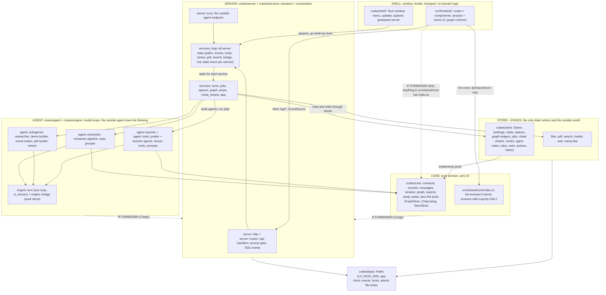
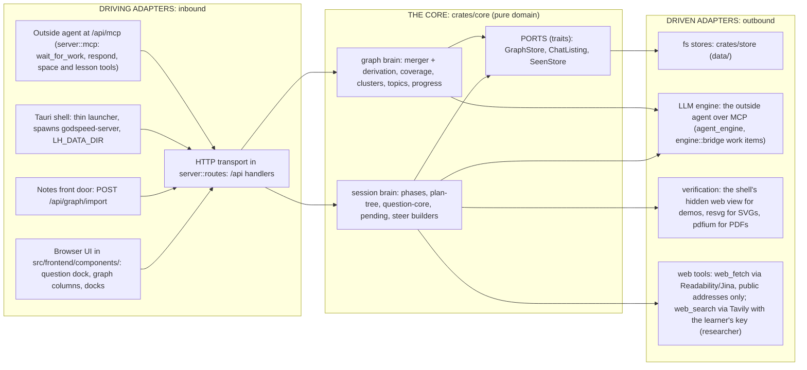
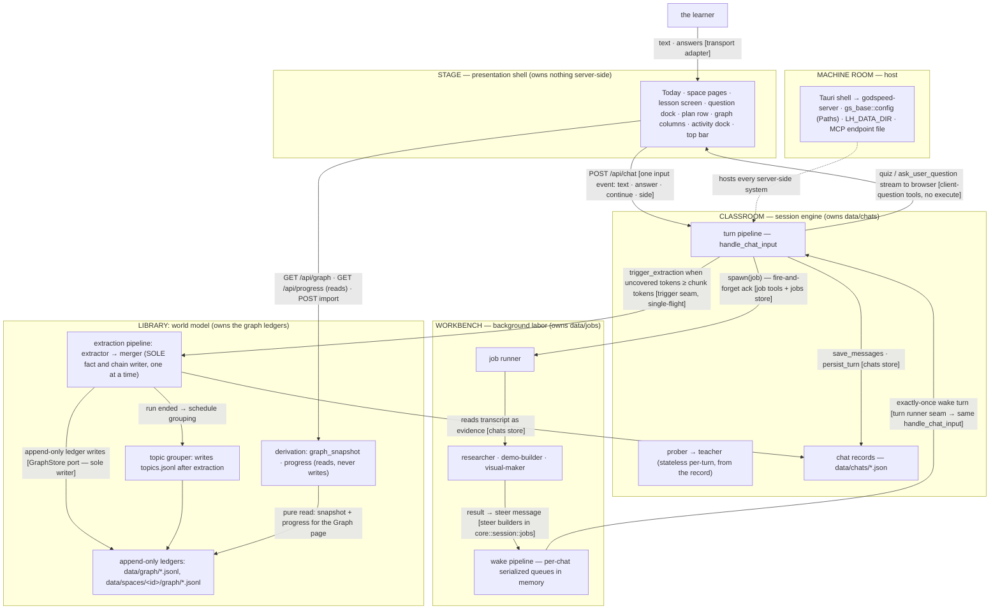
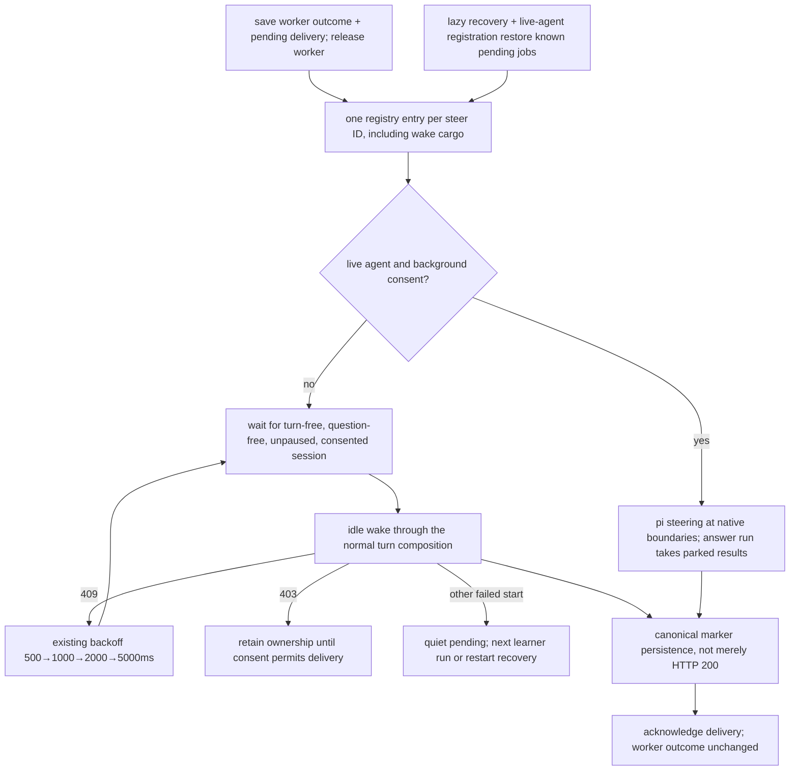
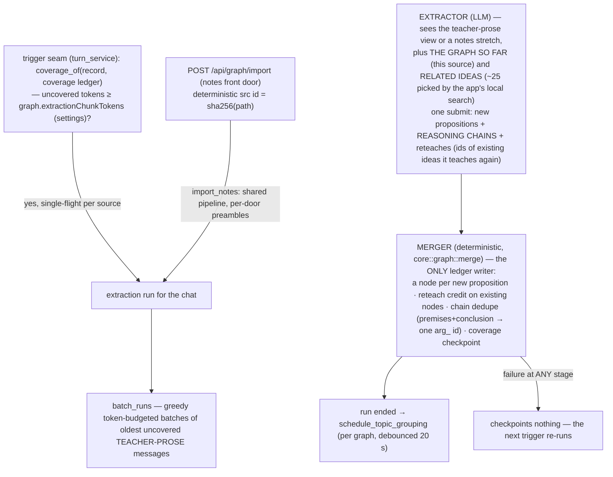
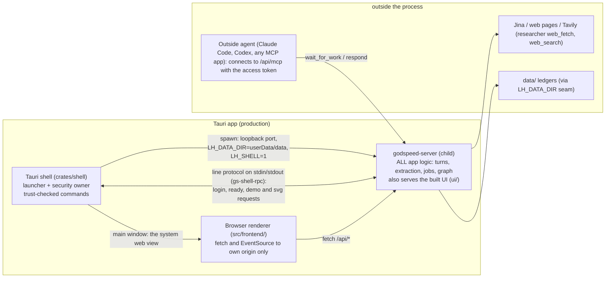

# godspeed — Architecture

Status: **the canonical architecture spec** for the app as built. When this file and the code disagree, the code is right and this file gets fixed. The file-by-file layout lives in [development.md](development.md).

**What this is.** A learning app (a Tauri desktop app with a Rust server): the learner's knowledge accumulates into a persistent, cross-session knowledge graph per space, built from tutoring sessions in which a teacher agent authors a formal, visible dependency tree (the plan tree) and verifies understanding with structured questions. Today (`HomePage`, routed in `src/frontend/routes/router.tsx`) shows what is coming up across spaces; each space's graph is drawn as a Graph page at `/graph`; the session is the classroom.

**Design principles, in priority order:**

1. **Maximum control.** Every dependency edge is explicit and machine-checked. Nothing reaches sideways for convenience.
2. **Easy editability.** A worker can trace any behavior to one file. Layers are named by responsibility, not by framework accident.
3. **Zero technical debt.** The shape you see is the shape that runs. Deprecated paths are deleted, not parked.
4. **Crystal-clear architecture.** One public door into the shared TypeScript core, two composition roots, one writer per store, named seams. When a rule can be a lint or Cargo rule, it is.

**The one-sentence model:** a pure domain core at the center; every external effect (fs, LLMs, browser, OS) behind an adapter at the edge; two composition roots as the only places the edges are plugged together; and every persistent store written by exactly one system.

---

## 1. Two axes, one law

Hold the architecture along two orthogonal axes:

**Static structure — the hexagon.** One pure core (`crates/core` on the server, `src/shared/core` for the browser); everything else is an *adapter* (implements a core port or drives the core) or a *composition root* (the only code that wires adapters to core). Dependency arrows point **inward only** — toward purity, toward stability. The browser reaches its core through one barrel, `@/shared/core`; the server crates reach theirs through Cargo.

**Runtime ownership — six systems.** Each persistent store has exactly one owning writer-system; systems talk only through named, idempotent protocols:

| System | Owns (sole writer) | Role |
|---|---|---|
| **Classroom** — session engine | `data/chats/*.json` | the turn pipeline, prober→teacher, plan tree, questions, phases |
| **Workbench** — background labor | `data/jobs/*.json` | job runner, researcher/demo-builder/visual-maker, steer delivery |
| **Library**: world model | `data/graph/*` and `data/spaces/<id>/graph/*` ledgers | extraction pipeline (sole fact and chain writer), topic grouping, derivation |
| **Spaces**: what the learner studies | `data/spaces/<id>/space.json` + `files/` + `cheat-sheets/` + `mocks/` | space records, space files, linked folders, deadlines (`services::spaces`, through the spaces store), cheat sheets (`services::cheat_sheets`) (§6.1), prep sheets and mocks (`services::preps`) (§6.2) |
| **Stage**: presentation shell | nothing server-side | src/frontend/components/, Today, the space pages, the lesson screen, docks; a pure consumer via `/api/*` |
| **Machine room**: host | process + config, `data/mcp-token`, `data/search-key`, `data/agent-notes.json`, `data/agent-seen.json`, `data/agent-rules.json`, `data/agent-actions.json` | Tauri shell, `godspeed-server`, `gs_base::config` (`Paths`), data-dir seam, the outside-agent boundary (§8.1) |

**The unifying law** (generates everything else): **imports point inward, writes point to append-only evidence, and everything else is derived.** Dependency flows toward purity; data flows toward evidence; no state is stored where it can be recomputed.

---

## 2. The layers and the import law

Dependency arrows point **down only**. Each layer may use the core; nothing skips a boundary for convenience.

Where the layers live: `src/frontend` holds what the browser runs (a Vite + React Router app: `index.html`, `main.tsx`, `routes/`, `components/`, `lib/`), `src/shared/core` the pure TypeScript logic the frontend uses, and `crates/` all Rust: the server `godspeed-server` (the crates `server`, `services`, `agent`, `engine` and the crates below them) and the Tauri desktop shell (`crates/shell`). The crate layout is the Layout table in [rust-server.md](rust-server.md).

```
┌────────────────────────────────────────────────────────────────────┐
│ SHELL    crates/shell/             Tauri window, menu, updater;   │
│                                    spawns godspeed-server         │
│          src/frontend/             Vite + React Router: routes/ and│
│                                    components/ (render only)      │
├────────────────────────────────────────────────────────────────────┤
│ SERVER   crates/server/            HTTP layer, /api routes, MCP   │
│                                    endpoint. Translates HTTP, zero│
│                                    business logic                 │
│          crates/services/          App (all server state) and the │
│                                    services: turns, jobs, spaces, │
│                                    graph, preps, cheat sheets, app│
├────────────────────────────────────────────────────────────────────┤
│ AGENT    crates/agent/             prompts, prober + teacher, tool│
│                                    surfaces, sub-agents, extraction│
│          crates/engine/            the turn loop and the work     │
│                                    bridge to the outside agent    │
├────────────────────────────────────────────────────────────────────┤
│ CORE     crates/core/              pure domain: contracts, records,│
│          src/shared/core/          messages, session, graph, spaces,│
│                                    study, preps. No IO. (The TS half│
│                                    is what the browser runs)      │
├────────────────────────────────────────────────────────────────────┤
│ EDGES    crates/store/             the data files, read and written│
│                                    by the stores                  │
│          files, pdf, search,       space files, PDFs, search,     │
│          media, web, transcribe    pictures, web pages, recordings│
│          crates/base, json         JS-compatible text, app clock, │
│                                    paths, events, locks; JSON     │
└────────────────────────────────────────────────────────────────────┘
```

**The import law** (`eslint.config.mjs` holds the TypeScript half, its sole job: one `import/no-restricted-paths` zone set to `"error"`, verified to fire, plus `import/no-cycle` over `src/`; `lint` is a gate on every change. Cargo holds the Rust half):

| Zone | May import | Rationale |
|---|---|---|
| `src/frontend/**` | `src/shared/core` only through the barrel `index.ts` (`@/shared/core`) | The UI renders domain data; it reaches shared logic through one public door and never touches IO |
| `crates/*` | only crates below it in the Layout table of [rust-server.md](rust-server.md) | Lower crates never import higher ones: each crate's `Cargo.toml` lists what it may use, and Cargo refuses a cycle. The shell depends on `gs-base` and `gs-shell-rpc` only, never on the server crates |



**One rule is documentation only.** The browser-safety of the core barrel is a doc-comment convention (see §2.1), not a lint rule. `tests/` and `scripts/` are deliberately outside the law (lint-excluded); tests import freely.

### 2.1 The core barrel and browser-safety

`src/shared/core/index.ts` exports browser-safe modules: pure logic and types, no fs, no network, no node builtins, and it is the only module `src/frontend` may import from the core. The server's logic (merger, derivation, coverage, study and progress rules) lives in `crates/core`; the TypeScript core holds what the browser runs (grading, plan statuses, usage folding, the event vocabulary, settings shapes, source marks and the like). A few rules exist on both sides, for example source marks (`src/shared/core/citations.ts` and `core::messages::citations`).

### 2.2 Contracts: one file per domain

`src/shared/core/contracts.ts` is a barrel over the domain files in `src/shared/core/contracts/`, the types the frontend codes against:

- `contracts/plan.ts`: plan tree types + derived statuses (`derivePlanStatuses`)
- `contracts/graph.ts`: graph domain (ledgers, findings shapes, snapshot, topics)
- `contracts/chat.ts`: session records, the usage channel, handoff text
- `contracts/jobs.ts`: the ack-and-steer protocol: job records, steer message builders, deterministic steer ids, usage accumulation
- `contracts/probe.ts`: probe assessment + the shared schema
- `contracts/space.ts`: space records, space files, deadlines, signatures and icons
- `contracts/prep.ts`: prep records and sheets
- `contracts/boot.ts`: the `GET /api/boot` payload

On the server, records are `Json` (see [rust-server.md](rust-server.md)); the constants and guards they share live in `core::contracts` (`chat`, `space`, `graph`), and the rest of the contract functions sit with the logic that uses them (`core::session`).

---

## 3. Stores, ports, and the composition root

Storage is **per-entity**, never one generic interface. `Stores` (`crates/store`, built once in `App::new`) holds one store per kind of data file: settings, prompt overrides, agent notes, agent rules, agent-seen marks, the activity log, the access token, jobs, graph ledgers (`GraphStores`, one `GraphStore` per graph folder), chats, spaces, cheat sheets and mocks. They contain persistence and nothing else. Three narrow traits in `crates/core` let pure code work against storage: `GraphStore` and `ChatListing` (`core::graph::ports`, with an in-memory version in `core::graph::memory` for tests) and `SeenStore` (`core::records::agent_seen`, implemented by the agent-seen store). Every other store is a concrete type.

**Idioms.** Graph evidence lives in **append-only JSONL ledgers** (corrupt-line-tolerant reads; strict shape guards drop invalid lines, never guess). Chats, spaces, jobs, sources, agent notes, agent rules, agent-seen marks, the activity log and the settings blob are whole-file read-modify-write JSON. Every write goes through the atomic writers in `gs_base::fsx` (temp file, then rename), and every read-modify-write takes a lock from `app.locks` first (keys: space, chat, graph scope, app file), so requests running in parallel never interleave. The job store keeps parsed records in memory while their file's modified time and size are unchanged, and `chat_version` (on the chat store) gives a lesson record's version the same way, so a cache of something derived from a lesson can key on it (the graded answers in `services::graph::progress`, the waiting-question check in `services::jobs::jobs`). Merge/dedup/derivation semantics are **reader-side, in core**: the store never decides.

- **`App` (`crates/services/src/lib.rs`) is THE composition root for storage and state**: `App::new` builds the stores and holds `paths`, `events`, `locks`, `stores`, `pdf`, `search`, `bridge`, one state struct per service area and the shell link when the desktop shell started the server. Routes and MCP tools get an `Arc<App>`. `graph_store_for(app, scope)` (`services::graph::graph`) hands out one `GraphStore` per graph folder (§6.1). `Stores::new` is the single place a storage decision (JSON vs SQLite, local vs remote) gets re-made.
- **`services::turns::chat_handler` is THE composition root for a turn**: it wires the stores, the job runner, the extraction pipeline and the engine into the turn (`set_turn_runner` / `set_job_respawn` register its seams for the wake pipeline). All logic lives behind the seams it calls.
- The agent layer takes its dependencies as arguments: `create_job_runner(host)` takes a `JobHost` (`agent::subagents::runner`), and `create_prober_agent` / `create_teacher_agent` take `AgentBuildOptions` (the engine, the prompts, the record's messages, optionally a tool registry). Tests inject the same hosts production wires, or swap an in-memory graph store.

The engine side is adapted too: `agent_engine` (`engine::turn::models`) is the ONE production engine, the outside agent (MCP). Its stream parks each model request as a work item in `engine::bridge`, and the connected agent takes it with `wait_for_work` and answers with `respond` (`server::mcp`). There are no model settings and no API keys: the agent picks its own model in its own harness. Chat records store pi's own message shapes (`core::messages::native_messages`), so a turn replays the record directly; `to_llm_messages` there turns app markers into model text and gives dangling tool calls an interrupted result. `engine::turn::ui_stream` streams the agent events to the browser as SSE, and `engine::turn::call_ids` makes tool-call ids unique at that boundary.



---

## 4. The six systems (runtime ownership and protocols)

The systems view: each box owns its store; edges are the protocols, each with the adapter/seam that implements it. (Spaces are left out of the diagram; see §6.1.)



The server-side systems are each the sole writer of their own store, connected by named protocols: the **turn request** (Stage→Classroom), the **ack-and-steer** loop (Classroom→Workbench→Classroom), and the **extraction trigger + transcript read** (Classroom→Library). Study and practice are not separate systems: they are lesson kinds that run in the Classroom (§7). The Stage touches systems only through the thin HTTP transport; the teacher reaches the Library directly through the gated prober tools (`list_sessions` / `list_propositions`) rather than any injected context.

---

## 5. The session (one chat turn)

`handle_chat_input` (`services::turns::chat_handler`) is plain Rust over `App`, with `AgentBuildOptions` as its test seam so tests drive it with scripted engines. The turn, in exact order:

```mermaid
sequenceDiagram
    participant B as Browser (lesson screen)
    participant R as POST /api/chat
    participant H as handle_chat_input
    participant L as turn_liveness (in memory)
    participant CS as chats store
    participant A as prober/teacher/practice agent (pi engine)
    participant F as end-of-turn seams

    B->>R: {chatId, input}: ONE input event (text · answer · continue · side; practice adds thinking · next)
    R->>H: handle_chat_input(req)
    H->>H: turn the input (or queued steers) into native record appends
    H->>L: begin_turn(chatId)
    Note over H,L: already running → 409; the client waits for that turn to end,<br/>then POSTs the same input again (gives up after 30 s)
    H->>CS: save_messages (write-ahead: persist even before the stream)
    H->>A: build agent from record (successful probe_done in the record ⇒ teacher)
    Note over H,A: the record IS the pi message list; to_llm_messages flattens<br/>markers and gives dangling tool calls an interrupted result
    A-->>B: SSE stream of pi agent events (ui_stream)
    Note over B: question tools only check input on the server and end the turn:<br/>rendered in the dock; graded client-side via question-core
    B->>B: QuestionDock: parse → shuffle (seeded) → buildAnswer (grade)
    B->>R: next POST with input {answer}
    A-->>F: turn ends
    F->>CS: persist_turn (canonical, idempotent) + append_turn_usage
    F->>F: trigger_extraction — if uncovered tokens ≥ chunk tokens, fire async
    F->>L: end_turn (ALWAYS last — the registry never locks)
```

- **Client-side question tools** (`probe`, `quiz`, `ask_user_question`, `explain`, `recall`, `write_code`) only check their input on the server and then end the turn (the "question posed" placeholder lives in memory and is never saved). The call streams to the browser, the learner answers in the dock, the client grades via `question-core` (or `code-question.ts` for code, which the teacher grades by reading) and POSTs the answer as an input event. The server saves it as the call's native tool result and the next turn runs. A pending question saved in the record is exactly what makes **resume mid-question free**. Deterministic seeded shuffling (keyed by toolCallId) keeps server and client renders identical.
- **Side questions**: while a question waits, a message from the lesson's one writing box, at the foot of the teacher column (`LessonBox` in `src/frontend/components/lesson/lesson-box.tsx`), is a side question, with pictures and PDFs like any message. The `side` input event (`core::messages::input_events`) is refused unless a question waits, and is saved as a user message with `side: true` (`new_side_question`, `core::messages::native_messages`); its files are stored like any learner message's. The question stays open: `dangling_question_of` looks past side questions and their replies, so the dock keeps the question. `is_side_turn` marks the reply turn (the newest input is a side question and the question still waits; a job result after it ends that): it keeps the same tool list so the outside agent still gets a small delta, but the question tools, `problem` and `conclude` refuse (`side_turn_tools` in `agent::teacher::teacher_agent`), and it takes no `today-context` note and no job results (`services::turns::chat_handler`), so nothing but the reply follows the waiting question. In the model's view (`to_llm_messages`), a question call gets a placeholder result right away, the side question follows as a plain user message (its pictures and PDF notes included, so the outside agent's work item lists its images like any other), and the learner's later answer (or skip) arrives where it happened as a user message. Earlier model views stay a prefix of later ones.
- **Open problems**: in every lesson kind (study, practice, homework) the open problem fills the teacher column's Your turn area (`OpenProblemPane` in `src/frontend/components/lesson/open-problem-pane.tsx`), with no writing box of its own. The learner works in the lesson's one box, and each message is a plain `text` input: their work on the problem or a question about it. It never ends the problem (`active_problem_of`); only the teacher's `conclude` or the learner's discard does, and the teacher may conclude and pose the problem the learner asked for in one turn. Lessons saved before this hold the learner's work as `practice-thinking` markers, which still read back (`projectView` in `src/shared/core/view.ts`, `to_llm_messages`).
- **The prober→teacher handoff** (older teach lessons; a study session has no prober and starts in teach, §7): the first turn(s) run the prober (floor/ceiling via quiz, goal via ask); `probe_done` (server-executed) files the assessment and queues a handoff steer; from the first `tool-probe_done` part in the transcript, the handler builds the teacher agent for every later turn. Phases (`core::messages::phases`) fold strictly: probe → plan → teach.
- **The formal plan tree is author-once**: the teacher authors the session's dependency map with a single schema-validated `plan_init` tool (a mermaid-subset graph, parsed deterministically with line-numbered errors, validated as a DAG). Progress is never mutated — statuses (`current`/`visited`/upcoming) are **derived** from tagged quiz, explain and problem calls in the transcript (a study session's tree is written by the app at birth, §7); the lesson's plan row (`src/frontend/components/lesson/plan-row.tsx`, its steps from `src/shared/core/plan-step-bar.ts`) and the plan blocks (layout in `src/frontend/components/plan-block-model.ts`) render that derivation.
- **Job tools are server-executed, ack-and-steer**: `research`/`demo`/`visual`/`pdf` resolve immediately mid-turn with a fire-and-forget ack (the teacher keeps teaching); `spawn(job, input)` fires the background runner.
- **Attachments**: a learner message (the lesson's writing box, side questions included, or Talk) and an answer in the learner's own words (explain, recall and ask questions, `answer_takes_files` in `core::messages::pending`; it is typed in the same writing box, so it uses the same button, tray, paste and drop) can carry up to 5 pictures and PDFs (`core::messages::attachments`, `services::turns::attachments`; the box's button, tray, paste and drop in `src/frontend/components/lesson/attachment-tray.tsx`). A picture is resized (long side at most 1568 px) and stored inline in the message. A PDF is saved in `data/chats/<id>/`, and the message gets a short note with the file's path. An answer's files follow its record in the question call's tool result (`new_answer_result`), so the model and the outside agent's work item (`imageFiles`) get them like a message's, and the answered card shows them. Limits: 20 MB per picture, 30 MB per PDF. Files waiting in a lesson's message box stay in memory (by lesson) until sent, so leaving the lesson and coming back keeps them; a reload drops them, and they never go in localStorage.
- **Space and date context**: a space lesson starts with a `space-context` marker (the space card, `services::spaces::space_card`). A hidden `today-context` marker tells the model today's date, time and time zone and the space's open deadlines. A new one is added before the learner's message when the day or the deadlines changed, or a compaction cut the last one out of view (`core::spaces::today_note`, `services::app::today_note`).
- Turn services are named seams taking explicit dependencies. Extraction contains its errors, but **canonical persistence must not fail silently**: a failed input write refuses acceptance without starting an agent; `persist_turn` fails on a failed reply write. The runner reports settlement failure before `[DONE]` and releases liveness even when normal settlement fails. Steer reconciliation uses the durable record, so a later bookkeeping failure cannot replay already-saved learner input.
- **Late attachment must still see settlement failure.** A small, memory-only notice per session precedes the settled stream terminal when the failing turn has already left the live registry. The next accepted turn, successful session deletion, or server exit clears it. Reopening seeds the existing banner from that notice and waits for ordinary learner input; dismissing the banner is not permission to automatically retry the model. No synthetic failure entry is added to the saved transcript.
- **Recovery never blindly resends an answer.** Submitted question drafts survive optimistic unmount in memory; the existing Submit action reconciles uncertain acceptance against the canonical record and running-turn state before sending again. EOF or a rejected stream read without a terminal triggers one read-only reattachment; another transport failure shows the existing error banner rather than claiming completion. Explicit completion, cancellation, and the literal-final-entry saved-error rule remain unchanged.

### 5.1 The wake pipeline (Workbench → Classroom)

**Worker completion and session delivery are separate lifecycles.** Dispatch persists the tool input on the job before spawning. On completion, the runner saves its result, terminal worker status (`done`/`error`), and `delivery: {kind: "result", status: "pending"}` in one job-record update. It then queues the native custom **steer message** without awaiting delivery. Its content is model-facing text; details carry the UI artifact. Worker resources are released and the Background agents row disappears even if an unanswered question holds the result indefinitely. Dispatch cards say “finished,” not “delivered.” Only computing workers can be aborted; abort saves an independent pending abort notice.



The per-chat registry retains ownership across live handoff, idle-wake flight, and 409/403 return; repeated submissions share one entry/promise. A deterministic marker ID in the **saved conversation** completes delivery. Streaming visibility alone does not. A failed bookkeeping acknowledgement cannot replay a saved marker, and later teaching/model failure does not reopen delivery or retry the accepted turn. Failed starts leave results durably pending without a new error UI or retry timer; the in-memory entry stays parked until a learner run or process restart. Normal question/dismissal waits and consent deferrals are not failures.

Recovery reads saved job input before legacy transcript lookup. Missing research questions fail honestly without invoking the researcher. Legacy running jobs with saved results become finished workers with pending delivery; legacy terminal jobs without delivery metadata remain untouched, rather than guessing that old outcomes should be replayed. Pending result and abort notices are restored before a newly registered agent's first steering poll, even without a preceding jobs-feed read. Deleting a session discards its pending delivery obligations; only live turns and computing workers block deletion. These guarantees use the existing JSON storage and single-process delivery registry, not a transactional queue or a promise of exactly-once model execution.

Sub-agents **verify, never one-shot**: the demo-builder runs its HTML in the desktop shell's hidden web view before delivery; the visual-maker renders each SVG and looks at it (the connected agent must accept images).

---

## 6. The knowledge graph — two channels, one writer

**The extraction pipeline is the sole writer of facts and chains.** Nothing else appends to a graph's `nodes.jsonl` or `chains.jsonl`: not the teacher, not the server, not a migration script. Two other writes exist, both named: deletion (`core::graph::graph_deletion`) rewrites the ledgers when the learner deletes a fact, deletes or moves a lesson, or removes or rebuilds a space file; and the topic grouper appends to `topics.jsonl`.



**The extractor reads only teacher prose.** It sees the session's teacher prose: plain paragraphs under the session title, no learner messages, no thinking, no tool calls or results, no quiz blocks. Coverage fingerprints, slot tokens and batch budgets all derive from that same selection (`message_view_lines` in `core::graph::coverage`), so "covered" is exactly "what the extractor saw": a quiz answer or learner edit can never open a run, and only a teacher-prose edit re-opens its message. Batching is a plain greedy fill. `core::session::session_markdown` renders the full session for the lesson menu's markdown export (`GET /api/chats/{id}/markdown`) and the MCP `read_lesson` tool; extraction doesn't use it.

**Propositions and reasoning chains.** The extractor's deliverable is propositions + reasoning chains. A chain is premises that JOINTLY entail a conclusion: independent arguments for the same conclusion are separate chains, conclusions are reusable by id as premises, and a bare proposition rides the propositions list alone. The wire schema carries propositions (id/name/statement/optional aliases) + chains (premises minItems 1/conclusion), and the store carries exactly that shape: chains append as-is to `chains.jsonl` (there is no translation seam). No typed edge is stored anywhere; every arrow is derived from a chain. The chain laws are enforced by an error-back hook at the submit seam: every premise/conclusion id must resolve to a submitted proposition or an existing idea, premises are non-empty, no self-reference. A violation returns an error string and the model re-submits within its turns. The prompt is goal-first: one shared `EXTRACTION_CORE` (the goal, the truth law, the submission mechanics) plus a short session or notes preamble (`SESSION_PREAMBLE`, `NOTES_PREAMBLE`), assembled in `agent::extraction::findings`, so both front doors share the core. The submit agent heals stringified payloads before validation (`heal_encoded_arguments` in `core::session::argument_heal`, called by `agent::extraction::submit_agent`). Every node is an objective, world-facing fact. No quiz outcomes or understanding assessments are stored. How well the learner knows a fact is derived at read time from lesson answers (`GET /api/progress`); nothing ever writes learner states back to the graph.

**Digest-aware serialized extraction: the extractor is the assembler.** When a source already yielded material, each stretch's extractor prompt carries **THE GRAPH SO FAR** (that source's merged propositions and chains, ids verbatim), and the extractor builds on it: it references existing ids instead of restating them and leans on established conclusions as premises. Chains may therefore span stretches: endpoints are a mixed namespace of fresh local ids OR existing `n_` ids (validated at the submit seam, error-back; the merger's job-local map passes existing ids through verbatim). The prompt frames the goal as uncovering the source's **core ideas** and showing how everything **derives from the foundations**: direction upward, prefer lean derivations, never re-derive what the graph already holds. Because each stretch must read every earlier merge, a source's batches/chunks run **STRICTLY IN ORDER** (serialized per source). The first stretch of a source runs bare (no digest).

**Chain simplification: the merger's maintenance pass.** The same conclusion often arrives from many angles — `[A,B]⟹X`, `[X,C]⟹Y`, and then `[A,B,C]⟹Y`, which adds nothing. At every merge, `simplify_chains` (`core::graph::simplify`) walks the WHOLE chain ledger and drops provably redundant chains: a chain is redundant when its premises already derive its conclusion through the other kept chains (forward closure: start from its premises, add the conclusion of every kept chain whose premises are all known, and see whether its conclusion turns up). Chains with the most premises, then the newest, are checked first, so the leanest, earliest derivation stands, and a chain already dropped never helps derive another, so two chains that derive each other never both go. `[A,B]⟹X` + `[X,C]⟹Y` make `[A,B,C]⟹Y` redundant, while `[A]⟹Y` next to `[A,B]⟹X` + `[X]⟹Y` stays (A alone never reaches X). Same-(premises, conclusion) lines are one logical chain — a key drops with every provenance line. The rewrite rides the merge's audit-locked critical section (atomic `rewrite_ledgers`); run stats count the drop separately (`droppedChains`) so appends and maintenance never blur. Simplification runs at merge time because a NEW chain can make an OLD one redundant — nothing is retroactively re-derived, only provable redundancy is removed.

**Per-part jobs, one at a time** — every part (a notes stretch) and every batch (chat coverage) is its own JOB: registry row, usage record, failure domain. Extract + merge for every job runs inside one process-wide graph lock (`with_graph_lock` in `agent::extraction::extraction`): the extractor reads the live graph (its own source's findings and the related ideas), so two at once would each miss what the other is adding and mint duplicates. A job waiting for the lock shows the `waiting` phase. A source's parts run in order. Failure isolation: one job failing (bad part, degraded model output) is absorbed; its messages stay uncovered and re-runnable while its siblings still merge, and the run returns what actually merged. Abort is source-wide: the serial loop stops at the first AbortError (also while waiting for the lock), and merged jobs keep their checkpoints. The status feed shows one row per job (`file.md (2/5)` suffixes for parts), and each job persists its own usage record (failed jobs bill their partial spend too).

**Identity without a second model call.** The extractor is the only LLM stage and the only one that sees the source. Before each part, the app's local search (`related_facts`, the hybrid embedding + BM25 search in `crates/search`) picks the ~25 existing ideas that best match the part's text, and the prompt lists them as RELATED IDEAS (`id | name | statement`) next to THE GRAPH SO FAR. An idea either list already holds is never submitted again: the extractor references it by its `n_` id in chains and lists it in `reteaches` when the part teaches it. The merger (`merge_findings`, deterministic) then appends: every new proposition becomes a node; each valid `reteaches` id gets a credit line (this source's provenance, the node's own name and statement) so the source counts toward that idea; chains resolve through the job-local id map (existing `n_` ids pass through verbatim) and dedupe by (sorted premises, conclusion), so a known argument re-asserted elsewhere appends under the SAME `arg_` id with provenance unioned; then the chain-simplification pass runs and coverage checkpoints. The submit seam rejects `reteaches` ids that are not existing ideas, and chains whose ids resolve to nothing; the model re-submits within its turns. Duplicates the search misses stay as separate nodes.

**Coverage, not quiz-counting.** Each message's *view* (the compact line format `core::graph::coverage` has always hashed) is hashed into a per-chat fingerprint ledger (`coverage.jsonl`); "covered" means exactly "a run committed on this content." The prompt view is the richer markdown document, kept apart on purpose: re-formatting presentation never re-opens covered history. Uncovered = fingerprint diff, never dual-tracked; runs are greedy token-budgeted batches (`graph.extractionChunkTokens` — a settings knob, default 4096, floor 500, read fresh each turn) of the oldest uncovered messages — quiz-less sessions extract too. A coarse `sessions.jsonl` checkpoint still marks each merged run. The trigger seam (`trigger_extraction` in `services::turns::turn_service`) is trigger-agnostic from the pipeline's side: when a better mechanism lands (session end, idle, explicit flush), only the seam changes. Single-flight per source; the run registry (`agent::extraction::extraction_runs`) powers the activity feed, the coverage UI and true abort.

**Two front doors, one pipeline**: chat transcripts (coverage-triggered) and notes and space files (`POST /api/graph/import`, the `import_notes` MCP tool, or a space's file pipeline; each file becomes a `NotesSource` playing the `chatId` role, deterministic id from the path hash). Every explicit "No space" re-import processes the whole file again and adds to that source (`contentFp` in old source records is ignored). Space files are different: each has a space-unique source id (`src_` + hash of space + file id), and a changed or removed file has its old facts removed first (`delete_source_traces`, the delete-nodes law applied to a source) before re-extraction. Notes chunk like chats: large files split at line boundaries under the same token budget, and each chunk runs as its own job exactly like a chat batch — in order per source, one job at a time under the graph lock. No single model call carries a whole file. Both submit tools require their top-level fields (`propositions`, `chains` and `reteaches` present even when empty): a payload missing them fails validation rather than silently merging structure-less nodes.

**The read channel is pure derivation.** `GET /api/graph` and `GET /api/progress` read the ledgers and never write. The stored truth is propositions (`nodes.jsonl`) + reasoning chains (`chains.jsonl`). `graph_snapshot` merges the ledgers, then `derive_view` (`core::graph::graph`) rebuilds a view on every read: each stored chain becomes an implication node (id = the chain's `arg_` id, name `⟹`) with arrows premise→implication→conclusion; a chain whose member was deleted drops. Two independent arguments for one conclusion (`A∧B⇒E`, `C∧D⇒E`) stay two implication nodes, never one merged `A∧B∧C∧D⇒E`. Clusters are the birth-session partition over propositions (`birth_session_partition`, `core::graph::session_clusters`); the chain table groups chains by them.

**Deletion is full death, cascade-aware.** Deleting a proposition kills EVERY stored chain that references it, premise or conclusion. Deleting an implication node (any `arg_`-prefixed id) deletes exactly that ONE stored argument and nothing else. The same confirm dialog (`src/frontend/components/delete-node-dialog.tsx`) opens from a fact's right-click menu in the topic panel and from the chain table's Delete.

**The teacher probes, nothing is injected.** The teacher reaches the graph on its own terms through two read-only prober tools — `list_sessions` (birth sessions, the learner's files) and `list_propositions` (the names of what a session covered) — gated by the `agent.graphTools` setting (composing with `graph.enabled`). No topic embedding, no top-K selection, no session-start steer; the agent decides what to look at, and the graph never writes into a lesson unbidden.

**Rendering**: `/graph` shows the topics as level columns (`src/frontend/components/graph/level-columns.tsx`): one pane per level (a topic's `column`, its prerequisite depth), each topic a row with one square per fact in its right rate's color, no lines and no zoom. A picked topic marks what it needs (←) and leads to (→). The right side keeps the next deadline on top (`side-panes.tsx`); under it what to work on next, the picked topic (`topic-pane.tsx`), or the picked fact (`fact-pane.tsx`: its answers, the file or lesson it came from, and the facts it builds on and leads to, from the graph snapshot's chains). The topic grouper (`agent::extraction::topic_grouper`, scheduled by `services::graph::topics`) groups a graph's facts into topics, labels each topic's material (term, procedure, concept or proof; optional, so older snapshots have none) and appends a full snapshot to `topics.jsonl`. A topic that keeps an existing id across a regroup keeps its stored material (`repair_topics`, `core::graph::topics`). Nothing about the layout is stored.

---

### 6.1 Spaces — one graph per space

`GraphStore` is built per graph folder (`GraphStores` in `crates/store`); the composition root hands out `graph_store_for(app, scope)` (`services::graph::graph`) (null = "No space" = `data/graph/`, a space id = `data/spaces/<id>/graph/`). The extraction pipeline resolves its target per source (from the source's space), so the one writer still writes, now into the lesson's or file's own space graph. Reads may cross spaces (the prober's map tools take `graphs`), writes never do (`merge_findings` writes only the own graph). Space orchestration lives in `services::spaces` (the file pipeline and the linked-folder scan every 60 s in `pipeline`, lifecycle and cascade delete in `lifecycle`); the space card is `services::spaces::space_card`; lesson birth is `services::turns::lessons`.

**Space files.** A file is `study` (turned into facts) or `info` (the teacher can read it with `read_space` / `search_space_files` / `read_passage`, but it never becomes facts). A linked folder adds every supported file in it, up to `MAX_LINKED_FILES` (500). Supported: plain text and code files read as they are, text files with no extension (checked by their bytes), PDFs (`crates/pdf`), Word and PowerPoint files (`crates/files`, `office`, a small zip reader, slides headed like PDF pages), captions and recordings. A new linked file takes its name series' kind, else study; while reading a study file the agent also says when it is logistics (`import_notes` with `may_be_space_info`, decided on the first stretch at no extra call), and godspeed switches it to info (`sortedAsInfo`). A kind picked by hand (`kindChosen`, and every file added by hand) is never sorted. Recordings are transcribed locally with whisper.cpp (`crates/transcribe`), except one whose lecture transcript is already in the space (same date, or same lecture number, in the names: `core::spaces::lecture_transcript`): it is never read, has no facts of its own and records the transcript as `transcriptId`, and it is transcribed after all if that transcript goes. A linked folder that times out (Google Drive paused or offline) shows "not responding" and keeps its files, like a missing one. Files a linked folder holds that can't be read (Google Docs links among them) are counted in the folder status and named on the Files page. The work of reading a study file is a background work item for the outside agent: nothing is extracted until an agent is taking work.

**The teacher's work on a space.** While study files wait to be read, the space says so where the learner already is: a frame around the page of every tab (`src/frontend/components/work/`), a strip on Today, a tag on the space's tab in the top bar ("15 left") and a second line under Talk's "Created <space>" row. A space the teacher makes from Talk opens by itself (the action's `open`, as for a lesson started from Talk). The record remembers the newest round of work as `lastWork` (`core::spaces::space_work`, applied by the spaces store on every file write): a round opens when a study file starts waiting, collects each file that finishes or fails and each deadline added meanwhile, and ends when none waits. The frame then shows what the round made until the learner closes it (`DELETE /api/spaces/{id}/work`), new work starts, or a day passes. The list of spaces carries `filesLeft` and `building` for Today and the top bar.

**Source marks.** The teacher marks what it read from a space file with a source mark right after the sentence: `[[f_1a2b3c4d5e6f:7]]` (a passage id from `search_space_files` or `read_passage`), or `[[https://example.com/page]]` for a web page. The server checks every mark in the `respond` tool before the reply is stored (`services::spaces::citations`). A passage mark whose passage exists is stored as `[[<file id>/<range>/<file name>]]`, for example `[[f_1a2b3c4d5e6f/p. 12/Week 6 slides.pdf]]`, which still points at the right place after the file's passages are renumbered. A mark whose passage doesn't exist is removed, and `respond` tells the agent which ones. Cheat sheet replies are checked the same way, and a reply with a bad mark is sent back to the agent (a quote that does not hold is dropped there without a word). Web marks are stored as written. A mark may quote a few words of its passage, `[[f_1a2b3c4d5e6f:7 "degree 12"]]`: the quote is stored with the mark (`[[f_1a2b3c4d5e6f/p. 14/Lecture 6.pdf|degree 12]]`) only when it is 2 or more words or one code expression, at most 80 characters, free of `[ ]`, backticks and `$`, and found exactly once in that passage (`core::messages::quote_find`; spacing, a word split at a line end, ligatures and curly quotes don't matter). Otherwise the quote is dropped, the plain mark stays, and `respond` tells the agent why; in `topic_done`'s `opener.lead` such a quote refuses the call. The browser turns stored marks into numbered buttons after the sentence and a Sources list under the message (`src/frontend/components/citations/`); a space file source opens a popup with the PDF page as an image or the passage text, a web source opens the page. Two routes feed the popup: `GET /api/cited/<file id>?range=<range>&quote=<words>` returns `{name, range, page, text, marks}` (`page` is the PDF page number when the file is a PDF still on disk and the range names a page, else `null`; 404 when no space has the file, or when it isn't a PDF page and no passage is at that range). `marks` says where the optional quote sits, or is `null` without a quote or when it is not found exactly once: on a PDF page `{kind: "page", boxes: [{x, y, w, h}]}`, one box a line as fractions of the page image from its top left, found on the page's own text (cached beside the page images); in a text or code file `{kind: "lines", first, lines, spans: [{line, start, end}]}`, the 12 lines of the file centred on the quote's first line, read from the file itself, with the quote's place on each line in UTF-16 units; anywhere else (.docx, .pptx, transcripts) `{kind: "passage", start, end}`, UTF-16 offsets in `text`, and `GET /api/cited/<file id>/page/<n>` returns that page as `image/png`. File ids are unique across spaces, so the routes need no space id. Readers of plain text (the Markdown export, fact extraction) get the mark in words, like ` (Week 6 slides.pdf, p. 12)`. The pure parts (reading, rewriting, numbering, labels) are in `core::messages::citations` (the browser has its twin in `src/shared/core/citations.ts`); marks inside code and math are left alone. A Study topic's page, the quoted mark its excerpt is drawn from, is the first quoted mark in the shown opener's lead, else in the reply that opens the topic (`core::study::topic_parts`, twin of `src/shared/core/topic-parts.ts`; both replay `crates/core/tests/golden/topic_parts.json`).

**Deadlines.** A space can have deadlines (`SpaceDeadline` in `core::contracts::space`): kind `exam`, `homework`, `quiz` or `project`, a name, a due day, an optional time on the learner's own clock, the study files it covers, and a done flag. The learner edits them on the space's Deadlines tab; an outside agent edits them with `add_space_deadline` (a list at once) / `update_space_deadline` / `remove_space_deadline`. `GET /api/deadlines` lists every open deadline for Today. `GET /api/progress` turns a deadline's files into days left, a ready percentage and a "Work on next" list for the Graph page. The teacher sees them through the `today-context` marker (§5).

**Cheat sheets.** A deadline's header has a Cheat sheet button that opens its studio (`/space/deadline/<id>/cheat-sheet`). The agent makes the sheet as a real PDF with its own tools (LaTeX suggested) and godspeed shows that file as it is. The record is `spaces/<id>/cheat-sheets/<deadlineId>.json` (`store::cheat_sheets`, format 4, removed with its deadline): the last 5 versions (each a PDF in `<deadlineId>-versions/v<n>.pdf` with its page sizes and the message that made it, or marked as taken from the working folder), the sheet's chat (the last 100 messages), the sheet's rules, and the name of its working folder. Pictures and PDFs sent in the chat sit in `<deadlineId>-files/`, named by their content. Format 3's prompts read as the chat's first messages; an HTML (format 2) or block (format 1) sheet can't become a PDF without the agent: it keeps its asks and the studio offers Make it again (`core::study::cheat_sheet`).

Each chat message is one background work item (`sheet_reply`, `agent::subagents::cheat_sheet_writer`) like the topic grouper, not a chat kind, so lessons, Talk, search and extraction never see it: the request carries the deadline's topics with readiness and a few facts, the mistakes from practice, the sheet's rules, the working folder (`<godspeed folder>/cheat-sheets/<space> <deadline>/`, where the agent keeps its source so a change edits it), the last 8 messages, and the message itself: the learner's words and files, and the part of a page they pointed at (its picture first). The agent answers in markdown, and when it changed the sheet sends the new PDF's path and any rules the learner set (`new_rules`); its instructions ask it to render and look at every page, check the page count and size and check each formula against the space's material before sending. godspeed takes a PDF only from inside that folder (links resolved), checks it (a PDF by its bytes, 20 MB, 1 to 4 pages of 2 to 17 inches) and copies it into its data (`services::cheat_sheets::cheat_sheet_pdf`). Opening a sheet also takes the newest PDF in its working folder when it was written after the current version (an edit outside godspeed), after the same checks, as a version "From the working folder", once per file. The studio is a canvas (`src/frontend/components/cheat-sheet/`): every kept version's pages as artboards, newest first, drawn by pdf.js in the browser (worker and data served at `/pdfjs/`, outside `/api`, `server::http::ui`), each page drawn whole once and the part on screen again at the screen's resolution once the view settles, so it is sharp at any zoom. Point at the sheet draws a box on a page; that part is drawn from the PDF as a picture and goes with the next message. The chat floats on the right (`sheet-chat.tsx`): the sheet's rules with a remove ✕, the messages, "Made version N" rows that show that version on the canvas, Stop and Try again, and a box with math, pictures and PDFs and a kept draft. In a lesson, study or practice session of a space, the top bar's Cheat sheet button docks the sheet beside the session (`sheet-dock.tsx`, resizable, open state and pick kept per session): the session's deadline's sheet, else the space's next one with a sheet, with a picker when there are several, the current version fit to width. The docked sheet has no chat: questions about it go to the teacher in the lesson's writing box. Print draws the PDF's pages at 300 dpi into print-only pictures at the PDF's page size; On the desktop, Show in Finder reveals the PDF in its working folder (the agent's own file while it is still that version, else godspeed's copy written there as `cheat sheet v<n>.pdf`, through `window.lh.showInFolder`); a browser gets a download link. A space's Cheat sheets tab is its page (`/space/cheat-sheets`, `GET /api/spaces/<id>/cheat-sheets`): every deadline as a card, coming up first, then past, saying whether its sheet is made (a preview of page 1 drawn by pdf.js once the card is in view, its paper and when it was made), being made, older (Make it again) or not there (Make one).

### 6.2 Preps — a space made to get ready for one thing

**Preps.** A prep is a space with a `prep` on its record (`SpacePrep` in `core::preps::prep`; space format 10): what the learner is getting ready for in their own words (an interview round, an online assessment, a test), an optional day, and the prep sheet the teacher writes. "Prepare for something" in the app menu opens the start screen (`/prep`, `src/frontend/components/prep/prep-start.tsx`): one box, an optional day and optional files (a job posting, an email, a resume), which are kept as the space's info files. `POST /api/preps` makes the space (`create_prep` in `services::preps::preps`) and asks the teacher for the sheet: one background work item on the single-submit seam (`write_prep_sheet`, `agent::subagents::prep_writer`), like the topic grouper, so lessons and Talk never see it. The agent looks the thing up with its own web search, reads the attached files and sends what it is like, the pages it read, the topics to study in order and what one mock is (questions and minutes). The rules of a sheet are pure (`core::preps::prep`): a topic that keeps its name keeps its id (`pt_` + 8 hex) when the sheet is written again, so its track record stays, and a topic with answers that the new sheet leaves out or renames stays at its end, so no answer stops counting.

A prep's `/space` page is the prep sheet instead of Progress, and its tabs are Prep sheet, Mocks, Lessons and Files (`PREP_TABS` in `src/frontend/components/space-page/space-head-model.ts`). A topic's id is the plan node of study sessions on it, so each topic's status comes from the answers tagged with it, in lessons and in mocks (`prep_topic_progress`), and a weak one whose newest answer was not right is "latest wrong" as on any space topic (a mock's answers count from when it ended); nothing is written back. Study on the sheet starts a session on the three topics that most need work and a topic row starts one on that topic (`create_lesson` with `prepTopicIds`). The learner adds and removes topics, changes the day and asks for the sheet again on the page (`/api/spaces/{id}/prep`); every edit is one pure function (`with_edits`), which the teacher's `update_prep` tool in Talk and over MCP uses too. Lessons in a prep open with a space card that says what the learner is getting ready for and what it is like. A prep with a day has a row on Today.

**Mocks.** A mock is one timed run of questions like the real thing (`core::preps::mock`), saved as `spaces/<id>/mocks/<mockId>.json` (`store::mocks`, format 1, removed with its space). `services::preps::mocks` is its one writer, and a prep has at most one unfinished mock. It asks the teacher twice, each a background work item (`agent::subagents::mock_writer`): `write_mock_questions` when it is made (every question at once, each tagged with the sheet topic it tests) and `grade_mock` when it ends (every answered question at once). In between the clock runs with no agent: the page (`/space/mock/<spaceId>/<mockId>`, outside the space layout so nothing else is on screen) saves answers as the learner types (a code answer keeps what is written in each language, so switching and a reload lose nothing, and its `text`, the one graded and shown on the results, is the code in the language picked, or in the one written in when nothing is written in the picked one; `with_answer`), and a mock whose time ran out while nobody was looking is ended the next time it or its prep is read, or an answer or run reaches it (refused with "Time is up." past a 10 second grace for the page's last save; `services::preps::mock_end`). The state (writing, ready, running, grading, graded) is derived from the record. A mock with nothing answered is graded without asking.

A code question names one function and gives 2 to 6 examples as JSON, so "Run examples" can check it in JavaScript or Python. `core::preps::mock_run` builds the program (the learner's code plus a few lines that call the function on each example and print one marked line) and reads what it printed; `services::preps::mock_runner` saves it to a folder of its own in the system temp folder and runs it on this computer, with the computer's Node or Python (the py launcher first on Windows, Homebrew's first on a Mac, and never a stand-in that only opens an installer), with nothing to read on its input, for at most 5 seconds and 1 MB of output and without godspeed's own `LH_` settings (the desktop key among them), then ends every process in the run however it ended (it leads its own process group, ended whole; on Windows its process tree, with `taskkill /T /F`, only while the program runs; a run whose request goes away is stopped too; a process that starts its own session or group leaves it and is not ended, which only a sandbox could stop) and removes the folder. The program calls only a function the learner's code defines, never a built-in of the same name (`eval`, `exec`, `open`), so the teacher's examples can't run as code the learner never wrote, and a function name may not start with `__` or be `require`, `module` or `exports` (`take_questions`, and a saved mock is read the same way). The route runs code only while that mock's clock is running. The grading request carries how each code answer did on its examples. Graded questions count for their topics (right is right, blank is "I don't know", anything else is wrong), and "Go over it" on the results page starts a study session on that question (`create_lesson` with `mockQuestion`: the question, the learner's answer and the grade go in under the study plan). Follow never takes the window off a mock page unless the learner asked to go (`src/frontend/components/teacher/follow.ts`).

## 7. Study sessions

Every new lesson is a study session (`kind: "study"` on the chat record). The learner starts one from "Study something new" on a space's Lessons tab (the study page, `/new`: "Study for <deadline>", the topic box or its suggestions), Start on a Today row or Study on a deadline page (today's planned topics, then the strong ones not answered for a week), "study these N" / "study <topic>" / "practice this fact" on the Graph tab, Study on the Progress tab, Study or a topic row on a prep sheet, "Go over it" on a mock's results, or with "Start from facts" (the chain table in select mode, `src/frontend/components/home/facts-picker.tsx`). The MCP `start_lesson` tool starts one too. Older `teach` and `practice` lessons keep working with their own agents.

`create_lesson` (`services::turns::lessons`) writes the opening markers. The picked facts become a `graph-context` marker through `chains_for_selection` (`core::graph::chains`): a stored chain is included when its conclusion and every premise are picked, and a picked fact in no included chain stands alone. The picks are grouped into topics in space order (`core::study::study`), each with its material when it has one and the learner's standing on it: its status (untested, weak, shaky or strong), with "(latest wrong)" on a weak topic whose latest answer was not right, as in "procedure, weak (latest wrong)". A typed topic with no picks is one untested topic with no material. The move for each pair is a table in `crates/agent/prompts/study/10-study.md`, so a prompt override can change it. They go into a `study-context` marker, and the app saves the matching plan tree, so the plan row and its popup list the topics from the start.

A session started from a deadline records it on the chat (`deadlineId`). While the latest such session is unfinished (it has not reached its end, and its plan has not reached its last topic unless it waits at a stop), that deadline's Study button reopens it as "Continue studying, 1 of 4 topics" instead of starting a new one (`core::study::continue_study`; the progress payload carries it as `continueStudy` on the deadline, read from the cached lesson readout in `services::graph::progress`).

The study agent has the teacher's prompt and tools, without the deadline changes (Study sends those to Talk), plus `problem`, `conclude` (`agent::tools::practice`; `problem` carries the topic's `nodeId`), `topic_done` and, in multiple-choice lessons, `plot`, the practice hint rules (`prompts/practice/20-hints.md`) and `prompts/study/`. There is no prober, and the tool list is the same every turn; a posed problem ends the turn. The learner's work on a problem is saved as plain user messages (`practice-thinking` markers in lessons saved before that), and `practice-next` / `problem-dismissed` mark moving on or skipping. A study session is extracted into the graph like a teach lesson; older practice sessions never are.

**Questions from earlier.** godspeed asks some earlier topics again by itself and the window grades them, so no agent is woken. The schedule is `core::study::review`: a topic he got right comes back after 2, 4, 8, 16, 32, then 64 days of rest, a miss brings it back within 4 days, and an open deadline that covers the topic shortens its rest to a third of the days left (never under 2). A question is a stored `topic_done.review` or a Study `quiz` with `standalone: true` that he answered right; one shown in the last 7 days, the one missed the last time, and one skipped in this sitting are never asked. At most 3 a local day per space. They show only in a Study lesson of a space, in a sitting's first wait (its start, or after his first input on a return, until the teacher's reply lands) while a turn runs or no agent is teaching, with no question, problem, opener or stop open. An answer is a UI-only `review` marker (`{of: {chatId, messageId, toolCallId}, nodeId, topic, quiz, answer, sitting, kept?}`, the quiz copied, and `kept` the sentence he kept on that topic that was shown longest ago, below); his next input carries one hidden `[From earlier]` line for the answers since the last one, and progress counts each answer for the quiz it came from, and the activity feed like any quiz answer of the lesson. Ask Teacher on one sends `text` with `about: {reviewOf: {chatId, toolCallId}, picked?: [label]}`; a note before his message carries the question, its options, his pick and the explanation, and the question stays open (400 `That question from earlier is not open` when it is not). While the teacher's own question waits behind it, his message is written as a side question, so that one stays open and is posed again.

**The plot.** In a multiple-choice Study lesson the teacher can send `plot` (`agent::tools::plot`): one or two lines over x with one slider, written in plain math (`min(a, 4/(1+lambda))`), never code. The grammar is `core::session::plot_expr`, twin of `src/shared/core/plot-expr.ts` (both replay `crates/core/tests/golden/plot_expr.json`): numbers, the x and slider names, `pi`, `e`, `+ - * / ^`, brackets, `sin cos tan exp ln log10 sqrt abs`, `min max`, no implicit multiplication, names matched against fixed lists, at most 200 characters and 32 levels deep. The call's rules (`core::session::plot`) all run before validation and come back at once, one line each, with no echo: bounds and names, each formula, a line with no value at more than a tenth of its 200 x by 20 slider points, and a y range, when the call gives none, from the 2nd to 98th percentile of every value, refused when the values run 20 times wider. A plot comes with a prediction `quiz` whose `onPlot: {line, x, slider?}` names the point it asks about, in the same reply; the engine's before-tool-call hook (`agent::tools::lesson_parts`, the check in `core::study::topic_parts::reply_parts_problems`) passes or refuses the two together, whatever their order: the right option must name the drawn value to 2 significant figures, a topic has one plot, and neither this reply nor the topic's reply before it may carry a page or a plot, nor the reply before it a kept sentence he saw. A drawn plot is named `p1`, `p2` in lesson order, its result tells the agent its values at the slider's start (`p1 drawn. At lambda 1, a = 0, 5, 10: penalty 0, 2.5, 5. leash 0, 2, 2.`) and ends the turn, and its `details` are `{part: "plot", v: 1, id, onPlot: {toolCallId, value}, y: {min, max}}`: the guess's call id, the value it asks about, and where the window draws y. The window recomputes the lines from the stored call; the slider position is never stored or sent. `topic_parts` names the reply holding each topic's plot.

**Kept sentences.** A multiple-choice Study `quiz` may carry `keep: {text (160), source?, fits? (120), stops? (120, required with fits), phrase? (60)}`: one sentence he keeps when he answers it right, optionally the analogy's lines and a memory phrase. A keep never refuses its quiz: the quiz's preparation takes a keep whose own fields break the rules (or a phrase that does) out of the copy the checks read, and the stored call keeps it as sent. When the turn is saved (`save_turn`), each new keep gets one UI-only `keep-check` marker from `core::study::kept::keep_verdicts`: `{quizCallId, keep: "shown" | "dropped", fits, phrase, source?: "ok" | "dropped", sourceMark?, note?}`. It is not stored when its fields break the rules, when its reply or the topic's reply before it carries a page, a plot or a kept sentence he saw, or when the topic already kept 2 he answered right; its analogy lines show on one a topic; its `source` must be one mark that points at a passage (checked like a reply's marks, `sourceMark` the stored mark). `note` reaches the teacher in the hidden note right after his answer to that quiz. The window turns a right-answered quiz whose verdict says `shown` into the kept card. Dropping the analogy or the phrase writes a UI-only `analogy-drop` or `phrase-drop` marker (`{of, back?, at}`, the last one for a quiz wins); his next input of any kind carries one `[Analogy dropped] Regularization: "The leash fits one part"` line per analogy he dropped since the last such line and did not bring back. Dropping a phrase tells the teacher nothing. An answered question from earlier carries in `kept` the sentence he kept on its topic that was shown longest ago (on its card or on an earlier question from earlier): `{of: {chatId, messageId, toolCallId}, text, source?, phrase?}`, never the analogy lines, the phrase unless he dropped it. Coverage counts `keep.text` as a teaching line.

The lesson routes that write without a turn, allowed while one runs and never 409:
- `POST /api/chats/{id}/keep-going` `{input: {stopOf}}` → `{ok: true, opener, running}`; 404 unknown lesson, 400 when no turn runs and that call carries no stop.
- `POST /api/chats/{id}/kept` `{input: {of, part: "analogy" | "phrase", back?: true}}` → `{ok: true}` (`services::turns::lesson_events::drop_kept_part`); 404 unknown lesson, 400 for a malformed input or a quiz call with no kept sentence he saw with that part.
- `POST /api/chats/{id}/review` (`services::turns::review`), 404 for an unknown lesson and 400 for a malformed input:
  - `{input: {type: "next"}}` → `{question: {of: {chatId, messageId, toolCallId}, nodeId, topic, quiz: {question, options, correctAnswer, explanation, multiSelect?}}}`, or `{question: null}` when none may show now. The open question is the next pick, so asking again gives the same one. The question he asked the teacher about in this sitting (its note's `details.reviewOf`) comes first, window open or not, until he answers or skips it, so a reload shows it again; the window asks once when a lesson opens, then when a wait begins and when a turn starts or ends.
  - `{input: {type: "answer", of: {chatId, toolCallId}, answer}}` → `{ok: true}`. `answer` is the window's graded quiz answer (`{kind: "quiz", correct, answers, confidence?, thinking?}` or `{kind: "quiz", dontKnow: true, answers: []}`), stamped `answeredAt` with the server clock. 400 `That question from earlier is not open` when `of` is none of the sitting's current picks (window shown or not): the one on screen may have moved down them since it was served, and stays answerable. The window then gives his words back and says in Your turn that the question is no longer due. 400 `An answer is a graded quiz answer with a pick, or I don't know`.
  - `{input: {type: "skip", of}}` → `{ok: true}`, storing nothing; the next pick passes it by until the sitting ends. 400 when `of` is none of the sitting's current picks.

**The chain table** (`src/frontend/components/chain-table.tsx`) lists every reasoning chain of the graph, grouped by birth cluster, with a search. Its checkboxes pick clusters, chains or single facts. On the Graph page, the floating bar deletes the selection through the same confirm dialog (deletes run one at a time and stop at the first failure, then announce `lh:graph-revision` so the page refetches). Opened from "Start from facts" on the study page (`/new`), the bar has Done instead of Delete, and the picks become the new study session's opening context.

---

**Homework sessions** (`kind: "homework"`, `deadlineId` required) work on one homework or project deadline's problems. "Work on <name>" on the deadline page or "Work on it" on its Today row starts one (`POST /api/chats` with `homework: true`, `create_homework` in `services::turns::homework`) or reopens the latest. It opens with the space card and a `homework-context` marker: the deadline, its assignment file (`assignmentFileId` on the deadline) and the problems posted before. The homework agent (`agent::tools::homework`, prompt `prompts/homework/` plus the practice hint rules) posts the assignment's problems onto the deadline with `post_problems`, opens one at a time with `problem` (no solution field: homework is hints only, never the final answer) and closes it with `conclude`, which marks it done when the learner's own work is right. The lesson's plan row shows which problem is open and how many are done, and its problems dialog lists them all (`homeworkProblems` in `src/shared/core/homework.ts` folds the deadline's list with this lesson's calls), and the deadline's Today row says "2 of 7 problems done". Homework is never extracted into the graph.

## 8. Process boundaries (the machine room)



The shell is a launcher and security guard, never a host for teaching or inference logic: single-instance lock, a trust check at the top of every command (only the main window on the app's own origin may call them), and navigation pinned to the app's origin (web links open in the browser). All app logic runs in `godspeed-server` (`crates/server`), a child process the shell starts with `std::process::Command` from the install folder, with its working directory beside `ui/`, `models/` and `pdfjs-dist/`. `LH_DATA_DIR` relocates its data (it is also the test seam). The server binds only 127.0.0.1: port 47613 when it is free, so outside agents keep their saved setup, otherwise any free port; the real address is always in `<data>/mcp-endpoint.json`, which the shell writes. An advisory lock on the data folder (`server::data_lock`) keeps a second server off the same data. The shell talks to the server by one JSON object per line on the server's stdin and stdout (`crates/shell-rpc`): the server says `ready` once it listens, the shell sends one-time `login` tokens, and the server asks the shell to run demo checks and to draw SVGs that resvg cannot (the shell does it in a hidden web view and answers within 60 seconds, else the check fails; a server started without a shell answers a no-browser error). Closing the server's stdin stops it (open requests get 2 seconds), so a dying shell never leaves a server behind.

**The access gate** (`server::http::access`). The shell makes a per-launch secret and starts the server with `LH_DESKTOP_SERVER=1` and `LH_DESKTOP_API_SECRET`. The window logs in once through `GET /api/desktop/login?token=<one-time token>`, and the server answers with the cookie `gs_desktop` (HttpOnly, SameSite=Strict). From then on every `/api` path except `/api/mcp`, `/api/mcp/forget`, `/api/mcp/compacting` and the login needs that cookie and `Sec-Fetch-Site: same-origin`; anything else gets a 403. Outside agents reach the three MCP routes with their own bearer token (§8.1). Without the two desktop variables (browser mode) everything is allowed.

There is one startup screen: the window stays hidden until the app has drawn its first screen, which it reports through the shell shim (`window.lh.showWindow`, sent once `/api/boot` has answered and React has rendered; a page that never reports is shown 5 seconds after its first paint), and that screen is the welcome screen (`src/frontend/components/welcome/welcome.tsx`, chosen by `/api/boot` through `first_load_screen` in `services::app::welcome`), which plays the startup sound. The page reaches the shell through `window.lh` (typed in `src/frontend/components/desktop-env.tsx`, defined by `crates/shell/src/shim.js`, which calls the shell's Tauri commands). When the server crashes, the shell starts it again (at most 3 times a minute) with `LH_SERVER_RESTARTED=1` and reloads the window; that server's first page shows a "godspeed restarted after a problem" notice instead of the welcome screen (`first_load_screen` in `services::app::welcome`). After too many crashes a "godspeed stopped working" dialog offers Relaunch, Report a bug and Quit.

---

### 8.1 Outside-agent boundary

The outside agent is the only model. The server makes the access token `data/mcp-token` (mode 0600) on the first `/api/boot` (`services::app::boot`) and again whenever it is missing, so access is always on. `/api/mcp` accepts only local, non-browser requests that carry the token (`refuse` in `server::mcp`). The shell writes `data/mcp-endpoint.json` so the godspeed folder's connector can find the address; the connector reads the token file itself. Settings → Connection shows the connection status, shows and rotates the token, and has the button that opens the agent (or the setup for another MCP app). No credentials for model providers exist anywhere in the app. The server speaks both MCP versions on one endpoint: the 2026-07-28 one, where every request carries the client's version and name and `server/discover` replaces the handshake (Claude Code and the folder's scripts), and the older one that starts with `initialize` (Codex). Each request names the agent from its client info. Both versions answer in plain JSON (`server::mcp::transport`), never SSE, because the folder's scripts can't read it.

**The godspeed folder.** Agents are opened in one folder, `~/godspeed` by default (`data/agent-folder.json` remembers another one and whether the one-time notice was seen). `services::app::agent_folder` writes it from `crates/services/folder-files/` and `core::spaces::agent_folder`: `CLAUDE.md` (Claude Code's work loop with the waiter) and `AGENTS.md` (Codex's; each opens with a note that godspeed rewrites it, so the learner's own notes belong in `CLAUDE.local.md` or `~/.codex/AGENTS.md`), the `setup-spaces` skill, `.mcp.json` (Claude Code runs `.godspeed/connect.mjs`, a stdio bridge to `/api/mcp`), and in `.godspeed/` the scripts, `claude-settings.json` (loaded with `--settings`, so it applies before the folder is trusted: it turns on the folder's server, allows godspeed's tools, the waiter and web search (a prep sheet is looked up online; fetching a page still asks, as text hidden in a space file could send the learner's data out), and adds the forget hook) and a start script per agent. A learner who starts an agent through a launcher sets its command with Change command under the Open button (`startCommands` in `agent-folder.json`, one line of at most 300 characters, `usable_start_command`); the start scripts and Copy the command then run it in place of `claude` or `codex`, and an empty one goes back to the usual command. A start script stops with an install hint when the agent's command or Node.js is missing (`start_script` in `core::spaces::agent_folder`), since the connector and hooks run with plain `node`. Codex gets the same connector through `-c` flags, its tools pre-approved, with no project config (that would need the folder trusted). The app rewrites the files once per start, so an update reaches them. "Open Claude Code" (`src/frontend/components/agent-folder/`) writes the folder, then the shell (`window.lh.openAgent`, `crates/shell/src/open.rs`) opens Terminal, a Windows console or a Linux terminal running the start script; only those scripts can be run. The setup log follows the agent status from there. People who set up the old way (the retired Claude Code plugin, or the Codex config they pasted) see a one-time notice. Both load godspeed in every folder, so `services::app::old_setup` finds and removes what is left of them: the plugin's install and marketplace entries in Claude Code's plugin lists, its files in `plugins/cache/godspeed` and `plugins/marketplaces/godspeed` (a project that switched the plugin on still loads those after `claude plugin uninstall`), and the Codex block in `~/.codex/config.toml`. Setting up the folder removes them; once the folder exists, anything left shows as a corner notice on app start and a line in Settings → Connection, both with Remove.

**The spaces folder.** The godspeed folder also gets `spaces/`: a shortcut to every space file, grouped like the Files page (`spaces/<space>/<group>/<file>`, archived spaces under `spaces/Archived/`), with a `READ ME.txt`. `core::spaces::space_shortcuts` decides the names (safe on every OS, " (2)" for a repeat) from `core::spaces::file_groups`, the Files page's own grouping; `services::spaces::space_shortcuts` writes them when the folder is set up or refreshed and about 2 s after `spaces-changed`. Shortcuts are symlinks (a hard link on Windows when symlinks aren't allowed). `.godspeed/shortcuts.json` lists every link and folder it made, and a sync removes only those, so anything else in `spaces/` stays. Copies in the data folder are made read-only on macOS and Linux, where removing or replacing one still works (that depends on the folder). Moving the godspeed folder clears the old `spaces/`. Linking or adding a path inside `spaces/` is refused (`shortcut_path_problem`).

**The work loop.** Every model request (a lesson turn, a background job, an extraction run, topic grouping) waits in `engine::bridge` as a work item. The agent takes one with `wait_for_work` and answers with `respond`. If no agent is teaching, the work waits. Claude Code waits in a background script (`.godspeed/wait-for-work.mjs` in the godspeed folder), so the agent spends no tokens while the learner thinks; `CLAUDE.md` and the idle, `turn_complete` and `start_lesson` notes point a Claude Code client at it. Codex has no waiter: its wait is capped by its MCP tool timeout (60 s by default), so its start command sets `tool_timeout_sec = 620`, and `wait_for_work` accepts `timeout_seconds` up to 600 (default 45). Any request counts as "connected"; only `wait_for_work`, `respond` and `read_work` count as "teaching" (`agent_teaching`), and `GET /api/mcp-access` reports both plus `claimedLessons`, the lessons whose request an agent took and hasn't answered.

**The helper.** "Open Claude Code" and "Open Codex" each open two windows in the godspeed folder: the teacher, and a second session of the same agent told "Start as the helper", whose waiter runs with `--helper` (`wait_for_work` with `helper: true`). `engine::bridge::helper` keeps the two apart. A work item is background when its conversation id does not start with `chat_` (file reading, graph work, sheets, research, topic grouping). The helper takes the background items, and the lesson and Talk turns only while a teacher compacts its context (its PreCompact hook reports it; a mark that never ends lapses after 10 minutes), including the turn the teacher held. The teacher takes lesson and Talk turns, and background items only while no helper is here. A helper is here when it checked in recently or still holds an item whose claim has not run out, and it never counts as teaching. `GET /api/mcp-access` adds `helperHere`, `helperCovering` and `pendingTurns` (the waiting lesson and Talk turns, so the teacher's status leaves out the helper's work), and a space summary carries `filesRead` beside `filesLeft` while a round of reading is open. The window says who works from those (`src/frontend/components/work/`): a striped frame around a page being worked on (a space while its files are read or grouped, a lesson while its facts go into the graph, a cheat sheet or prep sheet being written), a yellow chip in the top bar on every page, and a Teacher and a Helper tile under Settings → Connection, each with its own Open button when its window is closed.

**Web search.** By default the agent looks things up with its own web search. A learner may save their own Tavily key under Settings → Connection (`services::app::web_search`, `GET /api/web-search`, `PUT` and `DELETE /api/web-search/key`): `store::search_key` keeps it in `data/search-key` (mode 0600), the window only ever gets its last 4 characters, and it is sent to `api.tavily.com` alone (`web::tavily`). Saving checks the key against Tavily first, and the page shows the searches used this month. With a key the research job gets a `web_search` tool (5 results a search); prep sheets keep the agent's own search. `web::guard` keeps `web_fetch` to public pages: it refuses an address on this computer or a private network as written, after every redirect and for every resolved address.

**The item's shape.** A work item is a compact JSON block (conversation, tools, messages), then its instructions and every message text of 1,000 characters or more as plain-text blocks (a message's `text` reads `[text N]`), so line breaks, quotes and LaTeX need no escaping.

**Paging.** A long work item is split into pages of at most 24,000 UTF-8 bytes of text blocks (`page_blocks` in `core::session::work_pages`), because agents cut long tool results. The agent reads pages 2 and up with `read_work`, and `respond` is refused until every page is read.

**What each agent has seen.** A later item in the same lesson carries only the new messages. What each agent (by its session id) has already seen of each lesson is saved in `data/agent-seen.json` (`core::records::agent_seen`, `store::agent_seen`), so an app restart or a second agent gets the right part. In a new conversation, instructions and tool schemas the agent already got (kept in memory per agent) come by reference: `instructionsAsIn` names the earlier work item, `toolsAsBefore` lists the tools. `full_context: true` on `wait_for_work`, or `read_work` with `full: true` for the item in hand, sends everything again.

**The forget hook.** When Claude Code compacts or the learner runs `/clear`, the godspeed folder's hook (`.godspeed/claude-settings.json` → `.godspeed/forget.mjs`) calls `POST /api/mcp/forget` with the session id (`handle_agent_forget` in `server::mcp`), so that agent's next item comes in full. If the app is closed, the hook removes the session from `agent-seen.json` itself.

**The other tools.** Besides the loop, agents get lesson, graph and space tools. `list_lessons` takes `space_id` (a space or `"none"`) and `limit` (default 20, max 200) and returns `{lessons, total}`. `read_lesson` pages a long lesson like a work item (`page`, a "Page N of M" note). `read_space` gives file counts by status and only the failed files; `files: true` lists them all. For a prep it also gives the prep sheet (topics with their ids and status, the mock format, the mocks taken), and `update_prep` changes it: the day, what it is like, the mock format, added topics and topics removed by id. `start_lesson` in a prep with a topic named like one on the sheet studies that topic, so its answers count for it. `add_space_deadline` takes a `deadlines` list and `set_space_file_kind` a `file_ids` list: valid items are applied and failed ones come back under `refused`. `update_space` and `unlink_space_folder` return only what changed. Every tool states all four MCP hints (read-only, destructive, idempotent, open world). The server instructions tell the agent to use only a work item's own tools inside it, through `respond`, even when the server has a tool with the same name, so the lesson keeps what it looked up. `respond` also checks the source marks in a reply before it is stored (section 6.1): a mark whose passage doesn't exist is removed and `respond` says so.

**Agent notes and the briefing.** The MCP tools `remember` and `forget` keep short notes about the learner in `data/agent-notes.json` (`store::agent_notes`, at most 200 characters each). The learner sees and deletes them in Settings → Connection. Every `initialize` or `server/discover` hands over instructions in this order: the intro and work loop, the waiter paragraph (Claude Code only), a "Where you left off" briefing (`services::app::agent_memory`, `core::spaces::agent_briefing`: the setup each space still lacks, the spaces, the last lessons, the next deadlines and the saved notes), then the Memory and Spaces paragraphs. The setup check (`core::spaces::space_setup`) lists a missing icon, signature or description, so spaces made before an update catch up the next time an agent connects; a new space feature the agent sets adds its check there. Claude Code cuts server instructions at 4096 characters, so the briefing gets a length budget that ends it before the cut, dropping lessons, then deadlines (list_lessons and read_space bring both back), then the oldest notes (they live only here), then spaces, then setup, and saying what it left out.

**Talk.** The teacher's panel (the teacher in the top bar) opens on a Talk tab: one ongoing chat outside lessons, kind `"talk"` with the fixed id `chat_talk` (`TALK_CHAT_ID`), opened and cleared through `/api/talk` (`services::turns::talk`). Its messages take pictures and PDFs like a lesson's (see Attachments). The store leaves it out of every lesson list, so Today, Progress, search, `list_lessons` and graph extraction never see it, and the lesson page 404s for it. Its agent (`create_talk_agent`) has a short prompt (`crates/agent/prompts/talk/`, plus the shared voice) and the space tools in `agent::tools::talk`: list and read spaces, create and update them, link a folder, add a file, set a file's kind, add, change and remove deadlines, change a prep's sheet, search files and read passages. None deletes a space or a file. Those tools run the same space actions as the MCP server (`services::spaces::space_actions`, names and text in `core::spaces::space_tools`), so each change is recorded in the activity log and also shows in the chat as a row that opens it. The chat is summarized like a lesson (`talk_compaction_prompt`). While a lesson is open the panel shows only Activity: the lesson's own box talks to the teacher, and lessons take `list_spaces` and the three deadline tools (`lesson_space_change_tools`) so "add HW 4, due Friday" works mid-lesson.

**Rules the agent saves.** When the learner states a lasting preference, the teacher calls `save_rule` (a lesson tool, `agent::tools::rules`) or an outside agent calls the MCP tool of the same name. The rule joins the learner's own list (Settings → Teaching for every lesson, Edit space for one space), up to the usual 20 rules of 200 characters, and `data/agent-rules.json` (`services::app::agent_rules`) marks it as the agent's, so the lists say "Saved by" and the teacher's name (Teacher unless renamed in Settings). A lesson shows the save as one line with Undo and Edit (`rule-saved-line.tsx`); a save from the terminal sends `rules-changed` with the rule, and the window shows a corner notice with the same buttons (`rule-notice.tsx`). Both go through `/api/rules`. Editing a rule makes it the learner's, and marks of rules the learner removed are dropped when the list is read.

## 9. The foundational invariants — what ALWAYS holds

### Tier A: machine-enforced (lint, Cargo and clippy fail the build)

| Law | Gate |
|---|---|
| **The frontend reaches the core through its barrel only.** `src/frontend/**` imports `src/shared/core` only via `index.ts` | the ESLint zone in `eslint.config.mjs` |
| **No import cycles in `src/`** | `import/no-cycle` |
| **Lower crates never import higher ones** | Cargo: each crate lists what it may use, and a cycle does not build |
| **Time, files and `unsafe` go through named doors**: the app clock (no `SystemTime::now`, no tokio timers), the atomic writers (no bare `fs::write`), and `unsafe` only in the shell's platform modules | clippy (`clippy.toml`, workspace lints) |

### Tier B: gate-enforced elsewhere

| Law | Gate |
|---|---|
| Strict types, no silent indexing (`strict`, `noUncheckedIndexedAccess`, `verbatimModuleSyntax`) | `tsc --noEmit` |
| Rust warnings are errors, and no crate declares a dependency it does not use | `cargo clippy -D warnings`, `cargo machete` (`npm run rust:check`) |
| No unused files, exports or packages | knip (`npm run deadcode`) |
| Prompt assets are compiled into the server | `include_str!` in `agent::teacher::prompts` (a missing file does not build) |
| The core barrel stays browser-safe | barrel doc-comment (convention) |

### Tier C — conventional, verified to hold in the code today

| Law |
|---|
| **One composition root per concern** — `App::new` with `Stores::new` (storage), `chat_handler` (a turn) |
| **One writer per ledger** — the merger is the sole writer of facts and chains (deletion and the topic grouper are the two named exceptions, §6); job records only by the runner; space records only through the spaces store |
| **The store never decides** — adapters persist and shape-guard; merge/dedup/derivation semantics are reader-side, in core |
| **Derived, never dual-tracked** — append-only evidence; every state recomputed at read (snapshot, plan statuses, phases, costs, coverage) |
| **Idempotency via deterministic keys** — steer ids, ledger refs, coverage fingerprints, source content fingerprints, cluster content hashes; re-running anything converges |
| **LLMs judge; code mechanizes** — grading, merging, fingerprints, layout are deterministic; a failed LLM stage checkpoints nothing |
| **The persisted record is the only source of truth** — agents are stateless per-turn rebuilds; no unanswered tool call reaches a provider |
| **Failure containment** — side channels (context, extraction, usage, naming) are fire-and-forget behind seams that swallow their errors; a side-channel failure never touches the response or the persist; the turn registry clears on every path |
| **Absence is not zero** — unreported tokens, absent prices, absent levels render as absent, never fabricated |
| **Schema-valid ⇔ parseable** — a model's tool input is checked against the tool's JSON schema before the tool runs (`engine::turn::validate`) |

### Known deviations from the ideal (documented, deliberate or accepted)

- The browser-safety of the core barrel is a doc-comment convention, not a lint rule (§2).
- `scripts/` is lint-exempt; `tests/` imports freely across layers.
- Small conventional-only sync points: the `window.lh` members are declared twice, in `src/frontend/components/desktop-env.tsx` and `crates/shell/src/shim.js`, and kept in step by hand.

---

## 10. Observability and change delivery (the push model)

Structured-logging frameworks are still deferred; the baseline is one correlation-tagged log line per event at the seams (`[chat <id>]` on turn services, `[extraction <id>]` on the pipeline, `[job <id>]` on runners, `[graph]` on reads). What has grown past log lines is the **activity feed** (`services::jobs::observability` → `GET /api/activity` → the background jobs on the teacher panel's Activity tab): running jobs, extraction runs, jobs that failed lately, per-run usage (tokens; nothing has a dollar price), and true abort (`POST /api/activity/abort` — kind `job`/`extraction`/`turn`). When structured logging lands, it goes behind these seams — no call sites change.

### 10.1 The events channel — how the client learns truth moved

The client learns about server-side change by **push**, not polling: exactly one app-scoped SSE channel, `GET /api/events` (the `Events` bus in `gs_base::events` → `server::http::events`), held open by **one EventSource per open window** (`src/frontend/components/server-events.tsx`, mounted outermost in `src/frontend/routes/root.tsx` — the only file where `EventSource` exists). The client owns the connection's lifetime; the server frames `: ping` heartbeats every 25s and ends the stream only when the window goes away or the server stops. **Notify→fetch**: payloads never carry data — an event says only *that* truth moved (plus a key like `chatId`); every consumer then fetches fresh from the normal endpoints. Reconnects (EventSource auto-retry) fire a **resync** hook per consumer for one immediate refetch, healing any events the gap ate.

### 10.2 Event vocabulary

| Event | Payload | Emitted at |
|---|---|---|
| `turn-started` | `{chatId}` | `begin_turn` success (after the registry write; the double-begin 409 path is silent) — every turn, client-initiated included |
| `turn-settled` | `{chatId}` | `end_turn` on a live entry — fires after `persist_turn`, so fetches read durable truth |
| `jobs-changed` | `{chatId?}` | every job-store write (create/update/delete-that-removed); `chatId` when known |
| `activity-changed` | `{}` | an extraction run changed phase, or a background work item (not a lesson turn) was queued, taken or dropped (`engine::bridge`, `agent::extraction::extraction_runs`) |
| `chats-changed` | `{}` | list-shape writes only: chat create/rename/delete-that-removed |
| `spaces-changed` | `{}` | a space was created, edited, archived or deleted, or its files changed |
| `agent-changed` | `{}` | the outside agent checked in or went quiet, or a request started or stopped waiting for it |
| `record-changed` | `{chatId}` | a chat record changed without a turn: a dismissal, a Keep going at a stop (also written during a turn: `POST /api/chats/{id}/keep-going` then answers `running: true` and the window leaves the next step to that turn's end), an answer to a question from earlier (`POST /api/chats/{id}/review`, also during a turn), a kept sentence's analogy or phrase dropped or brought back (`POST /api/chats/{id}/kept`, also during a turn), an answer that leaves a sibling question open, or a finished compaction |
| `agent-action` | the action | a new line in the activity log: an outside agent, the app or the learner changed something (`services::app::agent_actions`, saved in `data/agent-actions.json`) |
| `rules-changed` | `{saved?}` | a teaching rule was saved, undone or edited (`services::app::agent_rules`); `saved` carries the rule when an outside agent saved it from the terminal |
| `prep-changed` | `{spaceId}` | a prep's sheet or one of its mocks changed, or a request for either started or ended (`services::preps`: `preps`, `prep_runs`, `mock_end`); a saved mock answer is silent |
| `files-added` | `{spaceId, files}` | a linked folder scan added new files (`services::spaces::folder`); the window shows a notice |
| `files-removed` | `{spaceId, files}` | files a linked folder no longer holds were dropped with their facts (`services::spaces::folder`); the window shows a notice |
| `cheat-sheet-changed` | `{deadlineId}` | a cheat sheet's versions, chat or request changed (`services::cheat_sheets`) |

### 10.3 Emitter laws

- **Notify-after-write** — the emit always follows the successful write, so a fetch triggered by the event reads committed truth.
- **Present-entry gating** — mutations that changed nothing (missing-id update, delete of an absent row) emit nothing.
- **THE SILENCE LAW** — content writers (`save_messages`, `append_turn_usage`, `append_extraction_usage`, `save_tree`) are deliberately silent: `save_messages` would spam per turn-persist, and list-visible effects already arrive via `turn-started`/`turn-settled` (pinned in tests).
- **Reads never emit** — pure reads are side-effect-free (pinned).

The bus (`Events` in `crates/base/src/events.rs`) gives every subscriber its own unbounded queue, so a slow reader never blocks an emitter, and a subscriber that has gone away is dropped on the next emit.

### 10.4 Consumer laws

- **Refs, not closures** — handlers read `localStreamRef`/`turnInFlightRef`/`statusRef`, never stale render state.
- **The 409-race guard** — on `turn-started`, ignore when `localStreamRef.current` is held (the client's own turn just began; it owns that stream) or already attached; otherwise attach to the running turn (`GET /stream` live response).
- **No mid-attached-stream sync** — while attached, the terminal frame owns settle; a `turn-settled`-triggered `syncFromServer` would swap a stale snapshot and break in-place continuation (the one exception: error status heals by detaching).
- **~250ms trailing debounce** — bursty emitters coalesce into one fetch per window (lesson list/dock/jobs/graph all share the shape).
- **Resync on reconnect** — every consumer refetches once when the channel (re)opens.

### 10.5 What remains bounded or local, and why

- **Extraction-coverage ×2** (session menu block + ring) — bounded, run-scoped 2s reads: the ring drains **per fold**, and the events channel is per **phase**; that granularity gap is accepted by design.
- **The 409-retry poll** (`session-core.ts`, 500ms→5s ramp) — a racing client's bounded backoff while a turn it tried to start is already running; not standing.
- **Dock clock ticker** (1s `setNow`) — local rendering, no network.
- **Mount fast-paths kept** — `initiallyInFlight` (attach on render-time snapshot), the mount-time `needsContinuation` check, and the `lh:chat-renamed`/`lh:turn-state` **local window broadcasts** (instant same-tab patching; the channel is for cross-window and server-initiated truth).

---

## 11. Testing

All deterministic, no network: the model is injected (`engine::turn::faux` scripts its replies), the app clock (`gs_base::clock`) can be moved, and pure logic gets in-memory ports (`core::graph::memory`). Suites either mirror production wiring with the real stores over a scratch data folder or swap in-memory ports deliberately. Rust tests sit beside their crate (unit tests in the modules, `tests/` folders for the rest), and several crates replay committed golden files (`crates/<crate>/tests/golden/*.json`) so formatting, ranking and merging texts stay stable. Route and MCP behaviour is also checked against recorded contract scenarios, run as [rust-server.md](rust-server.md) describes. Four strata:

1. **Pure core units**: merger, derivation, coverage, question grading, plan tree, phases, clusters, topics, progress, prices, search ranking, work pages, the agent briefing (in `crates/core` and `crates/search`, and `tests/shared` for the TypeScript half).
2. **Service flows**: `handle_chat_input` driven end-to-end with scripted engines: persistence, liveness, steer claiming, the wake pipeline (409 retry, quiz deferral, idempotency), crash recovery, the data-dir seam (`crates/services`).
3. **Sub-agent loops and extraction**: researcher, demo-builder and visual-maker with a fake headless API; the extraction pipeline end-to-end (reteach credit, failure-checkpoints-nothing, single-flight, abort) (`crates/agent`).
4. **Frontend and shell tests**: transcript, cards, docks, the writing box, the top bar, coverage, stats, the chain table and practice cards via React server-side rendering (`renderToStaticMarkup`), no DOM library (`tests/frontend`); the `window.lh` shim and the release scripts (`tests/desktop`).

Gate on every change: `npm run check` passes (`tsc --noEmit`, all tests, `eslint`, `knip` for unused files, exports and packages, and `npm run rust:check`: cargo test, clippy and cargo machete). CI runs the same checks.

---

## 12. The seam directory

Every place the architecture is designed to be cut — the "one file" a future change should touch:

| Seam | Where | What it swaps |
|---|---|---|
| Storage decision (JSON→SQLite, remote) | `Stores::new` in `crates/store` (called by `App::new`) | the stores, once |
| LLM engine | `engine::turn::models` (`agent_engine`) → `engine::bridge` | the outside agent, one place |
| Turn composition | `services::turns::chat_handler` | what a turn consists of |
| Extraction trigger | `services::turns::turn_service` (`trigger_extraction`) | when the Library runs |
| Outside-agent boundary | `server::mcp` (tools, access check) + `engine::bridge` (work items) | what agents can do and how work reaches them |
| Graph access for teacher | `agent::tools::graph` (`list_sessions` / `list_propositions`) | what the teacher can probe, one gate |
| Steer delivery (wake) | `services::jobs` (`deliver_job_result`, `set_turn_runner`, `set_job_respawn`) | how background results re-enter lessons |
| Push events | `Events` in `crates/base` + `server::http::events` (SSE) + `src/frontend/components/server-events.tsx` (the window's EventSource); vocabulary in `src/shared/core/events.ts` | change notification, end to end |
| Agent construction (tests) | `AgentBuildOptions` in `agent::teacher::teacher_agent` | scripted engines and tool registries, no refactor |
| Sub-agent verification | `agent::subagents::headless` (`get_headless`) | demo/SVG verification, through the shell's web view or none |
| Access gate | `server::http::access` | who may call `/api` |
| Data location | `LH_DATA_DIR` env (`gs_base::config` `Paths`) | where data/ lives, nothing else |
| Desktop host | `crates/shell`, talking to the server through `crates/shell-rpc` | launcher/security shell only |

---

## 13. Deliberately deferred

Structured logging (§10); SQLite/remote storage (drop-in behind the stores, §3); multi-scale cluster hierarchy (Louvain's dendrogram idea, parked); the anchored calibration rubric; alternative extraction triggers beyond the coverage seam (session end, idle); retroactive bootstrap of the POC sessions (vision §1 consolidation). When any of these land, this doc changes with the commit that lands them — it describes the system, not an intention.