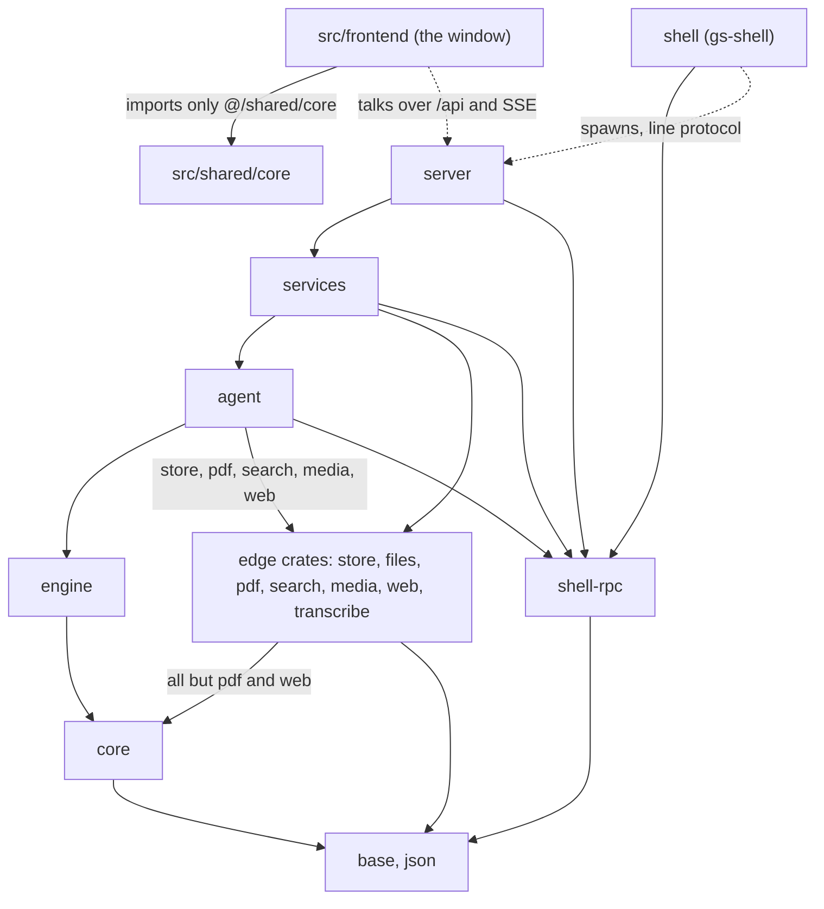
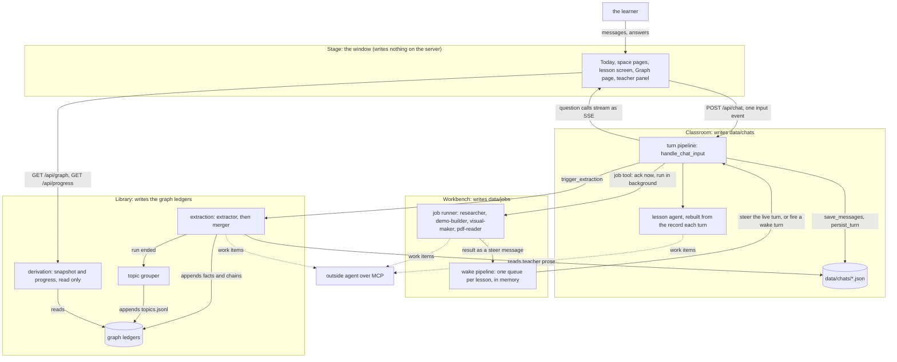

# Architecture

godspeed is a desktop learning app: a Tauri shell, a Rust server and a React window, with an outside agent (Claude Code, Codex or another MCP app) doing every model call. This doc explains how the app is built and why: the layers, who writes which data, how a lesson turn runs, how the knowledge graph grows, and the boundaries to the shell and the outside agent. When this doc and the code disagree, the code is right and this doc gets fixed.

For commands, file layout and testing, see [development.md](development.md). For the crates and the server process, see [rust-server.md](rust-server.md). For the shell, see [tauri-shell.md](tauri-shell.md).

---

## 1. The model and who writes what

Pure domain logic sits in the middle: `crates/core` on the server and `src/shared/core` in the window. Every outside effect (files, the outside agent, the browser, the OS) sits behind an adapter at the edge. Two composition roots plug the adapters in (§3).

Two rules hold everywhere:

- Imports point toward the pure core.
- Each data store has one system that writes it. Views such as plan statuses, phases, graph arrows, progress and coverage are recomputed when read, not stored.

| System | Writes (and nothing else writes it) | What it does |
|---|---|---|
| Classroom | `data/chats/*.json`, attached PDFs in `data/chats/<id>/` | the turn pipeline, lesson agents, plan tree, questions, phases (§5) |
| Workbench | `data/jobs/*.json` | the job runner, its sub-agents and the wake pipeline (§5.1) |
| Library | `data/graph/*` and `data/spaces/<id>/graph/*` | extraction (the only writer of facts and chains), topic grouping, derivation (§6) |
| Spaces | `data/spaces/<id>/space.json`, `files/`, `cheat-sheets/`, `mocks/` | space records and files, linked folders, deadlines, cheat sheets, interviews and mocks (§6.1, §6.2) |
| Search index | `data/search/` and `data/spaces/<id>/search/` | `crates/search` (`app.search`): the facts and passages index for local search |
| Stage | nothing on the server | the window: Today, space pages, the lesson screen, the Graph page, the teacher panel. It reads and writes only through `/api` |
| Machine room | `settings.json`, `prompts/`, `mcp-token`, `search-key`, `agent-notes.json`, `agent-seen.json`, `agent-rules.json`, `agent-actions.json`, `reminders.json`, `agent-folder.json` | the server process, `gs_base::config` (`Paths`), the outside-agent boundary (§8.1). The shell writes `mcp-endpoint.json` |

---

## 2. Layers and the import law

Code lives in three places:

- `src/frontend` is what the window runs: a Vite and React Router app (`index.html`, `main.tsx`, `routes/`, `components/`, `lib/`).
- `src/shared/core` is the pure TypeScript logic the frontend uses.
- `crates/` is all Rust. The server binary `godspeed-server` is built from `crates/server` on top of `services`, `agent`, `engine` and the crates below them. The shell is `crates/shell`.

The import law has a TypeScript half and a Rust half.

| Code | May import | Enforced by |
|---|---|---|
| `src/frontend/**` | `src/shared/core` only through its barrel `index.ts` (`@/shared/core`) | one `import/no-restricted-paths` zone in `eslint.config.mjs` |
| `src/**` | anything allowed above, with no import cycles | `import/no-cycle` in `eslint.config.mjs` |
| `crates/*` | only the crates listed in its own `Cargo.toml` | Cargo, which refuses a dependency cycle |

The shell depends on `gs-base` and `gs-shell-rpc` only, never on the server crates. `tests/` and `scripts/` are outside the law: ESLint ignores `scripts/` and `crates/`, and tests import freely.

This picture shows the main direct dependencies. Each arrow means "depends on". The exact lists are in each crate's `Cargo.toml`, and the crate table is in [rust-server.md](rust-server.md).

The edge crates also depend on each other: `files` uses `pdf`, and `pdf` uses `media`. The server also uses `agent`, `engine`, `store` and `core` directly.

### 2.1 The core barrel

`src/shared/core/index.ts` is the only module `src/frontend` may import from the core. Everything it exports is browser-safe: pure logic and types, no node builtins, no file system, no network. That rule is a doc comment in the barrel, not a lint rule.

The server's logic (merging, derivation, coverage, study and progress rules) lives in `crates/core`. The TypeScript core holds what the window runs: grading, plan statuses, usage folding, the event vocabulary, settings shapes, source marks and the like. A few rules exist on both sides, for example source marks (`src/shared/core/citations.ts` and `core::messages::citations`). Where both sides must agree, both replay the same golden file in `crates/core/tests/golden/`.

### 2.2 Contracts

`src/shared/core/contracts.ts` is a barrel over one file per domain in `src/shared/core/contracts/`:

| File | Holds |
|---|---|
| `plan.ts` | plan tree types and derived statuses (`derivePlanStatuses`) |
| `graph.ts` | ledgers, findings shapes, the snapshot, topics |
| `chat.ts` | lesson records, the usage log, handoff text |
| `jobs.ts` | job records, steer message builders, deterministic steer ids, usage accumulation |
| `probe.ts` | the probe assessment and its schema |
| `space.ts` | space records, space files, deadlines, signatures and icons |
| `boot.ts` | the `GET /api/boot` payload |

On the server, records are `Json`, not structs (see [rust-server.md](rust-server.md)). Shared constants and guards live in `core::contracts` (`chat`, `space`, `graph`). The other contract functions sit with the logic that uses them, mostly in `core::session`.

---

## 3. Stores, ports and the composition roots

Storage is one store per kind of data file, never one generic interface. `Stores` (`crates/store`) is built once in `App::new` and holds these stores:

- settings, prompt overrides, agent notes, agent rules, agent-seen marks
- the activity log (agent actions), the MCP token, the Tavily key (`search_key`), deadline reminders
- jobs, graph ledgers (`GraphStores`, one `GraphStore` per graph folder), chats, spaces, cheat sheets, mocks

Stores persist and shape-guard. They never merge, dedupe or derive: that happens on the reader's side, in core.

Three traits in `crates/core` let pure code work against storage:

- `GraphStore` and `ChatListing` in `core::graph::ports`. `core::graph::memory` has an in-memory version for tests.
- `SeenStore` in `core::records::agent_seen`, implemented by the agent-seen store.

Every other store is a concrete type.

### How data is written

- Graph evidence is append-only JSONL ledgers. Reads skip corrupt lines, and strict shape guards drop invalid lines instead of guessing.
- Chats, spaces, jobs, sources, agent notes, agent rules, agent-seen marks, the activity log and settings are whole-file JSON, read, changed and written back.
- Every write goes through the atomic writers in `gs_base::fsx` (a temp file, then a rename).
- Every read-modify-write first takes a lock from `app.locks` (keys `Space`, `Chat`, `Graph`, `AppFile`). The lock order and rules are in [rust-server.md](rust-server.md).
- The job store keeps parsed records in memory while a file's modified time and size are unchanged. `chat_version` on the chat store gives a lesson's version the same way, so caches can key on it (the graded answers in `services::graph::progress`, the waiting-question check in `services::jobs::jobs`).

### The two composition roots

`App` (`crates/services/src/lib.rs`) is the composition root for storage and state. `App::new` builds the stores and holds `paths`, `events`, `locks`, `stores`, `pdf`, `search`, `bridge`, one state struct per service area, and the shell link when the shell started the server. Routes and MCP tools get an `Arc<App>`. `graph_store_for(app, scope)` in `services::graph::graph` hands out one `GraphStore` per graph folder (§6.1).

`services::turns::chat_handler` is the composition root for a turn. It wires the stores, the job runner, the extraction pipeline and the engine into the turn. It also registers the wake pipeline's seams with `set_turn_runner` and `set_job_respawn`.

The agent layer takes its dependencies as arguments, so tests inject the same hosts production wires:

- `create_job_runner(host)` takes a `JobHost` (`agent::subagents::runner`).
- `create_prober_agent`, `create_teacher_agent` and the other builders take `AgentBuildOptions`: the engine, the prompts, the record's messages, and optionally a tool registry.

### The engine

`agent_engine` (`engine::turn::models`) is the only production engine, and it is the outside agent. Its stream parks each model request as a work item in `engine::bridge`. The outside agent takes it with `wait_for_work` and answers with `respond` (`server::mcp`). There are no model settings and no API keys: the outside agent picks its own model in its own harness.

Lesson records store the engine's own message shapes (`core::messages::native_messages`), so a turn replays the record directly. `to_llm_messages` turns app markers into model text and gives dangling tool calls an "interrupted" result. `engine::turn::ui_stream` streams the agent's events to the window as SSE, and `engine::turn::call_ids` makes tool-call ids unique at that boundary.

---

## 4. How the systems talk

Each system writes only its own store. They talk through three protocols:

- The turn request: the window posts one input event to the Classroom (§5).
- Ack-and-steer: a job tool answers at once, the Workbench runs the job, and the result comes back into the lesson (§5.1).
- The extraction trigger: the Classroom tells the Library to read new teacher prose (§6).

Study, practice and homework are lesson kinds inside the Classroom, not separate systems (§7). The teacher reads the graph through two read-only tools, `list_sessions` and `list_propositions` (§6). Nothing pushes graph context into a lesson.

---

## 5. One chat turn

`handle_chat_input` (`services::turns::chat_handler`) is plain Rust over `App`. `AgentBuildOptions` is its test seam, so tests drive it with scripted engines.

A turn runs in this order:

1. The window posts `{chatId, input}` to `POST /api/chat`. The input is one event: `text`, `answer`, `continue`, `side`, `next` (practice) or `opener-answer` (`core::messages::input_events`). `dismiss` and `dismiss-problem` are dismissals.
2. The handler turns the input, or queued steers, into record appends.
3. `begin_turn(chatId)` registers the turn in `turn_liveness` (in memory). If a turn already runs, the answer is 409. The window then waits for that turn to end and posts the same input again, giving up after 30 s.
4. `save_messages` writes the input before anything streams (write-ahead).
5. The handler builds the lesson agent from the record.
6. The agent's events stream to the window as SSE (`ui_stream`).
7. When the turn ends, `persist_turn` saves the reply and `append_turn_usage` logs usage.
8. `trigger_extraction` checks coverage and starts extraction in the background if enough teacher prose is uncovered (§6).
9. `end_turn` runs last, on every path, so the registry never stays locked.

### Question tools

The question tools are `probe`, `quiz`, `ask_user_question`, `explain`, `recall` and `write_code`. The server only checks their input, and the call ends the turn. The "question posed" placeholder lives in memory and is never saved.

1. The call streams to the window, and the question shows in the dock.
2. The learner answers. The window grades multiple choice with `question-core` and builds the answer. A `write_code` answer (`code-question.ts`) is never run or graded by the app: the teacher reads it.
3. The window posts the answer as an `answer` input event.
4. The server saves it as the call's tool result, and the next turn runs.

A question waiting in the saved record is what lets a lesson resume mid-question. Options are shuffled with a seed (the tool call id), so the server and the window show the same order.

### Side questions

The lesson has one writing box, at the foot of the teacher column (`LessonBox` in `src/frontend/components/lesson/lesson-box.tsx`; `lessonBox` in `lesson-box-model.ts` decides its buttons). While a question waits, a message from that box is a side question.

- It posts a `side` input event, refused unless a question waits. The server saves it as a user message with `side: true` (`new_side_question`, `core::messages::native_messages`). Its pictures and PDFs are stored like any message's.
- The question stays open: `dangling_question_of` looks past side questions and their replies.
- `is_side_turn` marks the reply turn. A job result arriving after the side question ends it.
- A side turn keeps the same tool list, so the outside agent gets a small delta. The question tools, `problem`, `conclude` and `plot` refuse (`side_turn_tools` in `agent::teacher::teacher_agent`).
- A side turn gets no `today-context` note and no job results (`services::turns::chat_handler`).
- In the model's view, the question call gets a placeholder result at once. The side question follows as a plain user message, and the learner's later answer (or skip) arrives where it happened. Earlier model views stay a prefix of later ones.

### Open problems

In study, practice and homework lessons, the open problem fills the teacher column's Your turn area (`OpenProblemPane` in `src/frontend/components/lesson/open-problem-pane.tsx`). It has no writing box of its own.

- The learner works in the lesson's one box. Each message is a plain `text` input, either work on the problem or a question about it.
- A message never ends the problem (`active_problem_of`). Only the teacher's `conclude` or the learner's discard does.
- The teacher may conclude one problem and pose the one the learner asked for in the same turn.

Lessons saved earlier hold the learner's work as `practice-thinking` markers, which still read back (`projectView` in `src/shared/core/view.ts`, `to_llm_messages`).

### The plan tree

The plan tree is written once. In a teach lesson the teacher writes it with one `plan_init` call: a mermaid-subset graph, parsed with line-numbered errors (`agent::tools::mermaid_plan`) and checked to be a DAG. In a study session the app writes it when the lesson starts (§7).

Progress is never written into the tree. Statuses (`current`, `visited`, upcoming) are derived from tagged `quiz`, `explain` and `problem` calls in the transcript. The plan row (`src/frontend/components/lesson/plan-row.tsx`, steps from `src/shared/core/plan-step-bar.ts`) and the plan blocks (`src/frontend/components/plan-block-model.ts`) draw that derivation.

Older teach lessons start with a prober: `probe_done` files the assessment and queues a handoff steer, and every later turn builds the teacher. Phases (`core::messages::phases`) go probe, then plan, then teach.

### Job tools

`research`, `demo`, `visual` and `pdf` run on the server. Each answers at once with an ack, so the teacher keeps teaching, and the job runs in the background (`agent::tools::jobs`, `agent::subagents`). The result comes back through the wake pipeline (§5.1).

### Attachments

A learner message can carry up to 5 pictures and PDFs: a message from the lesson box (side questions included), a Talk message, or an `explain`, `recall` or `ask_user_question` answer (`answer_takes_files` in `core::messages::pending`).

| Rule | Value |
|---|---|
| Pictures | resized to a long side of at most 1568 px and stored inline in the message; 20 MB each |
| PDFs | saved in `data/chats/<id>/`, with a short note in the message giving the path; 30 MB each |
| Code | `core::messages::attachments`, `services::turns::attachments`, and `src/frontend/components/lesson/attachment-tray.tsx` for the button, tray, paste and drop |

An answer's files go into the question call's tool result (`new_answer_result`), so the model and the work item get them like a message's. Files waiting in a lesson's box stay in memory, per lesson, until sent. Leaving the lesson keeps them, a reload drops them, and they never go into localStorage.

### Space and date context

A space lesson starts with a `space-context` marker holding the space card (`services::spaces::space_card`). A hidden `today-context` marker tells the model today's date, time, time zone and the space's open deadlines. A new one is added before the learner's message when the day or the deadlines changed, or when compaction cut the last one out of view (`core::spaces::today_note`, `services::app::today_note`).

### Compaction

A lesson past `compaction.thresholdTokens` (default 40,000) is shortened between turns, so a turn never waits for a summary (`services::turns::compaction`).

1. The server cuts the old part at once and writes its own short version of it (`local_summary` in `core::session::compaction`), without a model.
2. After 5 quiet minutes, the outside agent writes the real summary, which replaces the local one.

The accounting is in [compaction-accounting.md](compaction-accounting.md). Every call runs on the learner's own agent plan, so nothing has a dollar price: the app counts tokens only.

### When something fails

- Extraction failures stay inside extraction. Saving the turn must not fail quietly: a failed input write refuses the turn before any agent starts, and `persist_turn` fails on a failed reply write.
- The runner reports a settlement failure before `[DONE]` and releases liveness even then.
- If the window attaches after a failed turn has left the registry, the server keeps a small in-memory notice for it (`services::turns::turn_runs`). The next accepted turn, deleting the lesson, or a server exit clears it. Nothing is written into the saved transcript.
- Steer reconciliation reads the saved record, so a later bookkeeping failure cannot replay learner input that was already saved.
- The window never resends an answer blindly. Before sending again, Submit checks the saved record and whether a turn runs. A stream that ends without a final event gets one read-only reattach, and a second failure shows the error banner.

### 5.1 The wake pipeline

A job's worker finishing and its result reaching the lesson are two separate steps (`services::jobs`).

When a job finishes:

1. The runner saves the result, the worker status (`done` or `error`) and `delivery: {kind: "result", status: "pending"}` in one job-record update. The tool input was already saved on the job when it was dispatched.
2. It queues a `subagent-steer` custom message with the deterministic id `steer_<jobId>`. Its `content` is the text for the model, and its `details` carry the full result for the window.
3. The worker is released at once, and its row leaves Background agents even if a waiting question holds the result back. Dispatch cards say "finished", not "delivered".

Delivery then works like this:

1. The per-lesson queue holds one entry per steer id.
2. If a turn is streaming, the markers are steered into the live agent at its next turn boundary.
3. Otherwise the pipeline waits until no turn runs and no question waits, then fires one wake turn carrying every pending marker through the normal turn path.
4. A wake turn that gets 409 retries with a backoff of 500, 1000, 2000 and 5000 ms.
5. A wake turn that fails to start some other way leaves the markers pending, with no error and no timer. They go out with the learner's next turn or after a restart.
6. Delivery is complete only when the marker is in the saved conversation. Seeing it stream is not enough.

Rules that hold around it:

- A marker already in the transcript is never delivered twice. A failed bookkeeping step cannot replay a saved marker.
- A record ending in a dismissal waits for the learner's next message, which carries the markers.
- `register_live_agent` restores pending deliveries from the job records before a new agent's first steering poll, so a restart loses nothing.
- Only a computing worker can be aborted. An abort saves its own pending abort notice (`delivery: {kind: "abort"}`).
- Deleting a lesson drops its pending deliveries (`discard_chat_deliveries`). Only a live turn or a computing worker blocks deletion.
- Jobs saved by older versions are normalized on read (`normalize_legacy_result`). This all runs on the JSON stores and one in-process registry, not a transactional queue.

In the window, a wake turn is adopted like a turn in progress (`turnInFlight`), and steers render as artifact cards, never chat bubbles.

Sub-agents check their own work before delivering. The demo-builder runs its HTML in the shell's hidden web view. The visual-maker renders each SVG (resvg, or the shell's web view for SVGs resvg cannot draw) and looks at it, so the outside agent must accept images.

---

## 6. The knowledge graph

The extraction pipeline is the only writer of facts and chains. Nothing else appends to a graph's `nodes.jsonl` or `chains.jsonl`. Two other writes exist:

- Deletion (`core::graph::graph_deletion`) rewrites the ledgers when the learner deletes a fact, deletes or moves a lesson, or removes or rebuilds a space file.
- The topic grouper appends to `topics.jsonl`.

A graph folder holds `nodes.jsonl`, `chains.jsonl`, `sessions.jsonl` (run checkpoints), `coverage.jsonl`, `topics.jsonl`, `sources.json` and `format.json`.

### One extraction run

1. After a turn, `trigger_extraction` (`services::turns::turn_service`) compares the lesson with its coverage ledger (`coverage_of`). It starts a run when uncovered tokens reach `graph.extractionChunkTokens` (a setting, default 4096, floor 500, read fresh each turn). Only one run per source is in flight.
2. `batch_runs` (`core::graph::coverage`) fills token-budgeted batches with the oldest uncovered teacher-prose messages.
3. For each batch, the extractor (the outside agent, through a work item) submits new propositions, reasoning chains and `reteaches`.
4. The merger (`merge_findings` in `core::graph::merge`, deterministic) appends the results and runs chain simplification.
5. Coverage is checkpointed for what merged.
6. When the run ends, topic grouping is scheduled for that graph (`schedule_topic_grouping`, debounced 20 s).

A failure at any step checkpoints nothing, and the next trigger runs it again.

### What the extractor sees

The extractor reads teacher prose only: plain paragraphs under the session title, with no learner messages, thinking, tool calls, tool results or quiz blocks. Coverage fingerprints, slot tokens and batch budgets come from the same selection (`message_view_lines` in `core::graph::coverage`). So "covered" means "what the extractor saw". A quiz answer or a learner edit never opens a run, and only an edit to teacher prose reopens its message.

The prompt is one shared `EXTRACTION_CORE` plus a short `SESSION_PREAMBLE` or `NOTES_PREAMBLE`, assembled in `agent::extraction::findings`. Next to the text, it lists two things:

- `THE GRAPH SO FAR`: this source's merged propositions and chains, ids as they are. The first stretch of a source has none.
- `RELATED IDEAS`: about 25 existing ideas from other sources, picked by local search (`related_facts`, the embedding and BM25 search in `crates/search`).

The extractor references those ids instead of restating them and lists the ideas it teaches again under `reteaches`. Because each stretch builds on every earlier merge, a source's batches run strictly in order.

`core::session::session_markdown` renders a whole lesson for the markdown export (`GET /api/chats/{id}/markdown`) and the MCP `read_lesson` tool. Extraction does not use it.

### Propositions and chains

- A proposition is an objective fact about the world (id, name, statement, optional aliases). Nothing about the learner's understanding is stored.
- A chain is a set of premises that jointly entail a conclusion. Independent arguments for one conclusion are separate chains, and a conclusion can be a premise elsewhere.
- Chains are stored as submitted in `chains.jsonl`. No typed edge is stored anywhere; every arrow on screen is derived from a chain.
- Chain endpoints may be fresh local ids or existing `n_` ids. The merger's per-job id map passes existing ids through.

The submit step checks the chain rules and returns an error the model fixes within its turns:

- every premise and conclusion id resolves to a submitted proposition or an existing idea
- premises are not empty, and a chain does not reference itself
- every `reteaches` id is an existing idea
- `propositions`, `chains` and `reteaches` are present, even when empty

The submit agent repairs payloads that arrive as strings before checking them (`heal_encoded_arguments` in `core::session::argument_heal`, called from `agent::extraction::submit_agent`).

### What the merger writes

- Each new proposition becomes a node.
- Each valid `reteaches` id gets a credit line with this source's provenance, so the source counts toward that idea.
- Chains dedupe by sorted premises plus conclusion. A known argument found again appends under the same `arg_` id, with provenance combined.
- Search misses stay as separate nodes. There is no second model call to match duplicates.

### Chain simplification

At every merge, `simplify_chains` (`core::graph::simplify`) walks the whole chain ledger and drops chains that are provably redundant. A chain is redundant when its premises already derive its conclusion through the other kept chains.

- Chains with the most premises, then the newest, are checked first, so the leanest and earliest derivation stays.
- A dropped chain never helps derive another, so two chains that derive each other never both go.
- Example: `[A,B]⟹X` plus `[X,C]⟹Y` make `[A,B,C]⟹Y` redundant. `[A]⟹Y` next to `[A,B]⟹X` and `[X]⟹Y` stays, because A alone never reaches X.

The rewrite happens inside the merge's lock (`rewrite_ledgers`). Run stats count dropped chains separately (`droppedChains`).

### Jobs and the graph lock

Every batch of a lesson and every part of a notes file is its own job, with its own row, usage record and failure.

- Extract and merge run inside one process-wide graph lock (`with_graph_lock` in `agent::extraction::extraction`). The extractor reads the live graph, so two at once would miss each other's additions. A job waiting for the lock shows the `waiting` phase.
- One failing job leaves its messages uncovered and re-runnable while the others still merge.
- Abort stops the whole source at the first abort, also while waiting for the lock. Jobs that merged keep their checkpoints.
- The activity feed shows one row per job, with a `(2/5)` suffix for parts. Each job saves its own usage record, failed jobs included.
- The run registry (`agent::extraction::extraction_runs`) feeds the activity feed, the coverage menu and abort.

### Coverage

Each message's view is hashed into the lesson's `coverage.jsonl`. Covered means a run merged on exactly that content, and uncovered is the difference. The prompt shows a richer markdown version, kept apart on purpose, so a change in presentation never reopens covered history. `sessions.jsonl` also gets a checkpoint for each merged run.

### Notes and space files

The same pipeline reads notes and space files:

- Notes come in through `POST /api/graph/import` or the MCP `import_notes` tool. A notes file's source id is `src_` plus the first 12 hex of the sha256 of its path. A "No space" re-import reads the whole file again and adds to that source.
- A space file's source id is unique per space. A changed or removed file has its old facts removed first (`delete_source_traces`), then it is read again.
- Notes split at line boundaries under the same token budget, and each chunk runs as its own job, in order, under the graph lock. No model call carries a whole file.

### The read side

`GET /api/graph` and `GET /api/progress` read the ledgers and never write.

- `graph_snapshot` merges the ledgers, and `derive_view` (`core::graph::graph`) rebuilds the view on every read.
- Each stored chain becomes an implication node (id is its `arg_` id, name `⟹`) with arrows from premises to the implication to the conclusion. A chain with a deleted member drops out.
- Two arguments for one conclusion stay two implication nodes, never one merged node.
- Clusters are birth sessions: a fact joins the cluster of the lesson or notes file that created it (`birth_session_partition`, `core::graph::session_clusters`). The chain table groups chains by them.
- How well the learner knows a fact is derived from lesson answers at read time (`services::graph::progress`, `src/shared/core/progress.ts`). Nothing writes learner state into the graph.

### Deletion

- Deleting a proposition removes every stored chain that references it, as premise or conclusion.
- Deleting an implication node (any `arg_` id) removes exactly that one stored chain.
- The same confirm dialog (`src/frontend/components/delete-node-dialog.tsx`) opens from a fact's right-click menu and from the chain table's Delete.

### The teacher's graph tools

The teacher reads the graph only through `list_sessions` (birth sessions, the learner's files) and `list_propositions` (the facts a session covered), in `agent::tools::graph`. The `agent.graphTools` setting turns them off. There is no topic embedding, no top-K pick and no start-of-lesson injection.

### The Graph page

`/graph` shows topics in level columns (`src/frontend/components/graph/level-columns.tsx`). Each column is one prerequisite depth (a topic's `column`). Each topic is a row with one square per fact, colored by its right rate, with no lines and no zoom. A picked topic marks what it needs and what it leads to.

The right side (`side-panes.tsx`) shows the next deadline on top. Under it is what to work on next, the picked topic (`topic-pane.tsx`) or the picked fact (`fact-pane.tsx`: its answers, where it came from, and the facts it builds on and leads to).

The topic grouper (`agent::extraction::topic_grouper`, scheduled by `services::graph::topics`) groups a graph's facts into topics. It labels each topic's material as term, procedure, concept or proof, and appends a full snapshot to `topics.jsonl`. Older snapshots may have no material. A topic that keeps its id across a regroup keeps its stored material (`repair_topics`, `core::graph::topics`). Nothing about the layout is stored.

---

### 6.1 Spaces

Each space has its own graph. `graph_store_for(app, scope)` (`services::graph::graph`) gives `data/graph/` for "No space" and `data/spaces/<id>/graph/` for a space. Extraction picks the graph from the source's space, so lessons and files write into their own space's graph. Reads may cross spaces (the prober's tools can read several graphs), but `merge_findings` writes only the source's own graph.

Where the space code lives:

- `services::spaces::pipeline`: the file pipeline and the linked-folder scan every 60 s
- `services::spaces::lifecycle`: space lifecycle and cascade delete
- `services::spaces::space_card`: the space card
- `services::turns::lessons`: lesson creation

#### Space files

A file is `study` (turned into facts) or `info` (the teacher can read it with `read_space`, `search_space_files` and `read_passage`, but it never becomes facts).

Supported files:

- plain text and code, read as they are, and text files with no extension (checked by their bytes)
- PDFs (`crates/pdf`)
- Word and PowerPoint (`crates/files`, `office`, on a small zip reader; slides are headed like PDF pages)
- EPUB books (`epub` on the same zip reader; each spine file is a section headed like a PDF page; copy-protected books and books with no text are refused)
- captions and recordings. Recordings are transcribed locally with whisper.cpp (`crates/transcribe`).

Linked folders:

- A linked folder adds every supported file, up to `MAX_LINKED_FILES` (500).
- A new linked file takes its name series' kind, else `study`. While reading a study file, the agent can say it is logistics (`import_notes` with `may_be_space_info`, decided on the first stretch). godspeed then switches it to info (`sortedAsInfo`). A kind picked by hand (`kindChosen`, and every file added by hand) is never re-sorted.
- A recording whose lecture transcript is already in the space (same date or lecture number in the names, `core::spaces::lecture_transcript`) is never read and records the transcript as `transcriptId`. If that transcript goes, the recording is transcribed after all.
- A folder that times out (for example Google Drive paused or offline) shows "not responding" and keeps its files, like a missing folder.
- Files that can't be read, Google Docs links among them, are counted in the folder status and named on the Files page.

Reading a study file is a background work item for the outside agent. Nothing is extracted until an agent is taking work.

#### Kept pages

The PDF reader (`agent::subagents::pdf_reader`, a job run by the learner's own agent) reads a page with formulas by rendering it as a picture. When the PDF is a ready space file whose content still matches its `contentFp`, the reader also gets `save_page {page, markdown}` (`services::spaces::kept_pages`, reached through the job host's `kept_pages` and `keep_page`).

`save_page` writes a whole page as Markdown with LaTeX. It takes only a page whose picture was shown earlier in this job, not one rendered in the same reply.

| Limit | Value |
|---|---|
| Pages per job | 3 |
| Characters per page | 6,000 |
| Too short | under 40% of the page's own text, when that text is over 400 characters |

It also refuses empty text, control characters (what JSON makes of an unescaped `\frac` or `\theta`), a newline that broke a `\neq`, `\nu` or similar command, and lines like `--- Page 3 ---`.

- The text is stored, never run, as `texts/<file id>.<fp>.p<N>.md` beside the file's saved text (`services::spaces::text_cache`). A new version's text removes the old version's kept pages.
- From then on the kept text stands in for that page (`core::spaces::kept_pages`): in `pdf_extract`, marked `kept` in `pdf_info`, and in search.
- Until then, a lesson's `read_passage` or `search_space_files` result that shows a PDF page whose formulas may read broken ends with a line naming the page and the file's path, so the teacher has it looked at with `pdf` first (`services::spaces::space_search`). The signal is `gs_pdf::may_hold_broken_formulas`: a glyph the PDF could not map (a black square, U+FFFD or a private-use character), or 3 or more of the math characters `math_density` counts. The line never comes when there is no `pdf` tool to send: not in the cheat sheet writer's search, and not in a lesson whose learner switched PDF reading off.
- The search index records the file's fingerprint plus a hash of its kept pages. A save causes one re-index in the background, one at a time.
- A passage keeps its id while its place and piece number stay the same. A new piece takes a number the file never used (`idsUsed`), so a passage id the teacher holds still names the same page.
- A quote on a kept page is checked against the Markdown. The page picture shows its box only when pdfium's own text has the words too.

#### The teacher's work on a space

While study files wait to be read, the space shows it where the learner is:

- a frame around every tab's page (`src/frontend/components/work/`)
- a line on the space's row under "Your spaces" on Today
- a tag on the space's tab in the top bar ("15 left")
- a second line under Talk's "Created <space>" row

The record keeps the newest round of work as `lastWork` (`core::spaces::space_work`, applied by the spaces store on every file write). A round opens when a study file starts waiting, collects each file that finishes or fails and each deadline added meanwhile, and ends when nothing waits. The frame then shows what the round made until the learner closes it (`DELETE /api/spaces/{id}/work`), new work starts, or a day passes. The space list carries `filesLeft` and `building` for Today and the top bar, and `filesRead` while a round is open. A space the teacher makes from Talk opens by itself.

#### Source marks

The teacher marks what it read with a source mark right after the sentence:

- `[[f_1a2b3c4d5e6f:7]]`: a passage id from `search_space_files` or `read_passage`
- `[[https://example.com/page]]`: a web page

The prompt part is `crates/agent/prompts/shared/13-source-marks.md`, and Talk has one sentence about it in `talk/00-base.md`.

`respond` checks every mark before the reply is stored (`services::spaces::citations`):

- A mark whose passage exists is stored as `[[<file id>/<range>/<file name>]]`, for example `[[f_1a2b3c4d5e6f/p. 12/Week 6 slides.pdf]]`. That still points at the right place after the passages are renumbered.
- A mark whose passage doesn't exist is removed, and `respond` tells the agent which ones.
- Web marks are stored as written.
- Cheat sheet replies are checked the same way. A reply with a bad mark goes back to the agent, and a quote that does not hold is dropped there without a word.

A mark may quote a few words: `[[f_1a2b3c4d5e6f:7 "degree 12"]]` is stored as `[[f_1a2b3c4d5e6f/p. 14/Lecture 6.pdf|degree 12]]`. The quote is kept only when all of these hold (`core::messages::quote_find`):

- 2 or more words, or one code expression
- at most 80 characters, with no `[`, `]`, backticks or `$`
- found exactly once in the passage, ignoring spacing, line-end word splits, ligatures and curly quotes

Otherwise the quote is dropped, the plain mark stays, and `respond` says why. In `topic_done`'s `opener.lead`, a bad quote refuses the call.

In a Study lesson, `respond` then reads the reply's own words, not its other tool calls, plus a `quiz` question, a `problem` statement and a `topic_done` opener's lead for a curve (`core::study::reply_nudges`, `services::turns::reply_nudges`). A reply is sent back unstored, with the line below, when its words hold:

| Nudge | When | The agent reads |
|---|---|---|
| Curve | a Markdown table of 3 or more data rows and 2 or more columns, every cell a number, not all of them 0 or 1, and no header cell starting with step, iteration, t, k, n or i (a worked trace); or two lines (or list items) in a row, each a label and a run of 4 or more numbers | "not sent: these rows read as points of one curve. Send `plot` with the rows as `points` and a prediction instead. If the table is not a curve, send the reply again as it is." |
| Question list | 2 or more list items that end with a question mark, outside code | "not sent: a reply holds one question. Ask the first one now, through `quiz` or `problem` when it checks understanding. If these are not questions for the learner, send the reply again as it is." |

Each nudge is sent once a topic (the topic the reply's calls name, else the record's, for a question or statement too; for an opener, the topic it opens), so the same reply sent again is stored. Which were sent is kept in memory only: after a restart a topic may get each one again.

The window turns stored marks into numbered buttons and a Sources list (`src/frontend/components/citations/`). A file source opens a popup with the PDF page or the passage text, and a web source opens the page. The popup reads two routes:

| Route | Returns |
|---|---|
| `GET /api/cited/<file id>?range=<range>&quote=<words>` | `{name, range, page, text, marks}`. `page` is the PDF page number when the file is a PDF on disk and the range names a page, else `null`. 404 when no space has the file, or no passage is at that range |
| `GET /api/cited/<file id>/page/<n>` | the page as `image/png` |

`marks` places the quote, or is `null` without a quote or when it is not found exactly once:

- PDF page: `{kind: "page", boxes: [{x, y, w, h}]}`, one box per line, as fractions of the page image from its top left, cached beside the page images
- text or code file: `{kind: "lines", first, lines, spans: [{line, start, end}]}`, the 12 lines centred on the quote's first line, positions in UTF-16 units
- anything else (.docx, .pptx, transcripts): `{kind: "passage", start, end}`, UTF-16 offsets in `text`

File ids are unique across spaces, so the routes need no space id. Plain-text readers (the Markdown export, extraction) get the mark in words, like ` (Week 6 slides.pdf, p. 12)` (`cites_in_words`). The pure parts are in `core::messages::citations`, with a twin in `src/shared/core/citations.ts`; both replay `crates/core/tests/golden/citations_quotes.json`. Marks inside code and math are left alone.

A Study reply's topic is the one its calls name, else the one before it, else the plan's first topic. A topic's page excerpt comes from the first quoted mark in the shown opener's lead, else in the topic's first reply that is not only reads (`core::study::topic_parts`, twin of `src/shared/core/topic-parts.ts`; both replay `crates/core/tests/golden/topic_parts.json`).

#### Deadlines

A space can have deadlines (`SpaceDeadline` in `core::contracts::space`): a kind (`exam`, `homework`, `quiz` or `project`), a name, a due day, an optional time on the learner's clock, the study files it covers, and a done flag.

- The learner edits them on the space's Deadlines tab.
- An outside agent uses `add_space_deadline` (a list at once), `update_space_deadline` and `remove_space_deadline`.
- `GET /api/deadlines` lists every open deadline for Today.
- `GET /api/progress` turns a deadline's files into days left, a ready percentage and a "Work on next" list.
- The teacher sees them in the `today-context` marker (§5).

#### Deadline reminders

`services::app::deadline_reminder` sends at most one system notification a day for the soonest open deadline that is 3 days away or less.

1. The server checks 10 s after it starts, then every 10 minutes. Each wait reads the wall clock, so a computer that slept through 9:00 still sends within 10 minutes of waking.
2. From 9:00 local time on, it picks the deadline and writes the text, for example "Quiz 2 is in 2 days" with "Algebra. You are 40% ready." The ready percentage comes from `progress_for`. A deadline with problems says "Algebra. 2 of 7 problems done." Without either, only the space name shows.
3. The server asks the shell with `notify`. The shell skips it while the main window has focus and answers whether it showed it.
4. Only a shown reminder marks the day in `data/reminders.json` (`store::reminders`, `{version: 1, lastDay}`). A skipped one is tried again at a later check.

A server without a shell runs no check. Settings, General, Deadline reminders (`general.deadlineReminders`, on by default, shown only in the desktop app) turns them off, and is read at each check.

#### Cheat sheets

A deadline's header has a Cheat sheet button that opens its studio (`/space/deadline/<id>/cheat-sheet`). The outside agent makes the sheet as a real PDF with its own tools (LaTeX suggested), and godspeed shows that file as it is.

The record is `spaces/<id>/cheat-sheets/<deadlineId>.json` (`store::cheat_sheets`, format 4, removed with its deadline). It holds:

- the last 5 versions, each a PDF in `<deadlineId>-versions/v<n>.pdf` with its page sizes and the message that made it, or marked as taken from the working folder
- the sheet's chat (the last 100 messages) and the sheet's rules
- the name of its working folder

Pictures and PDFs sent in the chat sit in `<deadlineId>-files/`, named by their content. Older formats are read by `core::study::cheat_sheet`: format 3's prompts become the chat's first messages, and an HTML or block sheet (formats 2 and 1) keeps its asks and offers Make it again.

Each chat message is one background work item (`sheet_reply`, `agent::subagents::cheat_sheet_writer`), not a chat kind, so lessons, Talk, search and extraction never see it. The request carries:

- the deadline's topics with readiness and a few facts, and the mistakes from practice
- the sheet's rules and the last 8 messages
- the working folder `<godspeed folder>/cheat-sheets/<space> <deadline>/`, where the agent keeps its source
- the message: the learner's words and files, and the part of a page they pointed at, picture first

The agent answers in markdown. When it changed the sheet, it sends the new PDF's path and any rules the learner set (`new_rules`). Its instructions ask it to render and look at every page and check each formula against the space's material.

godspeed takes a PDF only from inside the working folder, links resolved (`services::cheat_sheets::cheat_sheet_pdf`). It checks the PDF by its bytes, at most 20 MB, 1 to 4 pages, each 2 to 17 inches, then copies it into its data. Opening a sheet also takes the newest PDF in the working folder when it is newer than the current version (an edit outside godspeed), after the same checks, once per file.

The studio is a canvas (`src/frontend/components/cheat-sheet/`):

- Every kept version's pages are artboards, newest first, drawn by pdf.js in the window. pdf.js is served at `/pdfjs/`, outside `/api` (`server::http::ui`).
- Each page is drawn whole once, then the visible part again at screen resolution once the view settles, so it stays sharp at any zoom.
- Point at the sheet draws a box on a page. That part goes with the next message as a picture.
- The chat floats on the right (`sheet-chat.tsx`): the rules with a remove button, the messages, "Made version N" rows, Stop and Try again, and a box with math, pictures, PDFs and a kept draft.
- Print draws the pages at 300 dpi into print-only pictures. On the desktop, Show in Finder reveals the PDF in the working folder (`window.lh.showInFolder`). A browser gets a download link.

In a lesson of a space, the top bar's Cheat sheet button docks a sheet beside the lesson (`sheet-dock.tsx`, resizable, open state kept per lesson). It shows the lesson's deadline's sheet, else the space's next one with a sheet, with a picker when there are several. The docked sheet has no chat: questions go to the teacher in the lesson box.

A space's Cheat sheets tab (`/space/cheat-sheets`, `GET /api/spaces/<id>/cheat-sheets`) shows every deadline but interviews as a card, coming up first. Each card says whether its sheet is made (with a page 1 preview), being made, older (Make it again) or missing (Make one).

### 6.2 Interviews and mocks

Getting ready for an interview, an online assessment or a test is a normal space that the learner's own agent sets up from Talk; there is no separate kind of space.

- **Interview deadlines.** A deadline may have the kind `interview` (no "due", like an exam) and an `aboutFileId`: a space info file on what it is like, usually `What it's like.md` (space format 11, `core::spaces::space_deadlines`; the reader drops the id once the file is gone). `GET /api/spaces/{id}/deadlines/{deadlineId}/about` gives its text, or 404 when the file is empty or not text.
- **Setting one up.** The tool texts tell the teacher to add the posting as space info, the interview with its date and time, `What it's like.md` as `about_file_id` (searched for first, under 200 words, only sources it read) and a `Study guide.md` it writes as a study file in `file_ids`, so the deadline's topics fill once extraction has run. `add_space_file` writes such a file from `name` and `text`; one it wrote before by that name (the upgrade's two files count) is replaced and keeps its id.
- **The upgrade from preps.** A space saved as a prep by 0.6.5 or before (a `prep` on its record) is upgraded once when the server starts, before it serves (`core::spaces::prep_upgrade`, run by `services::spaces::upgrade_old_preps`). What it was like becomes `What it's like.md`, its topics `Study guide.md`, its day an interview deadline, its goal the description when that is empty, and its mocks belong to the deadline. A prep with no day, or a day that can't make a deadline, gets the record's `waitingDeadline` instead; adding a deadline with that `id` takes its place (the window's Add the date sends it, and the agent's next interview from `add_space_deadline` takes it, after `read_space` showed it as an interview with no date). The ids come from the space id, so an upgrade stopped halfway writes the same things again next time, and the reader keeps `prep` as saved until the last write drops it.

A mock is one run of questions like the real thing on an exam, quiz or interview deadline (`core::mocks::mock`), saved as `spaces/<id>/mocks/<mockId>.json` (format 2; a format 1 mock reads as format 2) with `services::mocks::mocks` as its only writer.

- Mocks are numbered per deadline, a deadline has at most one unfinished mock, and it takes one only when it is not done and has a topic with facts or an about file the about route can read (the window turns Take a mock on by the same test). A mock is 1 to 10 questions with no time limit or 5 to 240 minutes. Removing a deadline removes its mocks.
- The agent writes all its questions before it starts and grades all its answers after it ends (`agent::subagents::mock_writer`), and the clock runs with no agent. The writer gets the deadline, what it is like and its topics weakest first with up to 5 facts each, and tags each question with the `fact_ids` it tests; with no facts it writes from what it is like alone (`fromAbout`). The grader gets each question with its facts and, for a timed mock, how often and how long it was paused.
- Each request waits on the bridge until an agent takes it. A request does not outlive the server, so at startup, after the upgrade from preps, every mock still waiting for its grades asks for them again, and one whose time ran out while the server was off ends then and asks (`ask_waiting_grades` in `services::mocks::mock_end`). A mock with its request out shows as being graded; one whose request failed shows why, with Try again.
- A timed mock can be paused: it keeps the seconds left, refuses answers and runs, and on resume runs for that long. Each pause is recorded. A running timed mock whose time ran out is ended at its end time the next time it is read (`services::mocks::mock_end`); a paused one never is.
- A graded question with `factIds` counts as an answer for those facts (`mock_answers`, passed to `derive_progress` by `progress_for`).
- "Run examples" runs the learner's JavaScript or Python with the computer's own Node or Python, for at most 5 seconds and 1 MB of output (`core::mocks::mock_run`, `services::mocks::mock_runner`).

---

## 7. Study sessions

Every new lesson is a study session (`kind: "study"` on the chat record). There is no prober, and the tool list is the same every turn.

The learner starts one from:

- "Study something new" on a space's Lessons tab (the study page, `/new`)
- Start on a Today row, or Study on a deadline page
- "study these N", "study <topic>" or "practice this fact" on the Graph tab, or Study on the Progress tab
- "Go over it with the teacher" on a mock's results
- "Start from facts" (the chain table in select mode, `src/frontend/components/home/facts-picker.tsx`)
- the MCP `start_lesson` tool

Older `teach` and `practice` lessons on disk keep working with their own agents. Practice lessons are never extracted into the graph.

### How a session starts

`create_lesson` (`services::turns::lessons`) writes the opening markers:

1. The picked facts become a `graph-context` marker through `chains_for_selection` (`core::graph::chains`). A chain is included when its conclusion and every premise are picked, and a picked fact in no included chain stands alone.
2. The picks are grouped into topics in space order (`core::study::study`). Each topic has its material when it has one, and the learner's standing: untested, weak, shaky or strong, with "(latest wrong)" on a weak topic whose latest answer was wrong. A typed topic with no picks is one untested topic with no material.
3. These go into a `study-context` marker. The move for each material and standing pair is a table in `crates/agent/prompts/study/10-study.md`, so a prompt override can change it.
4. The app saves the matching plan tree, so the plan row lists the topics from the start.

A session started from a deadline records it as `deadlineId`. While the latest such session is unfinished, the deadline's Study button reopens it as "Continue studying, 1 of 4 topics" (`core::study::continue_study`). The progress payload carries it as `continueStudy`. A deadline topic with a topic stop in a Study session on the learner's day carries `finishedToday: true` in the progress payload. The plan (`core::study::deadline_plan`, `deadline-plan.ts`) never puts such a topic on today: it moves to tomorrow, or out of the plan when tomorrow is the due day. When that empties today, Today has nothing planned and the deadline's Study button takes all its topics.

### The study agent

The study agent has the teacher's prompt and tools, without the deadline changes (Study sends those to Talk). It adds:

- `problem` and `conclude` (`agent::tools::practice`; `problem` carries the topic's `nodeId`)
- `topic_done`
- `plot`, in multiple-choice lessons
- the practice hint rules (`prompts/practice/20-hints.md`) and `prompts/study/`

A posed problem ends the turn. `practice-next` and `problem-dismissed` mark moving on or skipping. A study session is extracted into the graph. A problem solved with hints counts as an answer worth 0.6 of a right one (`HINTED_WEIGHT`), so alone it reads shaky, and counts print it apart: "1 of 2 right, 1 solved with hints". An answer whose facts are in no topic (none extracted yet, or new ones still in Ungrouped) counts once for its question's `nodeId` when that is one of the space's topics (`core::study::derive_progress`), so a topic studied today is not untested while its facts are being saved.

### Questions from earlier

godspeed asks some earlier topics again by itself, and the window grades them, so no agent is woken. The schedule is `core::study::review`:

| Rule | Value |
|---|---|
| Rest after a right answer | 2, 4, 8, 16, 32, then 64 days |
| After a miss | back within 4 days |
| Deadline covering the topic | rest shortened to a third of the days left, never under 2 |
| Per space | at most 3 a local day |
| Never asked | one shown in the last 7 days, the one missed last time, one skipped this sitting |

A question is a stored `topic_done.review`, or a Study `quiz` with `standalone: true` and no `keep` that the learner answered right.

They show only in a Study lesson of a space, during a sitting's first wait, with no question, problem, opener or stop open. That wait is the lesson's start, or after the learner's first input on a return, until the teacher's reply lands.

An answer is a UI-only `review` marker: `{of: {chatId, messageId, toolCallId}, nodeId, topic, quiz, answer, sitting, kept?}`. The learner's next input carries one hidden `[From earlier]` line for the answers since the last one. Progress counts each answer for the quiz it came from.

Ask Teacher on one sends `text` with `about: {reviewOf: {chatId, toolCallId}, picked?: [label]}`. A note before the message carries the question, its options, the pick and the explanation, and the question stays open. While the teacher's own question waits behind it, the message is written as a side question.

### Plots

In a multiple-choice Study lesson, the teacher can send `plot` (`agent::tools::plot`): one or two lines over x, each a formula with one slider, written in plain math such as `min(a, 4/(1+lambda))` and never code, or 2 to 12 measured `points` `[x, y]`. A plot with a formula line may also hold one points line, a model against data. The slider and `x.name` are needed only when a line is a formula, and a slider sent with no formula line is refused.

The grammar is `core::session::plot_expr`, twin of `src/shared/core/plot-expr.ts`; both replay `crates/core/tests/golden/plot_expr.json`. It allows numbers, the x and slider names, `pi`, `e`, `+ - * / ^`, brackets, `sin cos tan exp ln log10 sqrt abs` and `min max`. There is no implicit multiplication, and an expression is at most 200 characters and 32 levels deep.

The call's checks (`core::session::plot`) run on the call as sent, since the window draws the stored call, and return one line each:

- bounds and names, and a range too narrow for the size of its numbers
- each formula
- each points line: 2 to 12 pairs of numbers, x rising, every x inside the x range
- a formula with no value at more than a tenth of its 200 x by 20 slider points
- when no y range is given, one from the 2nd to 98th percentile of every formula value and point, refused when the values run 20 times wider

A plot comes with a prediction `quiz` in the same reply, whose `onPlot: {line, x, slider?}` names the point it asks about. The before-tool-call hook (`agent::tools::lesson_parts`, the check in `core::study::topic_parts::reply_parts_problems`) passes or refuses the two together:

- the right option must name the drawn value to 2 significant figures; on a points line, `x` is one of its measured x values and the value is that point's y
- a topic has one plot
- the topic's previous reply may not carry a kept sentence the learner saw; a page never holds a plot back

While a topic has no plot, its start carries the line "No plot yet in this topic. If its idea is a curve, open with `plot`.": the first topic's under the `[Study plan]`, every later one's after its `[Opener]` line (`core::study::topic_parts::NO_PLOT_YET`). Plots from earlier lessons are not looked up.

A drawn plot is named `p1`, `p2` in lesson order. Its result tells the agent its formula lines' values at the slider's start, every point of a points line, and ends the turn. Its `details` are `{part: "plot", v: 1, id, onPlot: {toolCallId, value}, y: {min, max}}`. The window recomputes the lines from the stored call, draws a points line as straight segments with a square on each point, shows no slider row when the plot has no slider, and never stores or sends the slider position.

### Kept sentences

A multiple-choice Study `quiz` may carry `keep: {text (160), source?, fits? (120), stops? (120, required with fits), phrase? (60)}`. It is one sentence the learner keeps when they answer right, with optional analogy lines and a memory phrase. A keep never refuses its quiz: a keep that breaks the rules is left out of what the checks read, and the stored call keeps it as sent.

When a Study turn is saved (`save_turn`), each new keep gets a UI-only `keep-check` marker from `core::study::kept::keep_verdicts`: `{quizCallId, keep: "shown" | "dropped", fits, phrase, source?: "ok" | "dropped", sourceMark?, note?}`. A keep is not shown when:

- its quiz is a prediction, or its fields break the rules
- its reply carries a plot or another keep it stores
- the topic's previous reply carries a plot or a kept sentence the learner saw
- the topic already kept 2 the learner answered right

Analogy lines show on one keep per topic. A keep's `source` must be one mark pointing at a passage, checked like a reply's marks. `note` reaches the teacher in the hidden note after the learner's answer to that quiz.

The window turns a right-answered quiz with a `shown` verdict into the kept card (`src/shared/core/kept-view.ts`, twin of `core::study::kept`; both replay `crates/core/tests/golden/kept.json`).

- Dropping the analogy or the phrase writes a UI-only `analogy-drop` or `phrase-drop` marker (`{of, back?, at}`).
- The learner's next input carries one `[Analogy dropped] Regularization: "The leash fits one part"` line per analogy dropped since the last such line. Dropping a phrase tells the teacher nothing.
- An answered question from earlier carries in `kept` the topic's kept sentence that was shown longest ago: `{of, text, source?, phrase?}`, never the analogy lines.
- Coverage counts `keep.text` as teaching when the keep's fields hold.

### Lesson routes that write without a turn

These are allowed while a turn runs and never answer 409.

| Route | Body | Answer |
|---|---|---|
| `POST /api/chats/{id}/keep-going` | `{input: {stopOf}}` | `{ok: true, opener, running}`. 404 unknown lesson, 400 when no turn runs and that call has no stop |
| `POST /api/chats/{id}/kept` | `{input: {of, part: "analogy" \| "phrase", back?: true}}` | `{ok: true}` (`services::turns::lesson_events::drop_kept_part`). 400 for a bad input or a quiz with no kept sentence the learner saw with that part |
| `POST /api/chats/{id}/review` | `{input: {type: "next"}}` | `{question: {of, nodeId, topic, quiz}}` or `{question: null}` |
| | `{input: {type: "answer", of: {chatId, toolCallId}, answer}}` | `{ok: true}` |
| | `{input: {type: "skip", of}}` | `{ok: true}`, storing nothing |

How `review` behaves (`services::turns::review`, 404 unknown lesson, 400 bad input):

- `next` returns the open question, so asking again gives the same one. A question the learner asked the teacher about this sitting comes first until answered or skipped. The window asks once when a lesson opens, then when a wait begins and when a turn starts or ends.
- `answer` takes the window's graded quiz answer (`{kind: "quiz", correct, answers, confidence?, thinking?}` or `{kind: "quiz", dontKnow: true, answers: []}`), stamped `answeredAt` with the server clock.
- An `answer` or `skip` whose `of` is none of the sitting's current picks gets 400 `That question from earlier is not open`. The window then gives the learner's words back and says the question is no longer due.
- Any other bad answer gets 400 `An answer is a graded quiz answer with a pick, or I don't know`.
- A skipped question is passed by until the sitting ends.

### The chain table

The chain table (`src/frontend/components/chain-table.tsx`) lists every chain of the graph, grouped by birth cluster, with a search. Its checkboxes pick clusters, chains or single facts.

- On the Graph page, the floating bar deletes the selection through the confirm dialog. Deletes run one at a time, stop at the first failure, then announce `lh:graph-revision` so the page refetches.
- Opened from "Start from facts" on `/new`, the bar has Done instead of Delete, and the picks become the new session's opening context.

### Homework sessions

A homework session (`kind: "homework"`, `deadlineId` required) works on one homework or project deadline's problems.

- "Work on <name>" on the deadline page or "Work on it" on its Today row starts one or reopens the latest (`POST /api/chats` with `homework: true`, `create_homework` in `services::turns::homework`).
- It opens with the space card and a `homework-context` marker: the deadline, its assignment file (`assignmentFileId`) and the problems posted before.
- The homework agent (`agent::tools::homework`, prompt `prompts/homework/` plus the practice hint rules) posts the assignment's problems onto the deadline with `post_problems`.
- It opens one problem at a time with `problem`, which has no solution field: homework is hints only. `conclude` marks a problem done when the learner's own work is right.
- The plan row and its problems dialog list the problems (`homeworkProblems` in `src/shared/core/homework.ts`), and the Today row says "2 of 7 problems done".

Homework is never extracted into the graph.

---

## 8. Process boundaries

The shell is a launcher and security guard. All app logic runs in `godspeed-server`, a child process the shell starts. The full design is in [tauri-shell.md](tauri-shell.md), and the server process, its environment variables and the access gate are in [rust-server.md](rust-server.md).

| Part | What it does |
|---|---|
| Shell (`crates/shell`) | single-instance lock, a trust check on every command (only the main window on the app's own origin), navigation pinned to the app's origin, web links opened in the browser |
| Starting the server | the shell picks port 47613 when it is free, else any free port, and starts the server with `PORT`, `LH_DATA_DIR`, `LH_SHELL=1`, `LH_DESKTOP_SERVER=1` and `LH_DESKTOP_API_SECRET`. The server binds 127.0.0.1 only |
| `mcp-endpoint.json` | the shell writes the server's real address there once the server is ready |
| Line protocol (`crates/shell-rpc`) | one JSON object per line on the server's stdin and stdout. The server sends `ready`, and `demo`, `svg` and `notify` requests. The shell sends one-time `login` tokens and the answers. A request gets 60 s |
| Access gate (`server::http::access`) | every `/api` path needs the `gs_desktop` cookie and `Sec-Fetch-Site: same-origin`, except `/api/mcp`, `/api/mcp/forget`, `/api/mcp/compacting` and `/api/desktop/login` |
| Data lock | an advisory lock on the data folder (`server::data_lock`) keeps a second server off the same data |
| Shutdown | closing the server's stdin stops it, so a dying shell never leaves a server behind |
| Crashes | the shell restarts the server at most 3 times a minute with `LH_SERVER_RESTARTED=1` and reloads the window. After that, a "godspeed stopped working" dialog offers Relaunch, Report a bug and Quit |

The window stays hidden until the app has drawn its first screen. It reports that through `window.lh.showWindow` once `/api/boot` has answered and React has rendered, or it is shown 5 seconds after its first paint. That first screen is the welcome screen (`src/frontend/components/welcome/welcome.tsx`, chosen by `first_load_screen` in `services::app::welcome`), which plays the startup sound. After a crash restart it is a "godspeed restarted after a problem" notice instead.

The page reaches the shell through `window.lh`. It is typed in `src/frontend/components/desktop-env.tsx` and defined by `crates/shell/src/shim.js`, which calls the shell's Tauri commands. The two are kept in step by hand.

### 8.1 The outside-agent boundary

The outside agent is the only model. No credentials for model providers exist anywhere in the app.

#### Access

- The server makes the access token `data/mcp-token` (mode 0600) on the first `/api/boot` and again whenever it is missing (`ensure_mcp_token`).
- `/api/mcp` accepts only local, non-browser requests that carry the token (`refuse` in `server::mcp`).
- The godspeed folder's connector finds the address in `mcp-endpoint.json` and reads the token file itself.
- Settings, Connection shows the connection status, shows and rotates the token, and has the button that opens the agent or the setup for another MCP app.

The server speaks two MCP versions on one endpoint. The 2026-07-28 version carries the client's version and name on every request, and `server/discover` replaces the handshake (Claude Code and the folder's scripts). The older version starts with `initialize` (Codex). Each request names the agent from its client info. Both answer in plain JSON (`server::mcp::transport`), never SSE, because the folder's scripts can't read SSE.

#### Connected and teaching

`engine::bridge::checkin` decides both, with a 3-minute window.

- **Connected**: any authorized MCP request in the last 3 minutes, or teaching.
- **Teaching**: a work-loop call (`wait_for_work`, `respond`, `read_work`) by an agent that is not the helper in the last 3 minutes, or a teacher still holding a work item whose 10-minute claim has not run out.
- An agent that is connected but not teaching leaves lessons waiting. The teacher pane and the Teacher tile then say to start teaching.
- The window hears `agent-changed` when either changes or the agent's name changes. A timer fires it again a second after the next lapse.

`GET /api/mcp-access` reports `agentConnected`, `agentTeaching`, `agentName`, `helperHere`, `helperCovering`, `pendingWork`, `pendingTurns` and `claimedLessons` (the lessons whose request an agent took and hasn't answered).

#### The godspeed folder

Agents are opened in one folder, `~/godspeed` by default. `data/agent-folder.json` remembers another one, whether the one-time notice was seen, and `startCommands`. A debug build uses `<data>/godspeed-folder` instead.

`services::app::agent_folder` writes it from `crates/services/folder-files/` and `core::spaces::agent_folder`, once per app start so an update reaches it:

- `CLAUDE.md` (Claude Code's work loop with the waiter) and `AGENTS.md` (Codex's). Each says godspeed rewrites it, so the learner's own notes belong in `CLAUDE.local.md` or `~/.codex/AGENTS.md`.
- the `setup-spaces` skill
- `.mcp.json`, which runs `.godspeed/connect.mjs`, a stdio bridge to `/api/mcp`
- in `.godspeed/`: the scripts, `claude-settings.json` and a start script per agent

`claude-settings.json` is loaded with `--settings`, so it applies before the folder is trusted. It turns on the folder's server, allows godspeed's tools, the waiter and web search, and adds the forget and compacting hooks. Fetching a page still asks, because text hidden in a space file could send the learner's data out. Codex gets the same connector through `-c` flags with its tools pre-approved, and no project config.

Opening an agent:

1. "Open Claude Code" (`src/frontend/components/agent-folder/`) writes the folder.
2. The shell (`window.lh.openAgent`, `crates/shell/src/open.rs`) opens Terminal, a Windows console or a Linux terminal running the start script. Only those scripts can be run.
3. A start script stops with an install hint when the agent's command or Node.js is missing (`start_script` in `core::spaces::agent_folder`), since the connector and hooks run with plain `node`.

A learner who starts an agent through a launcher sets its command with Change command under the Open button: one line of at most 300 characters (`usable_start_command`). An empty one goes back to `claude` or `codex`.

`services::app::old_setup` finds and removes what is left of the retired Claude Code plugin and the old Codex config block. A corner notice and a line in Settings, Connection offer Remove.

#### The spaces folder

The godspeed folder also gets `spaces/`, with a shortcut to every space file grouped like the Files page (`spaces/<space>/<group>/<file>`, closed spaces under `spaces/Closed/`) and a `READ ME.txt`.

- `core::spaces::space_shortcuts` picks the names (safe on every OS, " (2)" for a repeat) from `core::spaces::file_groups`.
- `services::spaces::space_shortcuts` writes them when the folder is set up and about 2 s after `spaces-changed`.
- Shortcuts are symlinks, or hard links on Windows when symlinks aren't allowed. `.godspeed/shortcuts.json` lists what the sync made, and it removes only those, then each folder it made that is left empty. So the `spaces/Archived/` of older builds goes once its shortcuts move to `spaces/Closed/`, and stays only while it holds something of the learner's.
- Copies in the data folder are read-only on macOS and Linux. Moving the godspeed folder clears the old `spaces/`.
- Linking or adding a path inside `spaces/` is refused (`shortcut_path_problem`).

#### The work loop

Every model request (a lesson turn, a background job, an extraction run, topic grouping) waits in `engine::bridge` as a work item. If no agent is teaching, the work waits.

- The agent takes an item with `wait_for_work` and answers with `respond`.
- Claude Code waits in a background script, `.godspeed/wait-for-work.mjs`, so it spends no tokens while the learner thinks. `CLAUDE.md` and the idle, `turn_complete` and `start_lesson` notes point it there.
- A waiter given a lesson id stays on that lesson: it takes its turns and Talk's, plus other lessons' turns no one else waits for, oldest first. So one agent takes turns between lessons, and two agents each keep their own.
- Codex has no waiter, and its wait is capped by its MCP tool timeout (60 s by default). Its start command sets `tool_timeout_sec=620` with `-c` flags (`core::spaces::agent_folder`).
- `wait_for_work` takes `timeout_seconds` from 1 to 600, default 45.

#### The helper

"Open Claude Code" and "Open Codex" each open two windows in the godspeed folder: the teacher, and a second session told "Start as the helper". The helper's waiter runs with `--helper` (`wait_for_work` with `helper: true`). `engine::bridge::helper` keeps the two apart.

- A work item is background when its conversation id does not start with `chat_`: file reading, graph work, sheets, research, topic grouping.
- The helper takes background items. It takes lesson and Talk turns only while a teacher compacts, including the turn the teacher held.
- A teacher's PreCompact hook reports compacting through `/api/mcp/compacting`. A mark that never ends lapses after 10 minutes.
- The teacher takes lesson and Talk turns, and background items only while no helper is here.
- A helper is here when it checked in within 3 minutes or holds an item whose claim has not run out. It never counts as teaching.

The window shows who works (`src/frontend/components/work/`): a striped frame around a page being worked on, a yellow chip in the top bar on every page, and Teacher and Helper tiles under Settings, Connection, each with an Open button when its window is closed.

#### The work item

A work item is a compact JSON block (conversation, tools, messages). Then come its instructions and every message text of 1,000 characters or more as plain-text blocks. A long text reads `[text N]` in the JSON, so line breaks, quotes and LaTeX need no escaping.

- A long item is split into pages of at most 24,000 UTF-8 bytes (`page_blocks` in `core::session::work_pages`), because agents cut long tool results.
- The agent reads pages 2 and up with `read_work`, and `respond` is refused until every page is read.
- Images: the waiter saves an item's images as files and lists them as `imageFiles`.

What each agent has seen:

- A later item in the same lesson carries only the new messages.
- What each agent, by its session id, has seen of each lesson is saved in `data/agent-seen.json` (`core::records::agent_seen`, `store::agent_seen`). A restart or a second agent gets the right part.
- In a new conversation, instructions and tool schemas the agent already got come by reference: `instructionsAsIn` names the earlier work item, `toolsAsBefore` lists the tools.
- `full_context: true` on `wait_for_work`, or `read_work` with `full: true`, sends everything again.

The forget hook: when Claude Code compacts or the learner runs `/clear`, `.godspeed/forget.mjs` calls `POST /api/mcp/forget` with the session id (`handle_agent_forget` in `server::mcp`). That agent's next item then comes in full. If the app is closed, the hook removes the session from `agent-seen.json` itself.

#### The other tools

Besides the loop, agents get lesson, graph and space tools (`crates/server/src/mcp/tools.json`):

- `list_lessons` takes `space_id` (a space or `"none"`) and `limit` (default 20, at most 200) and returns `{lessons, total}`.
- `read_lesson` pages a long lesson like a work item.
- `read_space` gives file counts by status and only the failed files; `files: true` lists them all. Its deadlines carry their about file.
- `add_space_file` takes a `path`, or a `name` and `text` (up to 20,000 characters) to write a Markdown file into the space. A written file is marked `written` on its entry, and a later write by that name replaces only such a file; a name the learner's own file has is refused.
- `add_space_deadline` takes a `deadlines` list and `set_space_file_kind` a `file_ids` list. Valid items are applied and failed ones come back under `refused`.
- `update_space` and `unlink_space_folder` return only what changed.

Every tool states all four MCP hints (read-only, destructive, idempotent, open world). The server instructions tell the agent to use only a work item's own tools inside it, through `respond`, even when the server has a tool with the same name.

#### Agent notes and the briefing

`remember` and `forget` keep short notes about the learner in `data/agent-notes.json` (`store::agent_notes`, at most 200 characters each). The learner sees and deletes them in Settings, Connection.

Every `initialize` or `server/discover` hands over instructions in this order:

1. the intro and the work loop
2. the waiter paragraph (Claude Code only)
3. a "Where you left off" briefing (`services::app::agent_memory`, `core::spaces::agent_briefing`): the setup each space still lacks, the spaces, the last lessons, the next deadlines and the saved notes
4. the Memory and Spaces paragraphs

The setup check (`core::spaces::space_setup`) lists a missing icon, signature or description, so older spaces catch up when an agent next connects. Claude Code cuts server instructions at 4096 characters, so the briefing has a length budget. It drops lessons first, then deadlines, then the oldest notes, then spaces, then setup, and says what it left out.

#### Talk

The teacher panel opens on a Talk tab: one ongoing chat outside lessons, kind `"talk"` with the fixed id `chat_talk` (`TALK_CHAT_ID`), opened and cleared through `/api/talk` (`services::turns::talk`).

- Its messages take pictures and PDFs like a lesson's.
- The store leaves it out of every lesson list, so Today, Progress, search, `list_lessons` and extraction never see it, and the lesson page 404s for it.
- Its agent (`create_talk_agent`) has a short prompt (`crates/agent/prompts/talk/` plus the shared voice) and the space tools in `agent::tools::talk`. None of them deletes a space or a file.
- Those tools run the same space actions as the MCP server (`services::spaces::space_actions`), so each change goes into the activity log and shows in the chat as a row that opens it.
- The chat is summarized like a lesson (`talk_compaction_prompt`).

While a lesson is open, the panel shows only Activity. Lessons get `list_spaces` and the three deadline tools (`lesson_space_change_tools`), so "add HW 4, due Friday" works mid-lesson.

#### Rules the agent saves

When the learner states a lasting preference, the teacher calls `save_rule` (`agent::tools::rules`), or an outside agent calls the MCP tool of the same name.

- The rule joins the learner's own list (Settings, Teaching for every lesson; Edit space for one space), within the usual 20 rules of 200 characters.
- `data/agent-rules.json` (`services::app::agent_rules`) marks it as the agent's, so the lists say "Saved by" and the teacher's name.
- A lesson shows the save as one line with Undo and Edit (`rule-saved-line.tsx`). A save from the terminal sends `rules-changed` with the rule, and the window shows a corner notice (`rule-notice.tsx`). Both go through `/api/rules`.
- Editing a rule makes it the learner's. Marks of rules the learner removed are dropped when the list is read.

#### Web search

By default the outside agent looks things up with its own web search. A learner may save their own Tavily key under Settings, Connection (`services::app::web_search`, `GET /api/web-search`, `PUT` and `DELETE /api/web-search/key`).

- `store::search_key` keeps it in `data/search-key` (mode 0600). The window only ever gets its last 4 characters.
- It is sent to `api.tavily.com` alone (`web::tavily`). Saving checks the key with Tavily first, and the page shows the searches used this month.
- With a key, the research job gets a `web_search` tool (5 results a search).
- `web_fetch` turns a page into markdown with Readability, with r.jina.ai as the fallback (`crates/web`). `web::guard` refuses an address on this computer or a private network, as written, after every redirect and for every resolved address.

---

## 9. Invariants

### Enforced by the build

| Rule | Gate |
|---|---|
| `src/frontend/**` imports `src/shared/core` only through `index.ts` | the ESLint zone in `eslint.config.mjs` |
| No import cycles in `src/` | `import/no-cycle` |
| A crate uses only what its `Cargo.toml` lists, with no cycles | Cargo |
| Time goes through the app clock (no `SystemTime::now`, no tokio timers), writes through the atomic writers (no bare `fs::write`), and nothing writes to stdout | `clippy.toml` |
| No `unsafe` outside the shell's platform modules | `unsafe_code = "deny"` in the workspace lints |
| Strict types and no silent indexing (`strict`, `noUncheckedIndexedAccess`, `verbatimModuleSyntax`) | `tsc --noEmit` |
| Rust warnings are errors, and no crate declares a dependency it does not use | `cargo clippy -D warnings`, `cargo machete` (`npm run rust:check`) |
| No unused files, exports or packages | knip (`npm run deadcode`) |
| Prompt files are compiled into the server | `include_str!` in `agent::teacher::prompts` |

### Kept by convention

| Rule |
|---|
| One composition root per concern: `App::new` with `Stores::new` for storage, `chat_handler` for a turn |
| One writer per store: the merger for facts and chains (deletion and the topic grouper are the named exceptions, §6), the job runner and wake pipeline for job records, the spaces store for space records |
| Stores never decide: they persist and shape-guard, and merging, deduping and derivation happen on the reader's side, in core |
| Derived, never stored twice: snapshot, plan statuses, phases, costs and coverage are recomputed when read |
| Deterministic keys make reruns converge: steer ids, `arg_` chain ids, coverage fingerprints, source ids |
| Models judge and code does the mechanics: grading, merging, fingerprints and layout are deterministic, and a failed model step checkpoints nothing |
| The saved record is the only truth: agents are rebuilt from it each turn, and no unanswered tool call reaches the model |
| Side channels (extraction, usage, naming) swallow their own errors and never touch the reply or the save. The turn registry clears on every path |
| Absent is not zero: unreported tokens and missing levels show as absent, never made up |
| A model's tool input is checked against the tool's JSON schema before the tool runs (`engine::turn::validate`) |
| The core barrel stays browser-safe (a doc comment, §2.1) |
| The `window.lh` members are declared in `desktop-env.tsx` and `shim.js` and kept in step by hand |

---

## 10. Events and observability

Logging is one tagged line per event on stderr, for example `[chat <id>]` on turn services, `[extraction <id>]` on the pipeline and `[job <id>]` on runners.

The activity feed is where running work shows: `services::jobs::observability` feeds `GET /api/activity`, which the teacher panel's Activity tab shows. It lists running jobs, extraction runs, recently failed jobs and per-run usage in tokens. `POST /api/activity/abort` takes `{kind: "job" | "extraction" | "turn", id}`.

### 10.1 The events channel

The window learns about server changes by push, not polling. There is one app-wide SSE channel, `GET /api/events`.

- The server side is the `Events` bus (`crates/base/src/events.rs`) and `server::http::events`.
- The window holds one EventSource per open window, in `src/frontend/components/server-events.tsx`, mounted around everything in `src/frontend/routes/root.tsx`. It is the only file that creates an EventSource.
- The server sends a `: ping` every 25 s and ends the stream only when the window goes away or the server stops.
- An event says only that something changed, plus a key like `chatId`. Every consumer then fetches fresh data from the normal endpoints.
- On reconnect, each consumer refetches once, which covers any events the gap missed.
- The bus gives every subscriber its own unbounded queue, so a slow reader never blocks an emitter. A subscriber that went away is dropped on the next emit.

### 10.2 Event kinds

The list is `EventKind` in `crates/base/src/events.rs`, mirrored in `src/shared/core/events.ts`.

| Event | Payload | Emitted when |
|---|---|---|
| `turn-started` | `{chatId}` | `begin_turn` succeeds, for every turn. The 409 path is silent |
| `turn-settled` | `{chatId}` | `end_turn` on a live entry, after `persist_turn`, so fetches read saved data |
| `jobs-changed` | `{chatId?}` | every job-store write that changed something |
| `activity-changed` | `{}` | an extraction run changed phase, or a background work item was queued, taken or dropped (`engine::bridge`, `agent::extraction::extraction_runs`) |
| `chats-changed` | `{}` | a lesson was created, renamed or deleted |
| `spaces-changed` | `{}` | a space was created, edited, closed or deleted, or its files changed |
| `agent-changed` | `{}` | the outside agent connected, started or stopped teaching, was renamed or lapsed, a helper arrived, or compacting started or lapsed |
| `record-changed` | `{chatId}` | a lesson record changed without a turn: a dismissal, Keep going at a stop, an answer to a question from earlier, a kept sentence's part dropped or brought back, an answer that leaves a sibling question open, or a finished compaction. The `keep-going`, `review` and `kept` routes also emit it during a turn |
| `agent-action` | the action | a new line in the activity log (`services::app::agent_actions`, saved in `data/agent-actions.json`) |
| `rules-changed` | `{saved?}` | a teaching rule was saved, undone or edited (`services::app::agent_rules`). `saved` carries the rule when an outside agent saved it from the terminal |
| `mocks-changed` | `{spaceId}` | one of a space's mocks changed, or a request for one started or ended (`services::mocks`). A saved mock answer is silent |
| `files-added` | `{spaceId, files}` | a linked folder scan added files (`services::spaces::folder`). The window shows a notice |
| `files-removed` | `{spaceId, files}` | files a linked folder no longer holds were dropped with their facts (`services::spaces::folder`). The window shows a notice |
| `cheat-sheet-changed` | `{deadlineId}` | a cheat sheet's versions, chat or request changed (`services::cheat_sheets`) |

### 10.3 Rules for emitters

- Emit after the write succeeds, so a fetch triggered by the event reads saved data.
- A change that changed nothing (an update of a missing id, a delete of an absent row) emits nothing.
- Content writers stay silent: `save_messages`, `append_turn_usage`, `append_extraction_usage` and `save_tree`. `save_messages` would fire on every turn save, and the list-visible effects already arrive through `turn-started` and `turn-settled`. Tests pin this.
- Reads never emit.

### 10.4 Rules for consumers

- Handlers read refs (`localStreamRef`, `turnInFlightRef`, `statusRef`), never stale render state.
- On `turn-started`, a lesson ignores the event when `localStreamRef.current` is held (its own turn just began) or it is already attached. Otherwise it attaches to the running turn (`GET /api/chats/{id}/stream`).
- While attached, the stream's final event settles the turn. A `turn-settled` refetch (`syncFromServer`) would swap in a stale snapshot, so it is skipped. An error status detaches and refetches.
- Bursty events coalesce into one fetch per window with a 250 ms trailing debounce (for example `use-lesson-list.ts`).
- Every consumer refetches once when the channel opens or reopens.

### 10.5 What still polls

- The coverage block in the lesson menu (`CoverageMenuBlock`, `src/frontend/components/extraction-coverage.tsx`) reads every 2 s while open, because the events channel only reports extraction phases.
- The 409 retry (`session-core.ts`) polls every 500 ms while another turn runs and gives up after 30 s.
- The dock clock ticks every second (`use-now.ts`), with no network.
- The mount fast paths stay: `initiallyInFlight`, the mount-time `needsContinuation` check, and the `lh:chat-renamed` and `lh:turn-state` window events for instant same-tab updates.

---

## 11. Testing

Tests are deterministic and use no network.

- The model is injected: `engine::turn::faux` scripts its replies.
- The app clock (`gs_base::clock`) can be moved.
- Pure logic gets in-memory ports (`core::graph::memory`), and service tests run the real stores over a scratch data folder.
- Where Rust and TypeScript share a rule, both replay one golden file in `crates/core/tests/golden/`.

The test layout, the golden files and the contract scenarios are described in [development.md](development.md) and [rust-server.md](rust-server.md). `npm run check` must pass before a change is done.

---

## 12. The seam directory

Each seam is the one place a future change should touch.

| Seam | Where | What it swaps |
|---|---|---|
| Storage | `Stores::new` in `crates/store` (called by `App::new`) | the stores, once |
| Model engine | `engine::turn::models` (`agent_engine`) and `engine::bridge` | how model requests reach the outside agent |
| Turn composition | `services::turns::chat_handler` | what a turn consists of |
| Extraction trigger | `services::turns::turn_service` (`trigger_extraction`) | when the Library runs |
| Outside-agent boundary | `server::mcp` (tools, access check) and `engine::bridge` (work items) | what agents can do and how work reaches them |
| Teacher's graph access | `agent::tools::graph` (`list_sessions`, `list_propositions`) | what the teacher can read of the graph |
| Steer delivery | `services::jobs` (`deliver_job_result`, `set_turn_runner`, `set_job_respawn`) | how background results re-enter lessons |
| Push events | `Events` in `crates/base`, `server::http::events`, `src/frontend/components/server-events.tsx`; vocabulary in `src/shared/core/events.ts` | change notification, end to end |
| Agent construction | `AgentBuildOptions` in `agent::teacher::teacher_agent` | scripted engines and tool registries in tests |
| Sub-agent checks | `agent::subagents::headless` (`get_headless`) | demo and SVG checks through the shell's web view, or none |
| Access gate | `server::http::access` | who may call `/api` |
| Data location | `LH_DATA_DIR` (`gs_base::config`, `Paths`) | where `data/` lives |
| Desktop host | `crates/shell`, talking to the server through `crates/shell-rpc` | the launcher and security shell |
