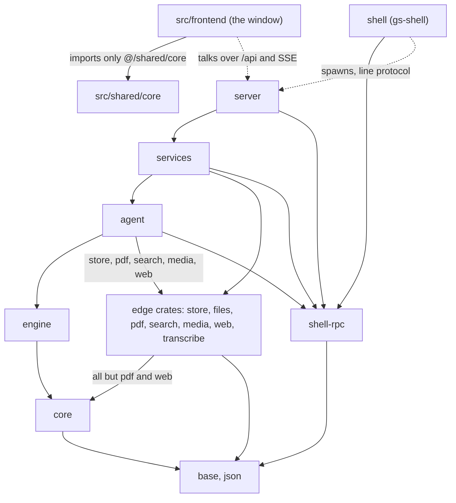

## 2. Layers and the import law

- `src/frontend`: what window runs; Vite and React Router app (`index.html`, `main.tsx`, `routes/`, `components/`, `lib/`).
- `src/shared/core`: pure TypeScript logic frontend uses.
- `crates/`: all Rust. Server binary `godspeed-server` is built from `crates/server` atop `services`, `agent`, `engine` and crates below. Shell is `crates/shell`.

| Code | May import | Enforced by |
|---|---|---|
| `src/frontend/**` | `src/shared/core` only through barrel `index.ts` (`@/shared/core`) | one `import/no-restricted-paths` zone in `eslint.config.mjs` |
| `src/**` | anything allowed above, no import cycles | `import/no-cycle` in `eslint.config.mjs` |
| `crates/*` | only crates in its own `Cargo.toml` | Cargo (refuses dependency cycles) |

Shell depends on `gs-base` and `gs-shell-rpc` only, never server crates. `tests/` and `scripts/` are outside the law: ESLint ignores `scripts/` and `crates/`; tests import freely.

Main direct dependencies below; an arrow means "depends on". Exact lists: each crate's `Cargo.toml`; crate table: [rust-server.md](../rust-server.md).

Edge crates also depend on each other: `files` uses `pdf`, `pdf` uses `media`. Server also uses `agent`, `engine`, `store`, `core` directly.

### 2.1 The core barrel

`src/shared/core/index.ts` is the only core module `src/frontend` may import. All exports are browser-safe: pure logic and types, no node builtins, file system or network. That rule is a doc comment in the barrel, not a lint rule.

Server logic (merging, derivation, coverage, study and progress rules) lives in `crates/core`. TypeScript core holds what the window runs: grading, plan statuses, usage folding, event vocabulary, settings shapes, source marks and the like. A few rules exist on both sides, e.g. source marks (`src/shared/core/citations.ts`, `core::messages::citations`); where both must agree, both replay the same golden file in `crates/core/tests/golden/`.

### 2.2 Contracts

`src/shared/core/contracts.ts` is a barrel over one file per domain in `src/shared/core/contracts/`:

| File | Holds |
|---|---|
| `plan.ts` | plan tree types, derived statuses (`derivePlanStatuses`) |
| `graph.ts` | ledgers, findings shapes, snapshot, topics |
| `chat.ts` | lesson records, usage log, handoff text |
| `jobs.ts` | job records, steer message builders, deterministic steer ids, usage accumulation |
| `probe.ts` | probe assessment and schema |
| `space.ts` | space records, space files, deadlines, signatures, icons |
| `boot.ts` | `GET /api/boot` payload |

Server records are `Json`, not structs (see [rust-server.md](../rust-server.md)). Shared constants and guards: `core::contracts` (`chat`, `space`, `graph`). Other contract functions sit with their logic, mostly `core::session`.
