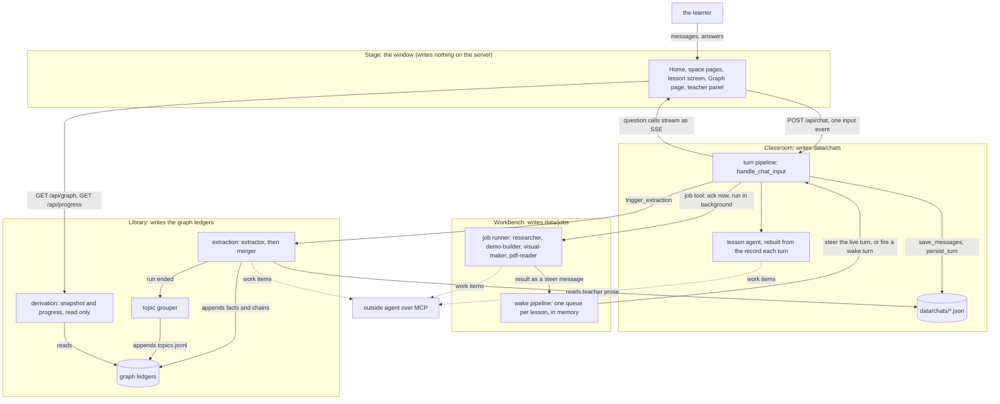

## 4. How the systems talk

Each system writes only its own store. Three protocols connect them:

- Turn request: window posts one input event to Classroom (§5).
- Ack-and-steer: a job tool answers at once, Workbench runs job, result returns into lesson (§5.1).
- Extraction trigger: Classroom tells Library to read new teacher prose (§6).

Study, practice and homework are lesson kinds inside the Classroom, not separate systems (§7). Every lesson reads its own graph through one read-only tool, `search_graph` (§6). A study lesson also starts with the picked facts and their chains in a `[Session context]` note and its topics in a `[Study plan]` note (§7).

