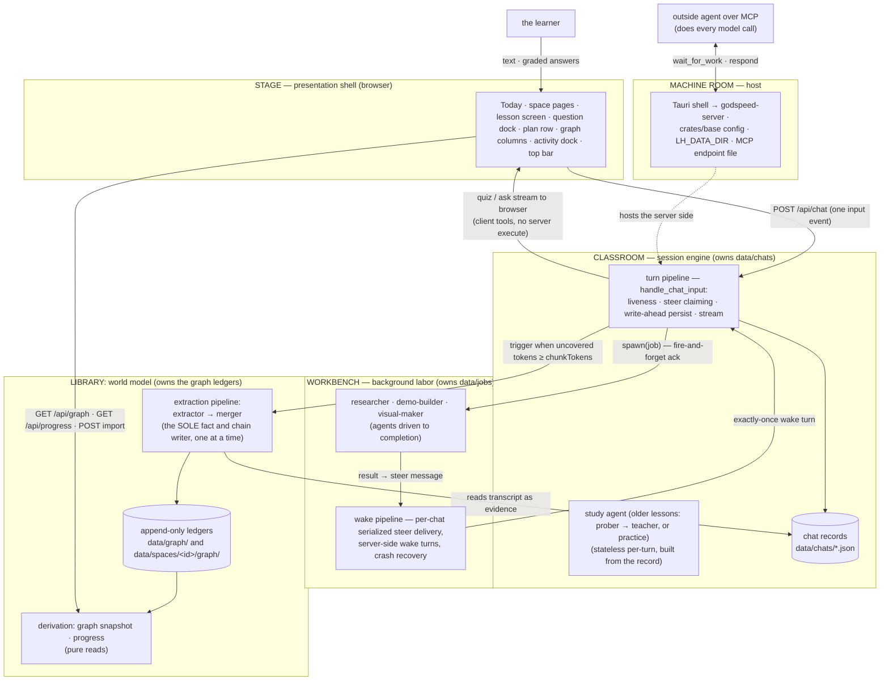

# Development guide

For people working on godspeed itself, not using it.

godspeed is a learning app: a React web app (built with Vite, in `src/`) served by a Rust server (`crates/`), inside a Tauri desktop shell. The model is always an **outside agent** (Claude Code, Codex or any MCP app) connected over MCP; the server parks every model request as a work item and the agent answers it. A **teacher agent** runs lessons with graded questions and a **plan tree** it writes once (`plan_init`); progress on the plan is derived from tagged quiz calls. Lessons are organized into **spaces**, each with its own files, deadlines and **knowledge graph** of facts (propositions) and the reasoning chains between them. Today (`/`) shows what is coming up across spaces; each space's graph is drawn as a Graph page at `/graph`.

The extraction pipeline turns teacher prose and space files into graph facts. The teacher reaches back into the graph through read-only tools when it wants to, so later lessons build on earlier ones.

Other docs:

- [architecture.md](architecture.md): the **canonical architecture spec**. Layers, the import law, the systems, the invariants, the seam directory.
- [rust-server.md](rust-server.md): the Rust server's crates, the rules every module follows, locks, the server process.
- [tauri-shell.md](tauri-shell.md): the desktop shell.
- [teaching-methodology.md](teaching-methodology.md): the theory of teaching the prompts compress.
- [desktop-release.md](desktop-release.md): builds, CI and releases.
- [keyboard.md](keyboard.md), [compaction-accounting.md](compaction-accounting.md), [tool-content-recovery.md](tool-content-recovery.md): single topics.

## Commands

You need Node, a Rust toolchain (`rust-toolchain.toml` pins it) and `cargo-machete` for the checks.

```bash
npm install          # once
node scripts/fetch-model.mjs   # once: the space-search model into models/ (the desktop builds run it too)
node scripts/fetch-onnxruntime.mjs  # once, Linux only: ONNX Runtime's library into .stage/ (search loads it)

npm run dev          # Vite serves the screens at http://localhost:3000; the debug Rust server serves /api on 4000
npm run dev:fresh    # a fresh instance with empty data at http://localhost:3005 (tests onboarding)
npm run build        # `vite build`: the screens into dist-ui/

npm run check        # THE done gate: typecheck + tests + lint + deadcode + rust:check
npm test             # the frontend and shared tests (node:test via tsx; deterministic, no LLM, no network)
npm run lint         # eslint, including the import law (architecture §2)
npm run typecheck    # tsc --noEmit (unused variables and parameters are errors)
npm run deadcode     # knip: unused files, exports, types and npm packages
npm run rust:check   # cargo test, clippy with -D warnings, cargo machete

npm run desktop:dev    # Vite + the debug Rust server + the Tauri shell pointed at Vite
npm run desktop:local  # unsigned local Mac app (Tauri) in target/release/bundle/macos/
npm run desktop:dist   # signed, notarized Mac app and DMG (scripts/mac-dist.sh says what it needs)
```

A change is done when `npm run check` passes. To bulk-import notes, use the app: a space's linked folder or Files page, the Graph's Add files (No space only), or the `import_notes` MCP tool. All extraction runs on the connected agent.

For Windows/Linux packages and the three-OS CI/release flow, see [`desktop-release.md`](desktop-release.md). Release builds run on the target OS, not as cross-builds from macOS.

## Environment

There are no model settings, API keys or sign-ins: the only model is an outside agent connected over MCP (Settings → Connection), which picks its own model and effort in its own harness. The extraction batch threshold is an app setting (`graph.extractionChunkTokens`, default 4096, floor 500). The server makes the access token `data/mcp-token` on the first page load. The server's environment variables are listed in [rust-server.md](rust-server.md).

## Architecture

Five layers, dependency arrows pointing inward only, machine-enforced as ESLint zones for the TypeScript and as the crate order for the Rust. Two composition roots, one writer per store. The full spec — layers, systems, runtime flows, invariants, seams: [architecture.md](architecture.md).



**Core invariant:** the extraction pipeline (extractor → merger) is the sole writer of facts and chains: tree-blind and post-hoc, triggered by token coverage, not quiz counts. The one LLM stage proposes new ideas and names the existing ones it re-teaches (the app's local search shows it the related ideas; each finding carries message-granular provenance); the deterministic merger owns every ledger append (ids, provenance, chain dedupe — the same argument re-asserted merges under one `arg_` id). Every node is an objective, world-facing fact. How well the learner knows it is derived from lesson answers at read time and never written back. Deletion and the topic grouper are the only other graph writes.

## Layout

```
src/                            the screens and the logic they share
  frontend/                     everything the browser runs (a Vite + React Router app)
    index.html                    the page
    main.tsx                      entry: reads /api/boot and the first screen, then renders
    routes/                       router.tsx (every screen: / Today, /new, /chat/:id,
                                  /space Progress (a prep: its prep sheet), /space/lessons,
                                  /space/files, /graph, /space/cheat-sheets,
                                  /space/deadlines, /prep, /space/mocks,
                                  /space/mock/:spaceId/:mockId, /settings, /archived),
                                  root.tsx (app frame), space-layout.tsx (space head and
                                  tabs), lesson.tsx, deadline.tsx, mock.tsx, settings.tsx,
                                  not-found.tsx, page-title.tsx
    fonts/                        the woff2 files and fonts.css
    globals.css                   Tailwind and the theme
    components/boot.tsx           the boot info (/api/boot) for the whole app
    components/                   the top bar (top-bar/), Today (home-page/), the space
                                  head and tabs (space-page/, overview/, lessons/, files/,
                                  graph/), the lesson screen (lesson/), question dock,
                                  plan row and plan blocks, Settings page (settings/),
                                  source marks (citations/), preps and mocks (prep/), the
                                  teacher's work (teacher-work/), onboarding, the welcome
                                  screen (welcome/), artifact renderers (registry:
                                  artifacts/), activity dock, keyboard
    lib/utils.ts                  shadcn class-name helper (cn)
    lib/lazy-component.tsx        lazy-loads a component on first use
  shared/                       pure logic the screens import (no IO)
    changelog.json              release notes shown in What's new
    core/contracts/{boot,chat,space,graph,jobs,plan,prep,probe}.ts
                                  the contracts the screens read — one file per domain
    core/                         native-messages (the record), input-events (what
                                  POST /api/chat accepts), question-core, code-question,
                                  plan-tree, plan-step-bar, phases, pending, tool-switches,
                                  chains, progress, study, citations (source marks),
                                  attachments, tool-parts, prep, mock, mock-run and more,
                                  all behind the barrel index.ts. Pure: storage never
                                  appears here
crates/                         the Rust workspace (details: rust-server.md)
  json base                     JSON with JS key order and number text; JS-compatible
                                text, dates, regex, ids, the app clock, locks, atomic writes
  core                          the pure logic: contracts, records, messages, session,
                                graph, spaces, study, preps
  store                         every data file, one store each
  files pdf search media web    space files to text, pdfium, the embedding model and
  transcribe                    BM25 search, images and SVG, web pages, recordings
  engine                        the turn loop and the work bridge to the outside agent
  agent                         prompts (prompts/), lesson tools, file tools, helper jobs
                                and the extraction pipeline
  services                      App (all server state) and the services: turns, jobs,
                                spaces, graph, cheat sheets, preps and mocks, app
                                (folder files in folder-files/ are embedded in the binary)
  server                        gs-server, the HTTP layer, the /api routes, the MCP endpoint
  shell-rpc shell               the line protocol with the desktop shell, and the Tauri
                                app (gs-shell)
integrations/                   the godspeed skill (skills/)
tests/                          frontend/ and shared/ (same split as src/) and desktop/
                                (the shell shim and the release scripts). Helpers and
                                fixtures/ sit in tests/ itself; skills/ holds the skill's
                                Python tests; perf/ the lesson-stream benchmark. Rust
                                tests sit in each crate's tests/ and next to the code
docs/                           docs; design mockups + exports live in docs/design/
scripts/                        fetch-model.mjs, fetch-pdfium.mjs, fetch-onnxruntime.mjs
                                (both on fetch-library.mjs), dev-resources.mjs,
                                stage-app.mjs, smoke-server.mjs, release-assets.mjs,
                                verify-release.ts, mac-dist.sh, dev-fresh.sh
data/                           runtime state, git-ignored:
                                chats/ (+ chats/<id>/ attached PDFs) ·
                                graph/ ("No space": nodes/chains/sessions/coverage/
                                topics ledgers + sources.json, format.json) ·
                                spaces/<id>/ (space.json, files/ with saved texts/
                                and transcripts/, graph/, search/, cheat-sheets/
                                one per deadline) · search/ ("No
                                space" facts) · jobs/ ·
                                prompts/ (edited system prompts) · models/ (the
                                downloaded speech model) · settings.json ·
                                mcp-token · mcp-endpoint.json (desktop only) ·
                                agent-notes.json · agent-seen.json · agent-rules.json
                                (marks agent-saved rules) · agent-actions.json (the
                                activity log) · agent-folder.json (the godspeed
                                folder + notice seen)
```

## Key mechanisms

See [compaction and accounting](compaction-accounting.md) for the local cutoff port and the measurement-only context meter. Lessons are shortened past `compaction.thresholdTokens` (default 40,000; Settings → General shows it in pages): godspeed cuts the old part at once with its own short version (`local_summary`), so nobody waits, and the agent's written summary replaces that version after 5 quiet minutes (`crates/services/src/turns/compaction.rs`). Every call runs on the outside agent, which bills the learner's own plan, so nothing has a dollar price: the app only counts tokens.

**The outside agent is the only model.** `crates/engine/src/bridge/` parks every model request (lesson turns, helper jobs, extraction, topic grouping) as a work item. The connected agent takes it with `wait_for_work` and answers with `respond` (`crates/server/src/mcp/work.rs`). If no agent is teaching, the work waits. Any MCP request in the last 3 minutes counts as connected; only `wait_for_work`, `respond` and `read_work` count as teaching, and the teacher pane and Settings → Connection show "connected, not teaching" when only the first holds. Access needs the token in `data/mcp-token` and a local, non-browser request. Details:

- **The item's shape.** A compact JSON block, then the instructions and long message texts (`[text N]`) as plain-text blocks.
- **Paging.** A long work item comes in pages of at most 24,000 UTF-8 bytes (`crates/core/src/session/work_pages.rs`). The agent reads pages 2 and up with `read_work`; `respond` is refused until every page is read. `read_work` with `full: true` sends the item again in full.
- **Per-agent seen tracking.** Later items in a lesson carry only the new messages. What each agent (by its session id) has seen of each lesson is saved in `data/agent-seen.json`, so a restart or a second agent gets the right part. Instructions and tools an agent already got come by reference in a new conversation (`instructionsAsIn`, `toolsAsBefore`).
- **Waiting.** Claude Code waits in a background script in the godspeed folder (`.godspeed/wait-for-work.mjs`) for free. Codex has no waiter. It waits with `wait_for_work` up to its MCP tool timeout. Its start command sets `tool_timeout_sec=620` with `-c` flags (`crates/core/src/spaces/agent_folder.rs`), so it can ask for waits up to 600 s.
- **The forget hook.** The forget hook in `.godspeed/claude-settings.json` runs `.godspeed/forget.mjs` when Claude Code compacts or the learner runs `/clear`. It calls `POST /api/mcp/forget` so that agent's next item comes in full, or edits `agent-seen.json` itself when the app is closed.
- **The other tools.** `list_lessons` takes `space_id` and `limit` and returns `total`; `read_lesson` comes in pages like a work item; `read_space` gives file counts and only the failed files unless asked for `files: true`; `add_space_deadline` and `set_space_file_kind` take lists (`deadlines`, `file_ids`) and return failed items under `refused`. Inside a work item the agent uses only that item's tools, through `respond`. See [architecture.md](architecture.md) §8.1.
- **Both MCP versions.** `/api/mcp` serves the 2026-07-28 version (every request carries the client's version and name, and `server/discover` replaces the `initialize` handshake; Claude Code and the folder's scripts) and the older one that starts with `initialize` (Codex).
- **Agent notes and the briefing.** `remember` / `forget` save short notes about the learner in `data/agent-notes.json` (Settings → Connection lists them). Every `initialize` or `server/discover` puts a "Where you left off" briefing right after the work loop in its instructions: spaces, last lessons, next deadlines and notes (`crates/services/src/app/agent_memory.rs`, `crates/core/src/spaces/agent_briefing.rs`), trimmed to end before Claude Code's 4096-character cut.

**Spaces and deadlines.** A space (`data/spaces/<id>/`) has its own lessons, files, linked folder, deadlines and graph. A file is `study` (turned into facts) or `info` (readable by the teacher, never facts). A linked folder is rescanned every 60 seconds and adds up to 500 files. Recordings are transcribed locally with whisper.cpp. A deadline has a kind (`exam`, `homework`, `quiz` or `project`), a due day, an optional time and the files it covers. Today lists open deadlines (`GET /api/deadlines`); the Graph tab shows days left and what to work on next (`GET /api/progress`). The teacher sees the date and the space's open deadlines in a hidden `today-context` message. Lessons with no space use `data/graph/`.

**Attachments.** A learner message can carry up to 5 pictures (20 MB each) and PDFs (30 MB each). Pictures are resized and stored inline in the message; PDFs are saved in `data/chats/<id>/` and the message gets a note with the path (`crates/services/src/turns/attachments.rs`).

**Client-side question tools.** `probe`, `quiz`, `ask_user_question`, `explain`, `recall` and `write_code` only check their input on the server and end the turn. The tool call streams to the browser, the learner answers in the dock, and the client builds the answer with `question-core` (grading multiple choice) and POSTs it to `/api/chat` as an input event. The server saves it as the call's tool result and the next turn runs. `write_code` (`src/shared/core/code-question.ts`) gives the learner a code editor; the app never runs or grades the code, the teacher reads it. Options are shuffled deterministically (seeded by toolCallId) so server and client renders match. A pending question saved in the chat record is exactly what makes **resume mid-question free**.

**Side questions.** The lesson has one writing box, at the foot of the teacher column (`LessonBox` in `src/frontend/components/lesson/lesson-box.tsx`; `lessonBox` in `lesson-box-model.ts` decides its buttons and what Enter does). While a question waits, a message from it is a side question (with a problem open it is a plain message, the learner's work on the problem): the learner asks the teacher something else first, with pictures and PDFs, and the box says the question stays open. It posts a `side` input event (`src/shared/core/input-events.ts`), saved as a user message with `side: true` (`newSideQuestion` in `src/shared/core/native-messages.ts`). The question stays open: `danglingQuestionOf` looks past side questions and their replies. `isSideTurn` marks the reply turn. It keeps the same tool list, but the question tools refuse (`crates/agent/src/tools/side.rs`), so the outside agent still gets a small delta. A side turn gets no `today-context` note and no job results (`crates/services/src/turns/chat_handler.rs`). The model sees a placeholder result right after the question call, then the side question as a plain user message; the learner's later answer reaches it as a user message at the point where it was given (`toLlmMessages`).

**Source marks.** The teacher writes `[[f_1a2b3c4d5e6f:7]]` (a passage id) or `[[https://example.com/page]]` (a web page) after a sentence it took from a space file or a web page. The `respond` tool checks every mark before the reply is stored (`crates/services/src/spaces/citations.rs`): a passage that exists is stored as `[[<file id>/<range>/<file name>]]`, one that doesn't is removed and the agent is told, and web marks stay as written. Lessons, Talk and the cheat sheet chat show stored marks as numbered buttons and a Sources list (`src/frontend/components/citations/`), and the popup reads `GET /api/cited/<file id>?range=<range>` (JSON `{name, range, page, text}`) and `GET /api/cited/<file id>/page/<n>` (`image/png`). The pure logic is `crates/core/src/messages/citations.rs` on the server and `src/shared/core/citations.ts` in the screens (tests in `tests/shared/citations.test.ts`); marks in code and math are left alone, and plain-text readers (Markdown export, extraction) get a mark in words through `citesInWords`. The prompt part is `shared/13-source-marks.md` (Talk has one sentence in `talk/00-base.md`).

**The formal plan tree (author-once).** The teacher authors the session's dependency tree with one schema-validated tool — `plan_init`, whose mermaid-subset input is parsed deterministically (line-numbered errors, `crates/agent/src/tools/mermaid_plan.rs`) and validated as a DAG. The tree persists in the chat record; progress is never mutated — `current`/`visited`/upcoming are **derived** from tagged quiz calls in the transcript, and the lesson's plan row (`src/frontend/components/lesson/plan-row.tsx`, its steps from `src/shared/core/plan-step-bar.ts`) and plan blocks render that derivation.

**The async sub-agent protocol (ack-and-steer).** `research` / `demo` / `visual` / `pdf` are server-executed tools: the call resolves immediately mid-turn with a fire-and-forget ack and the teacher keeps teaching; a background runner works in parallel (`crates/agent/src/subagents/`; the client learns about changes through the `/api/events` push channel and then reads `/api/activity` and `/api/jobs`). On completion the runner builds a **steer message**, a `subagent-steer` custom marker whose `content` is the model-facing result and whose `details` carry the full result for the client, and the **wake pipeline** (`crates/services/src/jobs/`) delivers it: a per-chat serialized queue waits for the turn to end and no question to be pending, then fires a server-side teacher turn that weaves the result into the lesson. Delivery is exactly-once (deterministic steer ids, delivered-flag checks at every claim point); stalled jobs are recovered on read; aborted jobs deliver an abort steer. The client adopts the wake turn through the same `turnInFlight` machinery as returning mid-stream (busy shimmer, composer gate) and renders steers as artifacts — never a bubble. Sub-agents **verify, never one-shot**: the demo-builder runs its HTML in a hidden webview of the desktop shell before delivery; the visual-maker rasterizes each SVG natively and looks at it (the connected agent must accept images).

**The knowledge graph (two channels, one writer).** The write channel: the extraction pipeline (`crates/agent/src/extraction/`) — extractor (LLM: sees the source (the session's teacher prose or a notes chunk) plus its own source's digest (**THE GRAPH SO FAR**: propositions + chains already extracted from this source, ids verbatim), so it references existing ids instead of restating them and leans on established conclusions as premises; fully trusted; its deliverable is core ideas + reasoning chains: premises that jointly entail a conclusion, submitted as chains and stored as chains (`chains.jsonl` is the truth, edges a derived view); it also sees RELATED IDEAS, the ~25 existing ideas the app's local search picks for the part, and lists the ones it re-teaches in `reteaches`) → merger (`crates/core/src/graph/merge.rs`, deterministic: a node per new proposition, a credit line for each re-taught idea, resolves and dedupes chains — identical arguments merge under one `arg_` id; then the chain-simplification pass strips provably redundant derivations, chains whose premises already derive their conclusion through the other kept chains — checkpoints coverage) → topic grouping is scheduled. A source's batches run strictly in order (each extractor continues the digest of every earlier merge). No quiz outcomes or understanding assessments live in the graph; practice sessions read it and write nothing back. Triggered when a chat's **uncovered tokens** (message-view fingerprints, `coverage.jsonl`) cross `graph.extractionChunkTokens` (a settings knob, default 4096, floor 500 — read fresh per turn); failure checkpoints nothing, the next trigger re-runs. The same pipeline serves the **notes front door** (`POST /api/graph/import` and the `import_notes` MCP tool: any `*.md`/`*.txt` becomes a source; a "No space" re-import is processed again and adds to that source) and space study files (a changed or removed space file has its old facts removed first, then it is read again). The read channel: `GET /api/graph` derives the snapshot from the ledgers — a pure read (`derive_view` turns each chain into an implication node `⟹` with premise→implication→conclusion arrows, so two arguments for one conclusion stay two). The `/graph` page shows **topics in level columns**: the topic grouper (`crates/agent/src/extraction/topic_grouper.rs`, scheduled by `crates/services/src/graph/topics.rs`) groups facts into topics saved in `topics.jsonl`, and `src/frontend/components/graph/layout.ts` places them in columns by prerequisite depth and draws only direct arrows. Nothing about the layout is stored. Scores, coverage and "Work on next" come from `GET /api/progress` (`crates/services/src/graph/progress.rs`, `src/shared/core/progress.ts`), derived from lesson answers. Clusters are **birth-session groupings**: a node joins the cluster of the session that birthed it (a chat, or an imported notes file as a file-kind session), derived at read. The chain table groups chains by them. The teacher reaches the graph on its own terms through the gated prober tools (`list_sessions` / `list_propositions`, the `agent.graphTools` setting) — there is no automatic context injection.

**Study sessions.** Every new lesson is `kind: "study"`. The learner starts one from "Study something new" on a space's Lessons tab (the study page, `/new`, with its suggestions), a Today row, a deadline page, the Graph tab or the Progress tab; `start_lesson` over MCP does too. `create_lesson` (`crates/services/src/turns/lessons.rs`) writes the picked facts into a `graph-context` marker (`chains_for_selection`, `crates/core/src/graph/chains.rs`), then a `study-context` marker with the session's topics in space order and each topic's material and standing (from `crates/core/src/study/`; the move table in `prompts/study/10-study.md` picks the move from that pair), and saves the matching plan tree. The study agent is the teacher plus `problem` / `conclude` (`crates/agent/src/tools/practice.rs`), with no prober; instructions in `crates/agent/prompts/study/`. Study sessions are extracted into the graph. Older `teach` and `practice` lessons keep working; practice sessions are never extracted.

**Preps and mocks.** "Prepare for something" in the app menu (`/prep`) makes a prep: a space with a `prep` on its record (`crates/core/src/preps/prep.rs`), for getting ready for one interview, assessment or test. The teacher writes its prep sheet as one background work item (`write_prep_sheet`, `crates/agent/src/subagents/prep_writer.rs`; server side `crates/services/src/preps/preps.rs`): what it is like, the pages it read, the topics to study and what a mock is. A topic's status comes from the answers tagged with its id, in study sessions and mocks. A mock (`crates/core/src/preps/mock.rs`, `crates/services/src/preps/mocks.rs`, one file per mock under `spaces/<id>/mocks/`) asks the teacher twice, for all its questions before it starts and for all its grades after it ends (`crates/agent/src/subagents/mock_writer.rs`); the clock runs with no agent. "Run examples" runs the learner's JavaScript or Python on this computer with a 5-second limit (`crates/core/src/preps/mock_run.rs`, `crates/services/src/preps/mock_runner.rs`), using the computer's own `node` or Python. The request texts are pure (`crates/core/src/preps/mock_requests.rs`). Details: `docs/architecture.md` section 6.2.

## Testing

Each test lives next to the code it tests. TypeScript: `tests/frontend`, `tests/shared` and `tests/desktop`, run by `npm test`. Rust: unit tests inside the module and `tests/` in each crate, run by `cargo test --workspace` (part of `npm run rust:check`). All deterministic, no LLM, no network (the engine is scripted per test with the faux provider; web and agent calls are stubbed where transport matters):

1. **Pure core units** — merger, derivation, coverage, question grading, plan tree, phases, clusters, topics, graph levels, progress, work pages, agent briefing, tool-parts, prices.
2. **Server flows** — a chat turn driven end to end with scripted engines: persistence, liveness, steer claiming, the wake pipeline (retry, quiz deferral, idempotency), crash recovery, the data-dir seam.
3. **Sub-agent loops** — researcher/demo-builder/visual-maker with fake headless calls; the extraction pipeline end to end (reteach credit, failure-checkpoints-nothing, single-flight, abort).
4. **Render tests** — transcript, cards, docks, the writing box, the top bar, coverage, chain table via React server-side rendering.
5. **Golden fixtures** — `crates/<crate>/tests/golden/*.json` hold recorded outputs of the original TypeScript functions, and a Rust test beside each replays them (see `crates/base/tests/golden.rs`). `tests/fixtures/golden-data/` is a real data dir, never hand-edited, read by the skill's Python tests. **The fixture law:** an intentional on-disk format change updates the fixtures in the same commit — see the fixture README.
6. **Contract scenarios** — the rewrite lab replays recorded HTTP and MCP traffic against a release `godspeed-server` ([rust-server.md](rust-server.md)).

Run `npm run check` before calling a change done: typecheck, tests, lint, knip, cargo test, clippy and cargo machete must all pass.

## Data

Nothing under `data/` is ever tracked by git. Chats, spaces, graph ledgers, jobs, agent notes and the settings record are plain files (JSON/JSONL) — inspect them freely; they are the canonical records. `mcp-token` is a secret: don't share it. The desktop app relocates the whole directory via `LH_DATA_DIR`.

**Schema stamps:** chat records carry `version` (stamped at the store's write choke point; absence reads as v1 — lazy migration, no mass rewrite). Space records carry their own `version` (now 5). The settings record carries one too (now 2: a v1 record that still holds the old 150,000-token summarize default is moved to the new 40,000 default on read). The graph family (ledgers and `sources.json`) shares one sidecar `graph/format.json`, created on the family's first write. A record stamped NEWER than the running build is refused on read — honest refusal for the downgrade scenario: a read-modify-write store never rewrites what it doesn't understand.
