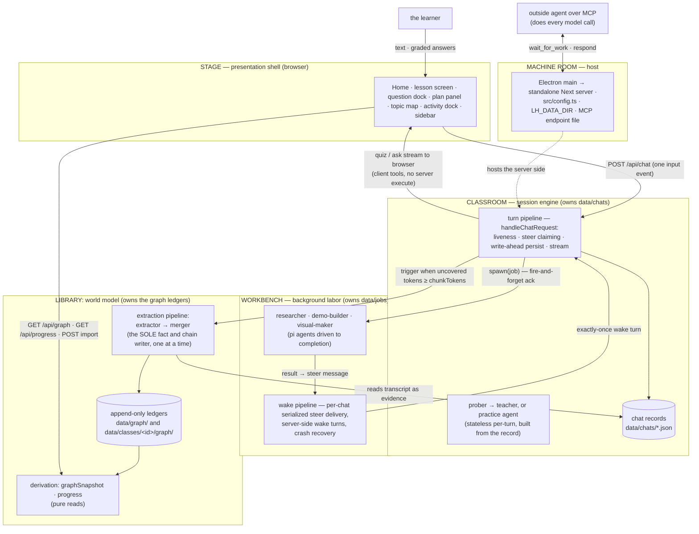

# Development guide

For people working on godspeed itself, not using it.

godspeed is a learning app: a Next.js web app inside an Electron desktop shell. The model is always an **outside agent** (Claude Code, Codex or any MCP app) connected over MCP; the server runs it through the pi-ai agent engine. A **teacher agent** runs probe→teach lessons with graded questions and a **plan tree** it writes once (`plan_init`); progress on the plan is derived from tagged quiz calls. Lessons are organized into **classes**, each with its own files, deadlines and **knowledge graph** of facts (propositions) and the reasoning chains between them. Home (`/`) shows what is coming up across classes; each class's graph is drawn as a topic map at `/graph`.

The extraction pipeline turns teacher prose and class files into graph facts. The teacher reaches back into the graph through read-only tools when it wants to, so later lessons build on earlier ones.

Other docs:

- [architecture.md](architecture.md): the **canonical architecture spec**. Layers, the import law, the systems, the invariants, the seam directory.
- [teaching-methodology.md](teaching-methodology.md): the theory of teaching the prompts compress.
- [desktop-release.md](desktop-release.md): builds, CI and releases.
- [keyboard.md](keyboard.md), [compaction-accounting.md](compaction-accounting.md), [tool-content-recovery.md](tool-content-recovery.md): single topics.
- [vision.md](vision.md): the product's decision log. Much of it is history.
- [archive/](archive/): finished plans (`plan.md`, `pi-engine-swap.md`, `probe-teach-split.md`, `release-0.3.md`, `mcp-2026-migration.md`) and the old architecture spec. History only.

## Commands

```bash
npm install          # once
node scripts/fetch-model.mjs   # once: the class-search model into models/ (the desktop builds run it too)

npm run dev          # http://localhost:3000
npm run dev:fresh    # a fresh instance with empty data at http://localhost:3005 (tests onboarding)
npm run build        # production build (standalone output)
npm start            # serve the production build

npm run check        # THE done gate: typecheck + tests + lint + deadcode. CI runs the same
npm test             # the full suite (node:test via tsx; deterministic, no LLM, no network)
npm run lint         # eslint, including the import law (architecture §2)
npm run typecheck    # tsc --noEmit (unused variables and parameters are errors)
npm run deadcode     # knip: unused files, exports, types and npm packages

npm run desktop:dev    # next dev + Electron shell pointed at it
npm run desktop:local  # unsigned local macOS arm64 app in dist/
npm run desktop:dist   # local signed/notarized macOS arm64 build (LH_NOTARY keychain)
```

A change is done when `npm run check` passes. To bulk-import notes, use the app: a class's linked folder or Files page, the Graph's Import notes (No class only), or the `import_notes` MCP tool. All extraction runs on the connected agent.

For Windows/Linux packages and the three-OS CI/release flow, see [`desktop-release.md`](desktop-release.md). Native renderer binaries are traced per platform, so release builds run on the target OS, not as cross-builds from macOS.

## Environment (`.env.local`)

Machine-specific paths only. There are no model settings: the outside agent picks its own model and effort in its own harness. The extraction batch threshold is an app setting (`graph.extractionChunkTokens`, default 4096, floor 500), not an environment variable.

| Variable | Purpose |
|---|---|
| `CHROME_PATH` | optional system Chrome fallback for demo verification; the app's own browser helper is primary (nothing is downloaded) |

There are no API keys and no sign-ins: the only model is an outside agent connected over MCP (Settings → Connection). The server makes the access token `data/mcp-token` on the first page load. PDFs render natively with pdfjs/Skia; SVGs use resvg.

## Architecture

Five layers, dependency arrows pointing inward only, machine-enforced as four ESLint zones (shell → barrels only; core and agent never import below themselves). Two composition roots, one writer per store. The full spec — layers, systems, runtime flows, invariants, seams: [architecture.md](architecture.md).



**Core invariant:** the extraction pipeline (extractor → merger) is the sole writer of facts and chains: tree-blind and post-hoc, triggered by token coverage, not quiz counts. The one LLM stage proposes new ideas and names the existing ones it re-teaches (the app's local search shows it the related ideas; each finding carries message-granular provenance); the deterministic merger owns every ledger append (ids, provenance, chain dedupe — the same argument re-asserted merges under one `arg_` id). Every node is an objective, world-facing fact. How well the learner knows it is derived from lesson answers at read time and never written back. Deletion and the topic grouper are the only other graph writes.

## Layout

```
src/
  app/                          Next.js App Router: pages (/ Home, /new, /chat/[id],
                                /class Overview, /class/files, /graph) + 37 thin API
                                route handlers. Settings is a dialog, not a page
  components/                   Home (home-page/), the lesson screen (lesson/), question
                                dock, plan panel, topic map (graph/), class Overview and
                                Files, settings dialog (settings/), onboarding, artifact
                                renderers (registry: artifacts/), activity dock, keyboard
  lib/utils.ts                  shadcn class-name helper (cn)
  config.ts                     paths (data dir, prompts) + engine construction facts
  proxy.ts                      Next proxy: desktop-only /api gate
  agent/
    system-prompt.md            base teaching behavior (the methodology)
    prompts/{prober,teacher,practice,shared}/
                                composed numbered fragments per role
    teacher-agent.ts            prober/teacher/practice factories (engine injectable for tests)
    models.ts, agent-bridge.ts  the one engine: every model request becomes a work item
                                for the outside agent
    tools.ts                    tool composition; the question tools (probe, quiz,
                                ask_user_question, explain, recall, write_code)
    tools/plan.ts               plan_init (author-once mermaid plan, deterministic parser)
    tools/probe.ts              probe_done (probe→teach handoff seam)
    tools/practice.ts           problem / conclude (practice sessions)
    tools/class.ts              read_class, set_class_note, search_class_files, read_passage
    tools/jobs.ts               research / demo / visual / pdf tool surfaces
    tools/web.ts                web_fetch (researcher only)
    subagents/                  researcher · demo-builder · visual-maker · pdf-reader ·
                                topic-grouper, extraction pipeline (extractor + merger
                                handoff), runner (async protocol), native renderers +
                                browser-service helper, abort registry
  server/chat-handler.ts       THE turn composition root (liveness · steers · persist · stream)
  server/mcp.ts                the MCP server at /api/mcp: work loop, lesson, class,
                               deadline and note tools; the /api/mcp/forget hook
  server/agent-memory.ts       the "Where you left off" briefing + the notes list
  server/classes.ts            class files, linked folders (scanned every 60 s), lesson
                               moves, cascade delete
  server/attachments.ts        pictures and PDFs on learner messages
  server/turn-service.ts       turn seams: persist · extraction trigger
  server/jobs.ts               the wake pipeline: serialized per-chat steer delivery,
                               server-side wake turns, crash recovery
  server/stores.ts              THE storage composition root — the one place adapters wire in
  server/turn-liveness.ts       per-chat turn registry (one turn per chat, ever)
  server/observability.ts       the activity feed (running jobs + extraction, abort)
  server/pi/                    ui-stream (pi agent events → SSE) · call-ids
  server/index.ts               the server barrel (the only server import src/app/ may use)
  core/contracts/{chat,class,graph,jobs,plan,probe}.ts
                                the contracts — one file per domain
  core/ports.ts                 storage ports — ChatStore · GraphStore · ClassStore ·
                                JobStore · SettingsStore · PromptOverrideStore
                                (core code depends on these types only)
  core/                         native-messages (the record), question-core,
                                code-question, plan-tree, phases, pending, graph
                                (merger/derivation), coverage, chains, topics,
                                progress, today-note, attachments, work-pages,
                                agent-seen, agent-briefing, prices, tool-parts.
                                All pure: storage arrives as parameters
  store/                        fs adapters: chats · classes · graph ledgers (+
                                graph-format) · jobs · settings · prompt-overrides ·
                                mcp-token · agent-notes · agent-seen
electron/                       desktop launcher + security guard (spawns the standalone
                                server; LH_DATA_DIR; a small set of IPC channels in
                                preload.cjs; the browser-service for demo checks)
  build/                        packaging inputs: icons, entitlements, dmg background
  electron-builder.yml          packaging config (pass -c electron/electron-builder.yml)
integrations/                   the godspeed skill (skills/)
docs/                           docs; design mockups + exports live in docs/design/
scripts/                        build-server.mjs (packaging guards), fetch-model.mjs,
                                smoke-server.mjs, smoke-demo-runtime.mjs,
                                verify-release.ts, make-icons.mjs, after-pack.cjs,
                                dev-fresh.sh
data/                           runtime state, git-ignored:
                                chats/ (+ chats/<id>/ attached PDFs) ·
                                graph/ ("No class": nodes/chains/sessions/coverage/
                                topics ledgers + sources.json, format.json) ·
                                classes/<id>/ (class.json, files/, graph/) · jobs/ ·
                                prompts/ (edited system prompts) · models/ (the
                                downloaded speech model) · settings.json ·
                                mcp-token · mcp-endpoint.json (desktop only) ·
                                agent-notes.json · agent-seen.json
```

## Key mechanisms

See [compaction and accounting](compaction-accounting.md) for the local Pi cutoff port
and the measurement-only context meter. Lessons are summarized past `compaction.thresholdTokens` (default 40,000; Settings → General shows it in pages). Every call runs on the outside agent, which
bills the learner's own plan, so nothing has a dollar price: the app only counts tokens.

**The outside agent is the only model.** `src/agent/models.ts` (`agentEngine`) parks every model request (lesson turns, helper jobs, extraction, topic grouping) as a work item in `src/agent/agent-bridge.ts`. The connected agent takes it with `wait_for_work` and answers with `respond` (`src/server/mcp.ts`). If no agent is teaching, the work waits. Any MCP request in the last 3 minutes counts as connected; only `wait_for_work`, `respond` and `read_work` count as teaching, and the sidebar and Settings → Connection show "connected, not teaching" when only the first holds. Access needs the token in `data/mcp-token` and a local, non-browser request. Details:

- **The item's shape.** A compact JSON block, then the instructions and long message texts (`[text N]`) as plain-text blocks.
- **Paging.** A long work item comes in pages of at most 24,000 UTF-8 bytes (`src/core/work-pages.ts`). The agent reads pages 2 and up with `read_work`; `respond` is refused until every page is read. `read_work` with `full: true` sends the item again in full.
- **Per-agent seen tracking.** Later items in a lesson carry only the new messages. What each agent (by its session id) has seen of each lesson is saved in `data/agent-seen.json`, so a restart or a second agent gets the right part. Instructions and tools an agent already got come by reference in a new conversation (`instructionsAsIn`, `toolsAsBefore`).
- **Waiting.** Claude Code waits in a background script in the godspeed folder (`.godspeed/wait-for-work.mjs`) for free. Codex has no waiter. It waits with `wait_for_work` up to its MCP tool timeout. Its start command sets `tool_timeout_sec=620` with `-c` flags (`src/core/agent-folder.ts`), so it can ask for waits up to 600 s.
- **The forget hook.** The forget hook in `.godspeed/claude-settings.json` runs `.godspeed/forget.mjs` when Claude Code compacts or the learner runs `/clear`. It calls `POST /api/mcp/forget` so that agent's next item comes in full, or edits `agent-seen.json` itself when the app is closed.
- **The other tools.** `list_lessons` takes `class_id` and `limit` and returns `total`; `read_lesson` comes in pages like a work item; `read_class` gives file counts and only the failed files unless asked for `files: true`; `add_class_deadline` and `set_class_file_kind` take lists (`deadlines`, `file_ids`) and return failed items under `refused`. Inside a work item the agent uses only that item's tools, through `respond`. See [architecture.md](architecture.md) §8.1.
- **Both MCP versions.** `/api/mcp` serves the 2026-07-28 version (every request carries the client's version and name, and `server/discover` replaces the `initialize` handshake; Claude Code and the folder's scripts) and the older one that starts with `initialize` (Codex). How it was moved: [archive/mcp-2026-migration.md](archive/mcp-2026-migration.md).
- **Agent notes and the briefing.** `remember` / `forget` save short notes about the learner in `data/agent-notes.json` (Settings → Connection lists them). Every `initialize` or `server/discover` puts a "Where you left off" briefing right after the work loop in its instructions: classes, last lessons, next deadlines and notes (`src/server/agent-memory.ts`, `src/core/agent-briefing.ts`), trimmed to end before Claude Code's 4096-character cut.

**Classes and deadlines.** A class (`data/classes/<id>/`) has its own lessons, files, linked folder, deadlines and graph. A file is `study` (turned into facts) or `info` (readable by the teacher, never facts). A linked folder is rescanned every 60 seconds and adds up to 500 files. Recordings are transcribed locally with whisper.cpp. A deadline has a kind (`exam`, `homework`, `quiz` or `project`), a due day, an optional time and the files it covers. Home and the sidebar list open deadlines (`GET /api/deadlines`); the topic map shows days left and what to work on next (`GET /api/progress`). The teacher sees the date and the class's open deadlines in a hidden `today-context` message. Lessons without a class are in "No class" and use `data/graph/`.

**Attachments.** A learner message can carry up to 5 pictures (20 MB each) and PDFs (30 MB each). Pictures are resized and stored inline in the message; PDFs are saved in `data/chats/<id>/` and the message gets a note with the path (`src/server/attachments.ts`).

**Client-side question tools.** `probe`, `quiz`, `ask_user_question`, `explain`, `recall` and `write_code` only check their input on the server and end the turn. The tool call streams to the browser, the learner answers in the dock, and the client builds the answer with `question-core` (grading multiple choice) and POSTs it to `/api/chat` as an input event. The server saves it as the call's tool result and the next turn runs. `write_code` (`src/core/code-question.ts`) gives the learner a code editor; the app never runs or grades the code, the teacher reads it. Options are shuffled deterministically (seeded by toolCallId) so server and client renders match. A pending question saved in the chat record is exactly what makes **resume mid-question free**.

**The formal plan tree (author-once).** The teacher authors the session's dependency tree with one schema-validated tool — `plan_init`, whose mermaid-subset input is parsed deterministically (line-numbered errors) and validated as a DAG. The tree persists in the chat record; progress is never mutated — `current`/`visited`/upcoming are **derived** from tagged quiz calls in the transcript, and the panel renders that derivation.

**The async sub-agent protocol (ack-and-steer).** `research` / `demo` / `visual` / `pdf` are server-executed tools: the call resolves immediately mid-turn with a fire-and-forget ack and the teacher keeps teaching; a background runner works in parallel (the client learns about changes through the `/api/events` push channel and then reads `/api/activity` and `/api/jobs`). On completion the runner builds a **steer message**, a `subagent-steer` custom marker whose `content` is the model-facing result and whose `details` carry the full result for the client, and the **wake pipeline** delivers it: a per-chat serialized queue waits for the turn to end and no question to be pending, then fires a server-side teacher turn that weaves the result into the lesson. Delivery is exactly-once (deterministic steer ids, delivered-flag checks at every claim point); stalled jobs are recovered on read; aborted jobs deliver an abort steer. The client adopts the wake turn through the same `turnInFlight` machinery as returning mid-stream (busy shimmer, composer gate) and renders steers as artifacts — never a bubble. Sub-agents **verify, never one-shot**: the demo-builder executes its HTML in the app's own Chromium browser-service (system Chrome fallback) before delivery; the visual-maker rasterizes each SVG natively and looks at it (the connected agent must accept images).

**The knowledge graph (two channels, one writer).** The write channel: the extraction pipeline — extractor (LLM: sees the source — the session's teacher prose or a notes chunk — plus its own source's digest (**THE GRAPH SO FAR**: propositions + chains already extracted from this source, ids verbatim — digest-aware redesign, 2026-09-30 evening: the extractor IS the assembler, referencing existing ids instead of restating, leaning on established conclusions as premises); fully trusted; its deliverable is core ideas + reasoning chains: premises that jointly entail a conclusion, submitted as chains and stored as chains — `chains.jsonl` is the truth, edges a derived view; owner redesign + chains-primary, 2026-09-30; it also sees RELATED IDEAS, the ~25 existing ideas the app's local search picks for the part, and lists the ones it re-teaches in `reteaches`) → merger (`mergeFindings`, deterministic: a node per new proposition, a credit line for each re-taught idea, resolves and dedupes chains — identical arguments merge under one `arg_` id; then the chain-simplification pass strips provably redundant derivations, chains whose premises already derive their conclusion through the other kept chains — checkpoints coverage) → topic grouping is scheduled. A source's batches run strictly in order (each extractor continues the digest of every earlier merge). No quiz outcomes or understanding assessments live in the graph; practice sessions read it and write nothing back. Triggered when a chat's **uncovered tokens** (message-view fingerprints, `coverage.jsonl`) cross `graph.extractionChunkTokens` (a settings knob, default 4096, floor 500 — read fresh per turn); failure checkpoints nothing, the next trigger re-runs. The same pipeline serves the **notes front door** (`POST /api/graph/import` and the `import_notes` MCP tool: any `*.md`/`*.txt` becomes a source; a "No class" re-import is processed again and adds to that source) and class study files (a changed or removed class file has its old facts removed first, then it is read again). The read channel: `GET /api/graph` derives the snapshot from the ledgers — a pure read (`deriveView` turns each chain into an implication node `⟹` with premise→implication→conclusion arrows, so two arguments for one conclusion stay two). The `/graph` page is a **topic map**: the topic grouper (`src/agent/subagents/topic-grouper.ts`, scheduled by `src/server/topics.ts`) groups facts into topics saved in `topics.jsonl`, and `src/components/graph/layout.ts` places them in columns by prerequisite depth and draws only direct arrows. Nothing about the layout is stored. Scores, coverage and "Work on next" come from `GET /api/progress` (`src/core/progress.ts`), derived from lesson answers. Clusters are **birth-session groupings**: a node joins the cluster of the session that birthed it (a chat, or an imported notes file as a file-kind session), derived at read. The chain table groups chains by them. The teacher reaches the graph on its own terms through the gated prober tools (`list_sessions` / `list_propositions`, the `agent.graphTools` setting) — there is no automatic context injection.

**Practice sessions.** Practice is a lesson kind (`kind: "practice"`). The learner starts one from New lesson → Practice (`/new?mode=practice`), from "Practice these N" / "Practice this topic" on the topic map, or with "Start from facts" on the New lesson screen (the chain table in select mode). `createLesson` (`src/server/lessons.ts`) writes the picked facts into a `graph-context` marker using `chainsForSelection` (`src/core/chains.ts`): a chain is included when every member is picked, and other picked facts stand alone. The practice agent poses problems with `problem` and ends with `conclude` (`src/agent/tools/practice.ts`; instructions in `src/agent/prompts/practice/`). The learner's work is saved as `practice-thinking` markers. Practice sessions are never extracted and never write to the graph.

## Testing

All deterministic, no LLM, no network (engines are injected — pi-ai's faux provider scripted per test; `globalThis.fetch` stubbed where transport matters):

1. **Pure core units** — merger (via the real fs adapters, backup-and-restored), derivation, coverage, question grading, plan tree, phases, clusters, topics, topic-map layout, progress, work pages, agent briefing, tool-parts, prices.
2. **Server flows** — `handleChatRequest` driven end-to-end with scripted engines: persistence, liveness, steer claiming, the wake pipeline (409 retry, quiz deferral, idempotency), crash recovery, the data-dir seam (including a fresh child process).
3. **Sub-agent loops** — researcher/demo-builder/visual-maker with fake headless APIs; the extraction pipeline end-to-end (reteach credit, failure-checkpoints-nothing, single-flight, abort).
4. **Render tests** — transcript, cards, docks, composer, sidebar, coverage, chain table via React server-side rendering.
5. **Golden fixtures** (`tests/fixtures/golden-data/`) — a REAL data dir (real records produced by the app, never hand-edited), copied to a temp dir and read through the production paths via the `LH_DATA_DIR` seam. Pins that real data parses, flattens to a legal LLM wire, derives the graph end-to-end, covers every custom-marker kind, and that reads never write. **The fixture law:** an intentional on-disk format change updates the fixtures in the same commit — see the fixture README.

Run `npm run check` before calling a change done: typecheck, tests, lint and knip must all pass.

## Lineage

The teaching methodology comes from an Obsidian-based POC (its `knowledge graph design.md` was the original epistemic-model source, since amended — see the amendments table in [vision.md](vision.md)). The harness was originally built on the pi agent SDK, pivoted to standalone Next.js + the Vercel AI SDK, later swapped its LLM engine back to pi-ai ([archive/pi-engine-swap.md](archive/pi-engine-swap.md)), and now stores pi's own message shapes with no AI SDK left. godspeed is a fork of LearnHarness that replaced built-in model sign-ins with outside agents over MCP.

## Data

Nothing under `data/` is ever tracked by git. Chats, classes, graph ledgers, jobs, agent notes and the settings record are plain files (JSON/JSONL) — inspect them freely; they are the canonical records. `mcp-token` is a secret: don't share it. The desktop app relocates the whole directory via `LH_DATA_DIR`.

**Schema stamps:** chat records carry `version` (stamped at the store's write choke point; absence reads as v1 — lazy migration, no mass rewrite). Class records carry their own `version` (now 5). The settings record carries one too (now 2: a v1 record that still holds the old 150,000-token summarize default is moved to the new 40,000 default on read). The graph family (ledgers and `sources.json`) shares one sidecar `graph/format.json`, created on the family's first write. A record stamped NEWER than the running build is refused on read — honest refusal for the downgrade scenario: a read-modify-write store never rewrites what it doesn't understand.